# Lab 16 — Enterprise Apps in Microsoft Entra ID

## Overview

This is my sixteenth SC-300 lab. I did it in my own Microsoft Entra tenant for the made-up company **Bam Co.**

In [Lab 15](../lab-15-app-registration/) I registered an app called **AskBamCoHR**. Registering it also created its **service principal**, which shows up under **Enterprise applications**. This lab picks up from there: controlling who can sign in to and see the app, assigning a test user, setting up consent, looking at application proxy, adding an app from the gallery, and organizing apps into **collections** in My Apps.

The big takeaway is how the three app settings work together. **Unassigned users can never see an app in My Apps**, even when "Visible to users" is on. I tested this with a test user, who couldn't see AskBamCoHR until I assigned them to it.

## Objectives

- Understand the application ID and the object ID
- Understand "Enabled for users to sign in", "Assignment required", and "Visible to users"
- Test app visibility as a user in My Apps, then assign the user and an app role
- Configure user consent, permission classifications, and admin consent requests
- Understand application proxy and the private network connector
- Add an app from the Microsoft Entra App Gallery
- Create app collections as an admin and as a user

## Tools & Technologies

| Category | Tools |
|---|---|
| Identity platform | Microsoft Entra ID |
| Portals | Microsoft Entra admin center, My Apps (`myapps.microsoft.com`) |
| Features | Enterprise applications, user assignment, app roles, consent and permissions, application proxy, Entra App Gallery, app launchers (collections) |
| Course | Microsoft Learn: SC-300 Identity and Access Administrator |

---

## Task 1 — Application ID vs Object ID

| ID | What it is |
|---|---|
| Application ID | A globally unique ID for the app registration. Think of it as the app's **passport number**. Other services use it to identify the app across every tenant, like when setting up authentication or API access |
| Object ID | A unique ID for **one specific object** inside my Entra directory, like an app, user, group, or service principal. Entra uses it internally, and admins use it to target that exact object, like in PowerShell |

---

## Task 2 — Enterprise App Properties

**Enterprise applications → AskBamCoHR → Properties.** This looks a lot like the app registration's properties, but the home page URL can't be changed here, and there are three settings that only exist on the enterprise app.

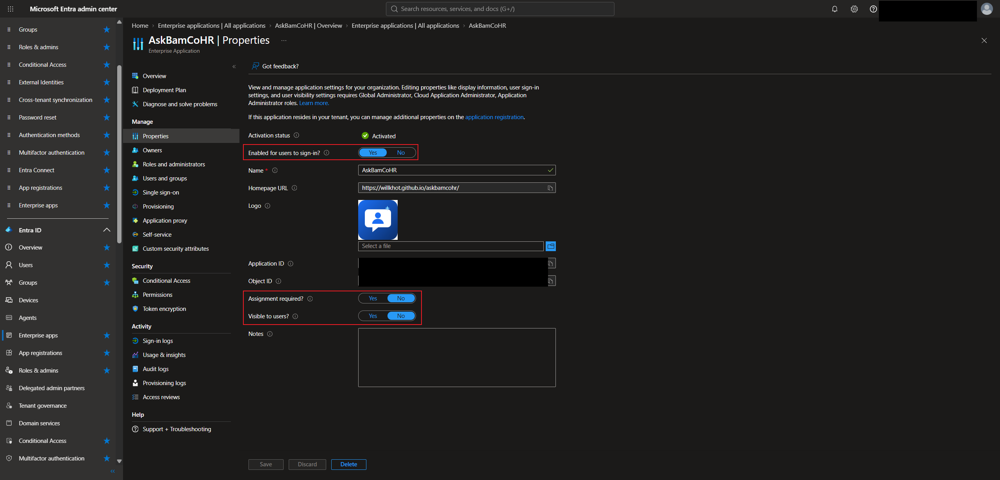

| Setting | What it does |
|---|---|
| Enabled for users to sign in? | **If this is No, the other two don't matter.** Nobody can sign in or see the app. Useful for retiring an old version of an app without deleting it, since you may still need it for auditing |
| Assignment required? | If Yes, only users and groups assigned to the app can sign in |
| Visible to users? | Whether **assigned** users see the app in My Apps |

How they combine, with sign-in enabled:

| Assignment required? | Visible to users? | Assigned users | Unassigned users |
|---|---|---|---|
| Yes | Yes | Can see the app and sign in | Can't see it or sign in |
| Yes | No | Can't see it, but can sign in with a direct link | Can't see it or sign in |
| No | Yes | Can see the app and sign in | **Can't see it**, but can sign in with a direct link |

> The two rules from my notes:
> - **Unassigned users can never see the app directly.** That's true in every combination.
> - **"Visible to users" only affects assigned users.** If it's on, they see the app, and if it's off, they don't.

---

## Task 3 — Testing App Visibility

### 3.1 Before assigning

I set **Assignment required** to **No** and **Visible to users** to **Yes**, and saved.

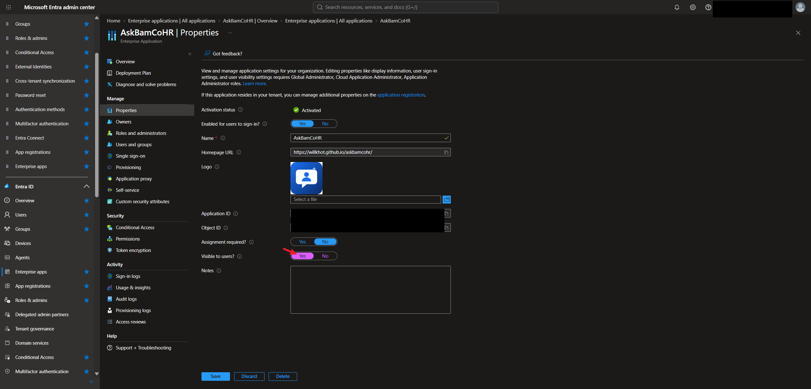

Then I signed in to **My Apps** (`myapps.microsoft.com`) as my test user, **Kaitlyn Ly**. AskBamCoHR wasn't there.

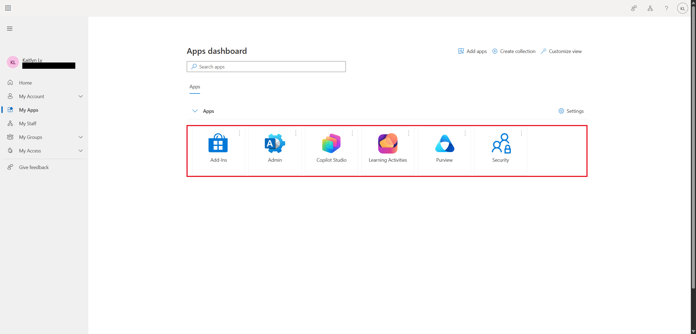

> Even though "Visible to users" is on, it doesn't matter, because Kaitlyn isn't an **assigned** user. This is the bottom row of the table above.

### 3.2 Assigning the user and an app role

**Users and groups → Add user/group.** I selected Kaitlyn.

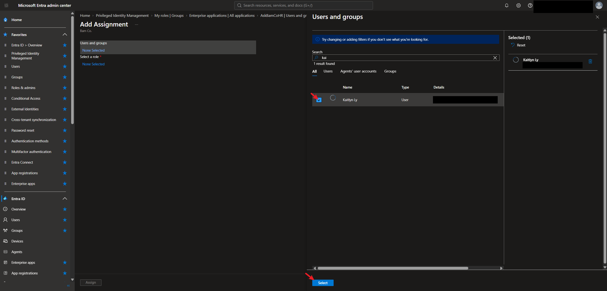

Then I picked the **EndUsers** role I created in Lab 15. Analyst can edit the app, so EndUsers (read only) is the least-privileged choice.

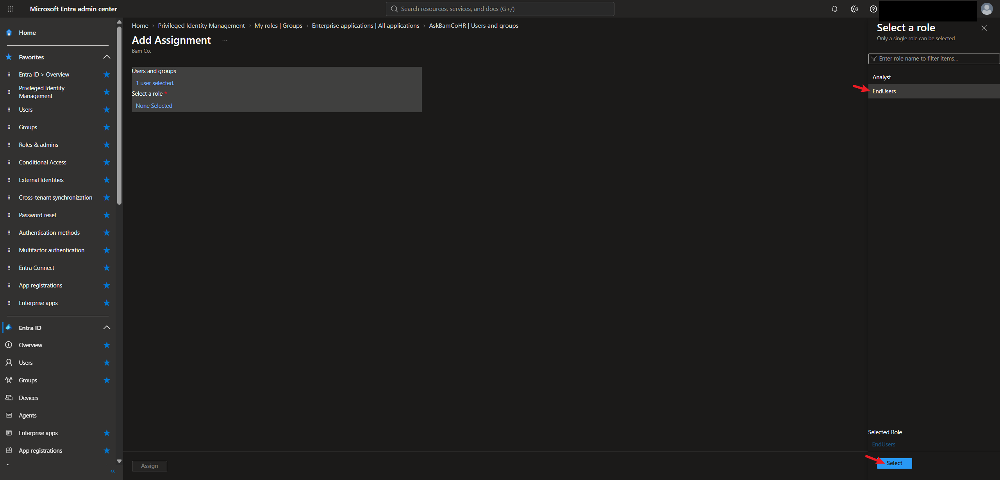

### 3.3 After assigning

Back in Kaitlyn's My Apps, AskBamCoHR now shows up.

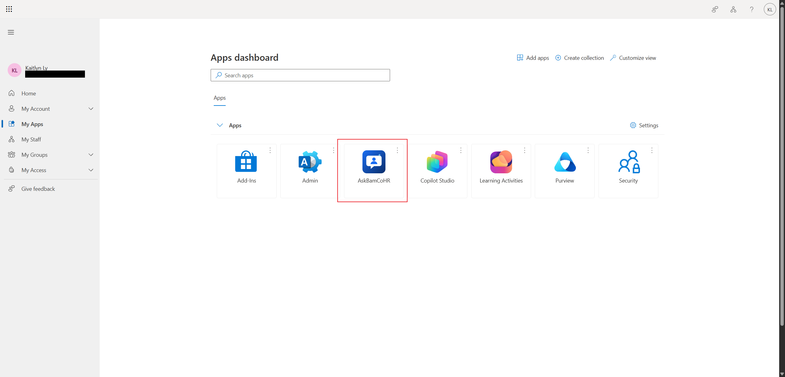

> It can take a few minutes for a newly assigned app to appear. Refreshing or signing out and back in can help.

### 3.4 Other enterprise app settings

- **Owners** and **Roles and administrators** work the same way as in the app registration
- **Single sign-on** and **Provisioning** depend on what the app supports, and my test app doesn't support either
- **Custom security attributes** can be added to an app, not just users, and Conditional Access can use them (see [Lab 9](../../2b-conditional-access/lab-09-conditional-access/))
- **Permissions** shows the admin consent and user consent the app has been given, and lets you review or revoke them

---

## Task 4 — Consent and Permissions

**Enterprise applications → Security → Consent and permissions.** These settings apply to every app in the tenant, not just one.

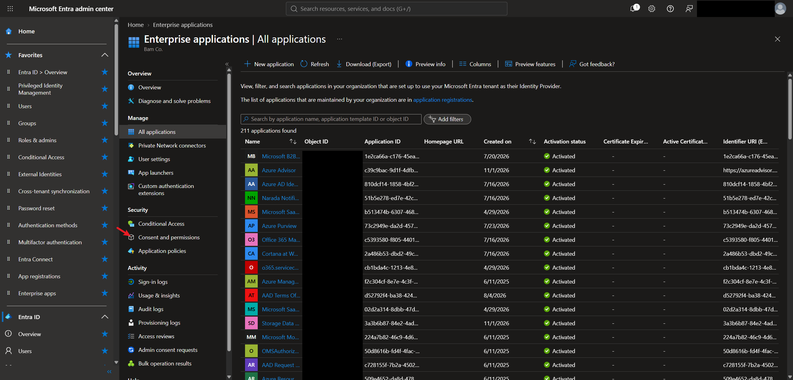

### 4.1 User consent settings

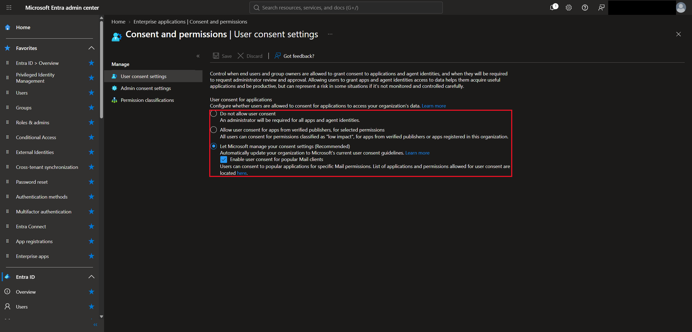

| Option | What it does |
|---|---|
| Do not allow user consent | An admin has to approve every app. The most locked down |
| Allow user consent for apps from verified publishers, for selected permissions | Users can consent to permissions classified as **low impact**, for apps from verified publishers or apps registered in this tenant |
| Let Microsoft manage your consent settings (Recommended) | Microsoft keeps the settings updated to its current guidance. This is what my tenant uses |
| Enable user consent for popular Mail clients | Lets users consent to specific mail permissions for well-known mail apps |

### 4.2 Permission classifications

This is where you define what "low impact" means for the verified-publisher option. I classified **User.Read**, **email**, and **profile** as **Low**, since they only let an app sign the user in and read basic info.

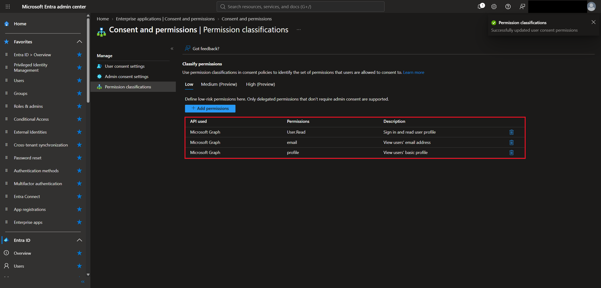

### 4.3 Admin consent requests

If users can't consent to an app themselves, this decides what happens next. I turned on **Users can request admin consent to apps they are unable to consent to**.

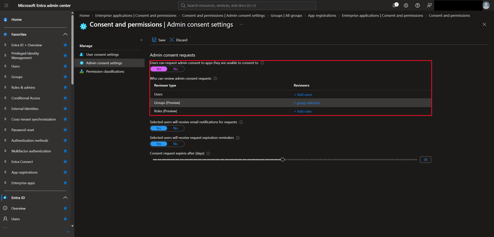

| Setting | What it does |
|---|---|
| Users can request admin consent | If **Yes**, users see a button to send a request to an admin. If **No**, they just get a message to contact their administrator, with no way to send a request |
| Who can review requests | Specific users, groups, or roles. I picked an **Admin Consent Group** |
| Email notifications | Reviewers get an email when a request comes in, so they don't have to keep checking |
| Expiration reminders | Reviewers get a reminder if they haven't acted yet |
| Consent request expires after | 30 days by default |

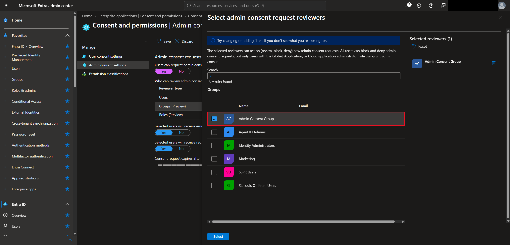

> Any reviewer can review, block, or deny a request, but only someone with Global Administrator, Application Administrator, or Cloud Application Administrator can actually **grant** admin consent.

---

## Task 5 — Application Proxy

**Application proxy** lets users reach an **internal web app from outside the company without a VPN**. It's for apps that have to stay on-prem, like a legacy app or one that can't be moved for security reasons.

### 5.1 How it works

```text
 Remote user                   Microsoft Entra                     On-premises network
┌────────────┐            ┌──────────────────────┐            ┌──────────────────────────┐
│ Opens the  │──sign in──►│ Microsoft Entra ID   │            │ Private network          │
│ app's      │◄──token────│ (MFA + CA apply)     │            │ connector (outbound only)│
│ external   │            │                      │            │        │                 │
│ URL        │──token────►│ Application Proxy    │◄──────────►│        ▼                 │
│            │◄──page─────│ service              │            │ Internal web server      │
└────────────┘            └──────────────────────┘            └──────────────────────────┘
```

1. **Sign in to Entra ID:** the user opens the app's external URL and signs in, and MFA and Conditional Access apply
2. **Token:** Entra gives the browser a token proving the user signed in
3. **Request reaches the connector:** the Application Proxy service passes the request to the connector inside the company network
4. **On-prem authentication:** if the app uses Windows authentication, the connector gets a Kerberos ticket from on-prem Active Directory on the user's behalf
5. **Connector reaches the app:** it forwards the request to the internal web server
6. **Page returns:** the response travels back through the connector and the Application Proxy service to the user

> The connector only makes **outbound** connections, so no inbound firewall ports need to be opened. It doesn't have to be on the same server as the app, but **it has to be able to reach the on-prem web server**.

### 5.2 The connector

**Enterprise applications → Private Network connectors.** This page lists connectors and has **Download connector service**. My tenant shows that Private Network is currently disabled.

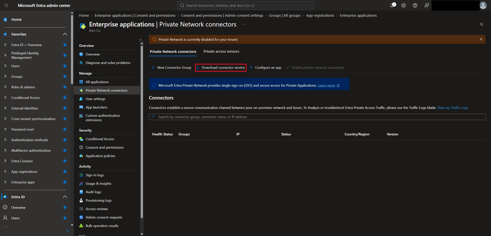

On the app itself, **AskBamCoHR → Application proxy** has **Download Private Network Connector**. The connector needs Windows Server 2012 R2 or later.

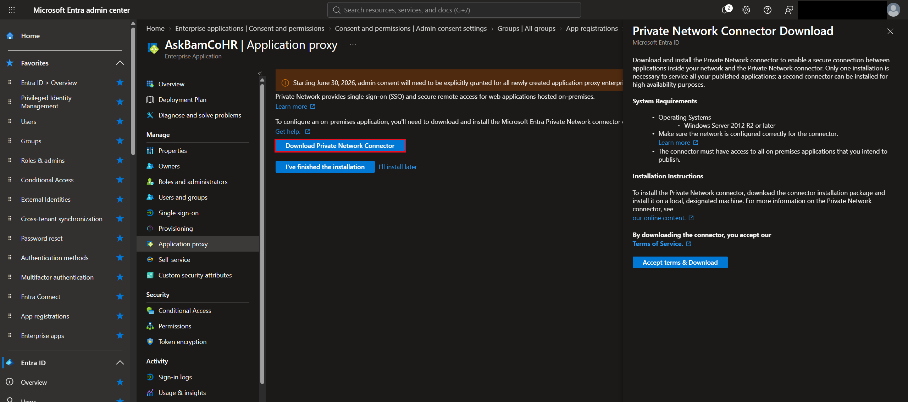

### 5.3 The app's proxy settings

The **Internal URL** is the app's address on the company network, and the **External URL** is the public address users go to. **Pre Authentication** set to **Microsoft Entra ID** makes users sign in to Entra before the request ever reaches the network.

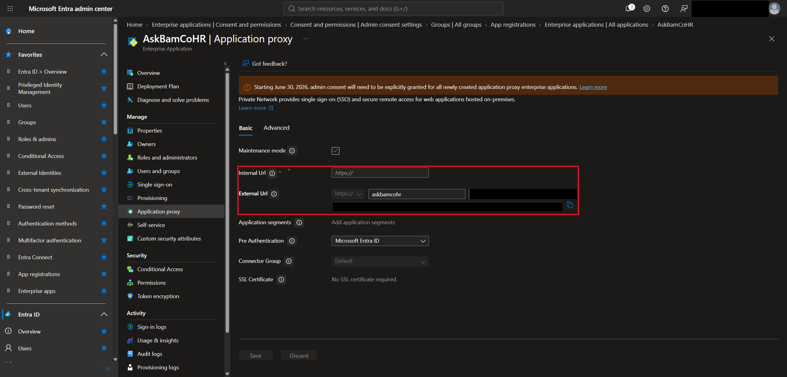

> I don't have an on-prem web server or a connector installed, so I didn't finish this setup. My [Hybrid Identity lab](../../../labs/hybrid-identity/lab-01-hybrid-identity-ad-entra-connect/) has an on-prem server that could host a connector later.

---

## Task 6 — Adding an App from the Gallery

**Enterprise applications → New application** opens the **Microsoft Entra App Gallery**. These are verified app templates from known publishers, so there's nothing to build or install.

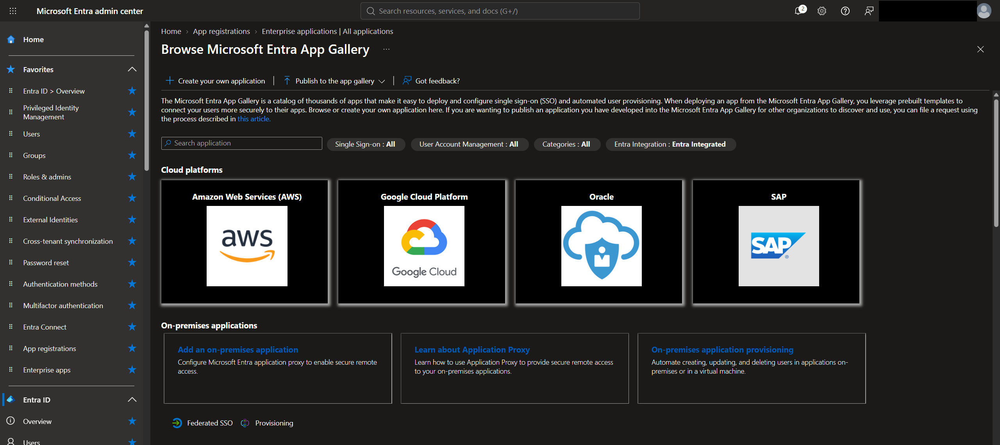

I picked **Slack** and clicked **Create**. You can rename the app, which helps if you need more than one instance of it.

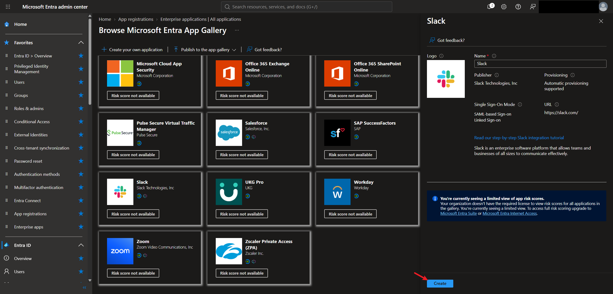

Gallery apps can support **single sign-on** (like SAML) and **automatic provisioning**, so users are created when they join and removed when they leave without anyone doing it by hand.

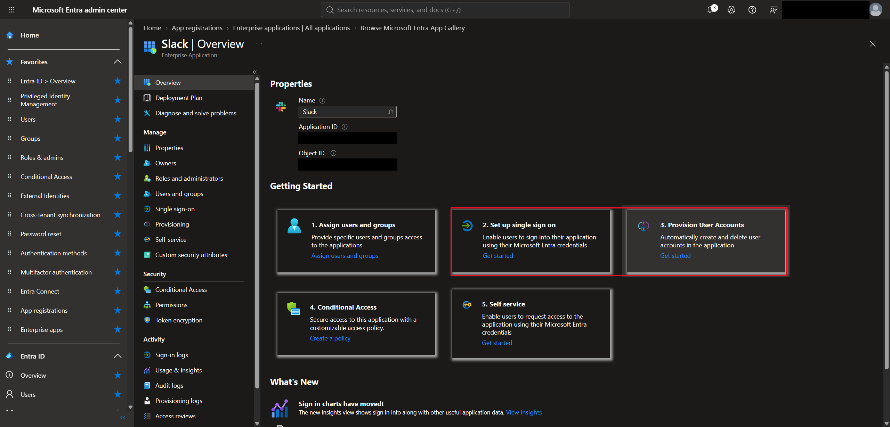

---

## Task 7 — App Collections

### 7.1 Admin-created collections

**Enterprise applications → App launchers → Collections.** A collection groups apps for a team, so they show up as their own tab in My Apps.

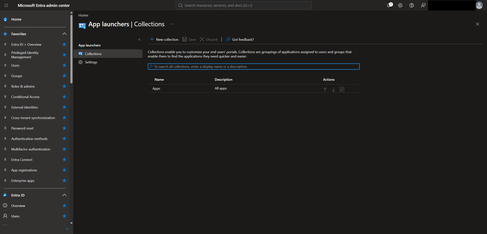

I created **SecOps Apps** and added AskBamCoHR, Slack, SharePoint, Loop, Engage, and OneDrive. I added myself as the **owner**, so I can manage the collection without needing an admin role. Then I added Kaitlyn under **Users and groups**, since only users added there can see the collection.

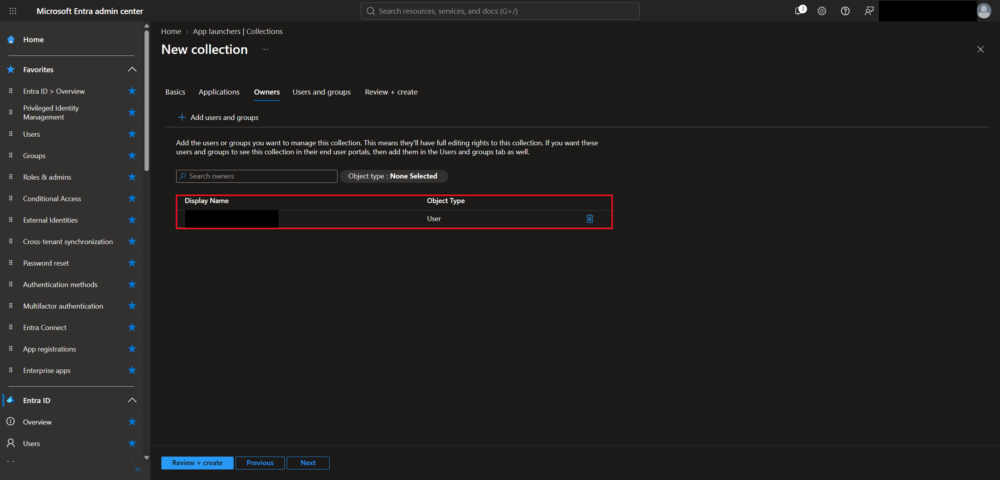

In Kaitlyn's My Apps, a **SecOps Apps** tab showed up.

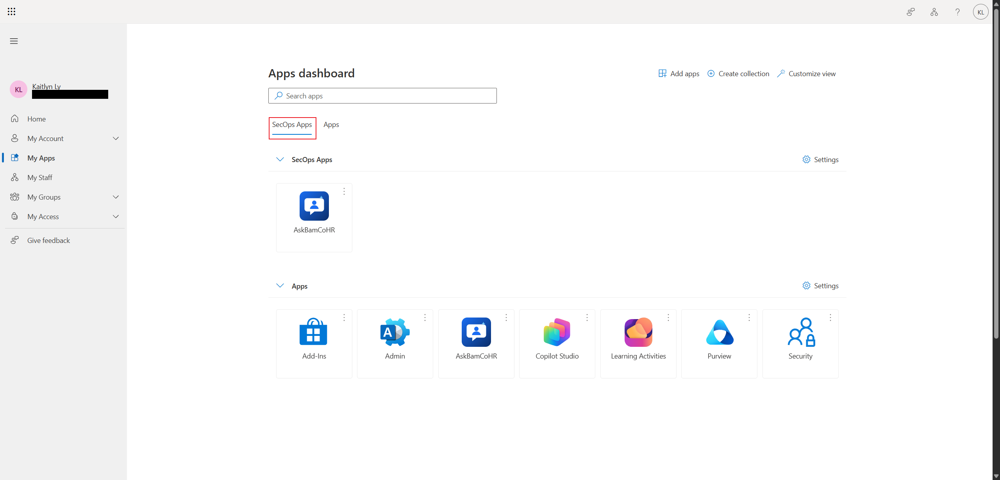

> The collection only shows **AskBamCoHR**, not the other five apps. That's because Kaitlyn is only assigned to AskBamCoHR. A collection doesn't give access to an app. The user still needs to be assigned to it, with sign-in enabled and visibility on.

### 7.2 User-created collections

Users can also make their own. As Kaitlyn, I used **Create collection** in My Apps to make an **HR** collection with AskBamCoHR in it.

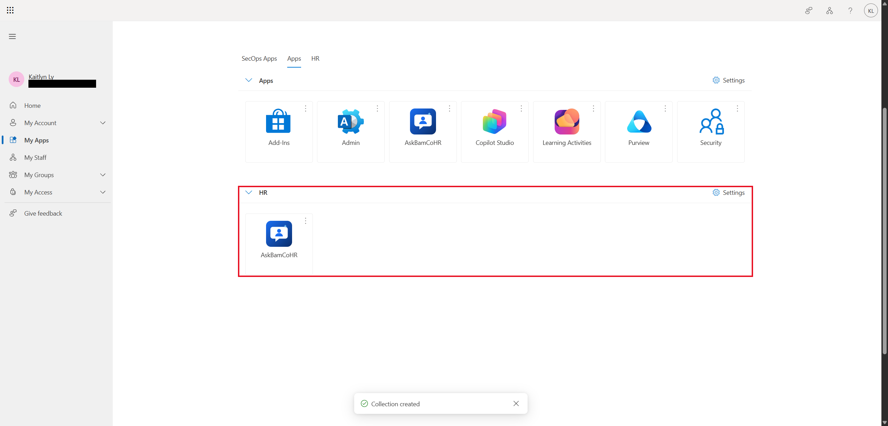

---

## What I Learned

- The application ID identifies an app everywhere, and the object ID identifies one object in my tenant
- If "Enabled for users to sign in" is off, nobody can use the app, no matter the other settings
- Unassigned users can never see an app in My Apps, and "Visible to users" only affects assigned users
- Assigning a user can also give them an app role, so least privilege applies here too
- User consent can be locked down, limited to low-impact permissions, or managed by Microsoft
- Admin consent requests give users a way to ask for approval, and only certain admin roles can actually grant it
- Application proxy publishes on-prem web apps through Entra ID using an outbound-only connector
- Gallery apps are prebuilt and can support single sign-on and automatic provisioning
- Collections organize apps in My Apps but don't grant access to them

---

> **Note:** Screenshots are from my personal lab tenant. My admin account, my name, the test user's sign-in name, the application and object IDs, the tenant name in the application proxy URL, and the object ID column in the app list have been redacted. Kaitlyn Ly is a fictional test account for a made-up company.

[← Back to Entra ID Labs](../../)
