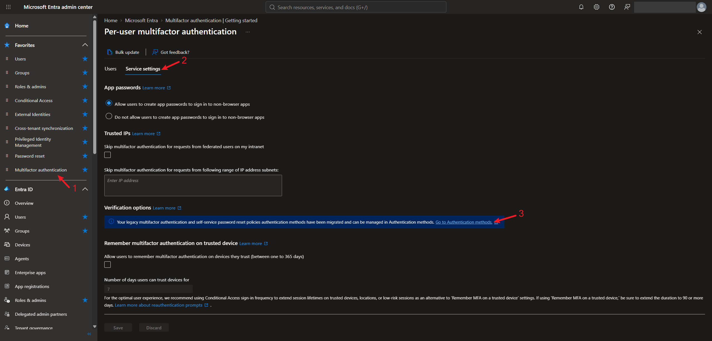
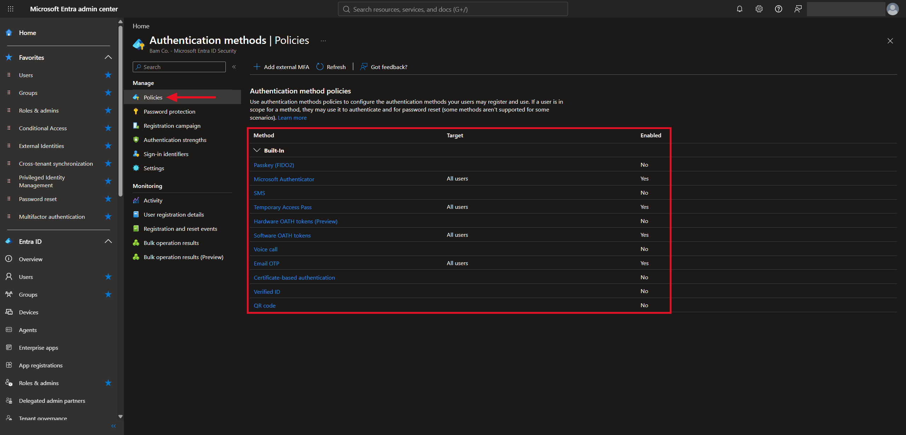
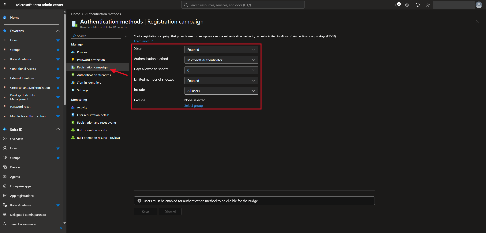
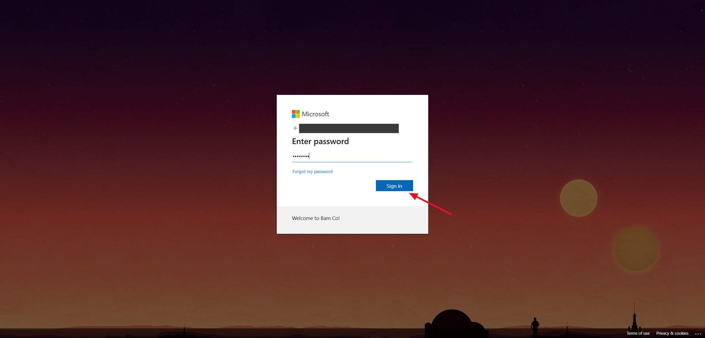
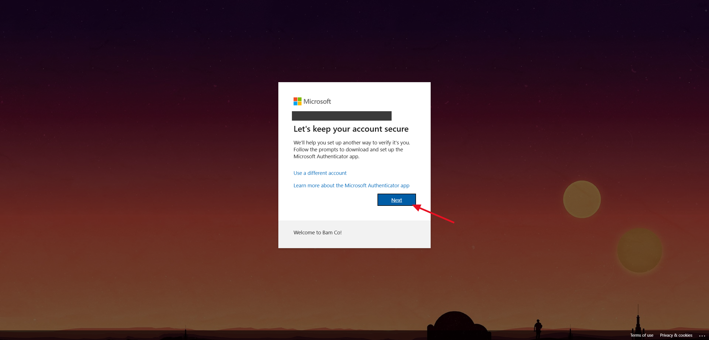
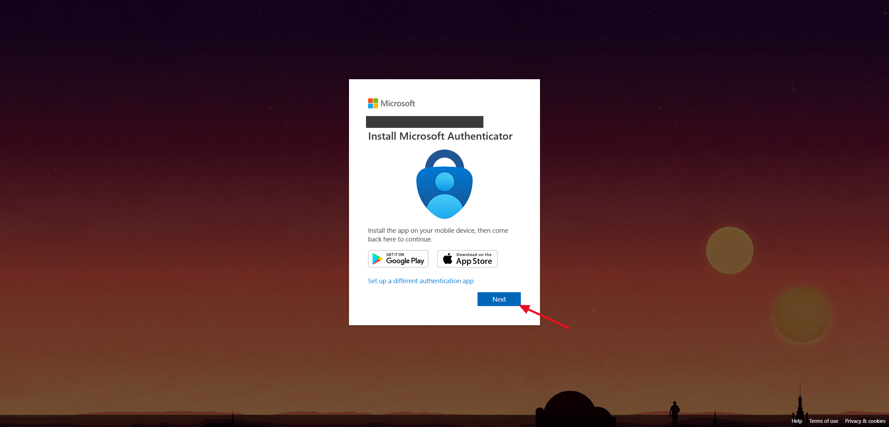
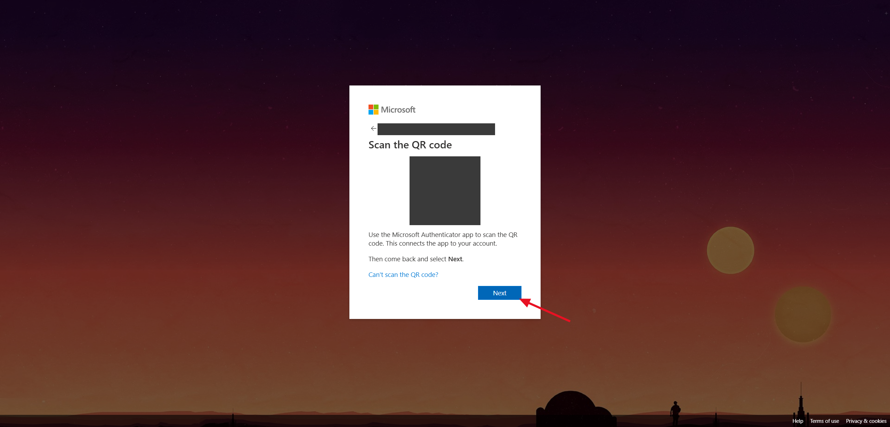
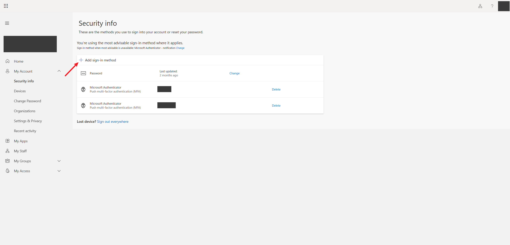
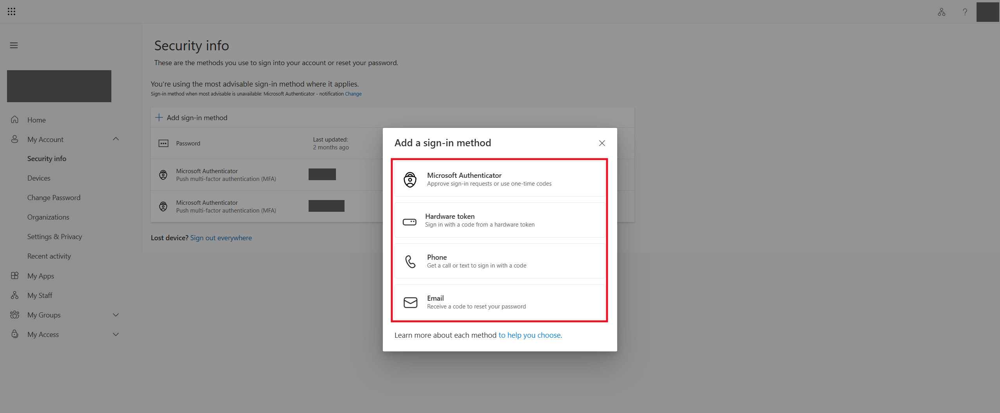

# Lab 5 — Multifactor Authentication: Methods, Policies, and Registration

## Overview

This is my fifth SC-300 lab. I did it in my own Microsoft Entra tenant for the made-up company **Bam Co.**

The earlier labs were about creating identities. This one starts on protecting them. A password by itself isn't enough anymore, so **multifactor authentication (MFA)** makes a user prove who they are in a second way before they get in.

I looked at where MFA is managed in the Entra admin center, checked which authentication methods my tenant allows, and turned on a **registration campaign** that asks users to set up the Microsoft Authenticator app. Then I signed in as a test user to see what that looks like from the user's side. Last, I looked at the page where users add and remove their own sign-in methods.

The big takeaway is that MFA has two sides. The admin decides which methods are allowed and who has to register, but each user still has to set up their own method. The registration campaign is what connects the two.

## Objectives

- Explain what MFA is and the three kinds of authentication factors
- Find the old per-user MFA settings and the newer Authentication methods policies
- See which authentication methods are enabled in a tenant and who they apply to
- Set up a registration campaign for Microsoft Authenticator
- Go through MFA registration as a user
- Know where users manage their own sign-in methods
- Compare what each authentication method can be used for

## Tools & Technologies

| Category | Tools |
|---|---|
| Identity platform | Microsoft Entra ID P2 |
| Portals | Microsoft Entra admin center, My Sign-Ins (`mysignins.microsoft.com`) |
| Features | Per-user MFA, Authentication methods policies, registration campaign, Microsoft Authenticator |
| Course | Microsoft Learn: SC-300 Identity and Access Administrator |

---

## Task 1 — What MFA Is

Here's why this matters. There are millions of password attacks every day, and about 30% of users have been the victim of a data breach because of a weak password.

MFA means signing in with **two or more** different kinds of proof. There are three kinds, called factors:

| Factor | What it means | Examples |
|---|---|---|
| Something you **know** | A secret only you should know | PIN, password |
| Something you **possess** | A physical thing you have with you | Phone, smart card, FIDO security key |
| Something you **are** | Part of your body | Fingerprint, face, voice |

```text
  Something you know   +   Something you possess or are   =   Signed in
      (password)            (phone, security key,
                             fingerprint)
```

> It only counts as MFA if the two proofs are **different kinds**. A password plus a PIN is two things you know, so it's still one factor. A password plus an approval on your phone is two factors.

---

## Task 2 — Where MFA Is Managed

### 2.1 Per-user MFA (the older way)

**Entra admin center → Multifactor authentication → Per-user MFA → Service settings.** This is the original place MFA was configured. It still has a few tenant-wide settings:

| Setting | What it does |
|---|---|
| App passwords | Lets users create a special password for older apps that can't do MFA |
| Trusted IPs | Skips MFA for sign-ins that come from listed IP ranges, like the office network |
| Remember MFA on trusted device | Lets users skip MFA on a device they've marked as trusted, for a set number of days |



Under **Verification options** there's a blue banner saying the legacy MFA and self-service password reset method settings have been **migrated** and are now managed in **Authentication methods**. I followed the link.

### 2.2 Authentication methods policies (the current way)

**Authentication methods → Policies** lists every method, who it applies to, and whether it's turned on. If a user is in scope for a method, they can register it and use it to sign in.



This is what my tenant had:

| Method | Target | Enabled |
|---|---|---|
| Passkey (FIDO2) | | No |
| Microsoft Authenticator | All users | Yes |
| SMS | | No |
| Temporary Access Pass | All users | Yes |
| Hardware OATH tokens (Preview) | | No |
| Software OATH tokens | All users | Yes |
| Voice call | | No |
| Email OTP | All users | Yes |
| Certificate-based authentication | | No |
| Verified ID | | No |
| QR code | | No |

> Each method can be targeted at **all users** or at specific **groups**, so a company can roll a new method out to a small group first.

---

## Task 3 — Registration Campaign

Turning a method on doesn't make anyone register for it. A **registration campaign** prompts users to set up a stronger method the next time they sign in. Right now it only supports Microsoft Authenticator and passkeys.

**Authentication methods → Registration campaign:**

| Setting | Value | What it means |
|---|---|---|
| State | Enabled | The campaign is on |
| Authentication method | Microsoft Authenticator | The method users are asked to set up |
| Days allowed to snooze | 0 | A user who skips the prompt is asked again at their next sign-in |
| Limited number of snoozes | Enabled | Limits how many times a user can skip the prompt |
| Include | All users | Who gets the prompt |
| Exclude | None selected | Groups that are left out |



> The note at the bottom of the page matters: users **must be enabled for the authentication method** to get the prompt. The campaign only works because Microsoft Authenticator is turned on for all users in Task 2.

---

## Task 4 — What the User Sees

To test the campaign I signed in as one of my test users.

**1.** The user enters their password like normal:



**2.** After the password, a **Let's keep your account secure** page appears instead of going straight in. This is the registration campaign.



**3.** The user is asked to install the Microsoft Authenticator app on their phone:



**4.** The page then shows a QR code to scan with the app. Scanning it connects the app to the account.



> I blacked out the QR code in the screenshot. It's a one-time secret that links an Authenticator app to the account, so it should never be shared.

---

## Task 5 — Users Managing Their Own Methods

Users don't need an admin to add or remove methods. They can do it themselves at `mysignins.microsoft.com` under **Security info**. This page lists the methods already registered on the account, and each one can be deleted from here.



**Add sign-in method** shows the methods the user is allowed to add. The list comes from what the admin enabled in the Authentication methods policies.



| Option | What it's for |
|---|---|
| Microsoft Authenticator | Approve sign-in requests or use one-time codes |
| Hardware token | Sign in with a code from a hardware token |
| Phone | Get a call or text to sign in with a code |
| Email | Receive a code to reset your password |

> The page also has **Lost device? Sign out everywhere**, which signs the account out of every session. That's the first thing to click if a phone is lost or stolen.

---

## Task 6 — Comparing the Methods

### Which methods are used for MFA

| Used when deploying MFA | Extra methods for special cases |
|---|---|
| Microsoft Authenticator app | Security questions (non-admins only) |
| Windows Hello for Business | Email address (part of SSPR if enabled) |
| FIDO2 security key | App passwords (for legacy apps that don't support MFA) |
| OATH hardware token (preview) | |
| OATH software token | |
| SMS | |
| Voice call | |

### What each method can do

Not every method works everywhere. Some can be used as the **first** step of signing in (primary), some only as the **second** step (secondary), and some can also be used for **self-service password reset (SSPR)**.

| Method | Primary authentication | Secondary authentication | SSPR / Account recovery |
|---|---|---|---|
| Authenticator Lite | No | MFA | No |
| Certificate-based authentication | Yes | MFA | No |
| Email OTP | No | SSPR and sign-in | SSPR |
| External MFA | No | MFA | No |
| Hardware OATH tokens (preview) | No | MFA | SSPR |
| Microsoft Authenticator passwordless | Yes | No | No |
| Microsoft Authenticator push notifications | No | MFA | SSPR |
| Passkey (FIDO2) | Yes | MFA | No |
| Passkey in Microsoft Authenticator | Yes | MFA | No |
| Password | Yes | No | No |
| Platform Credential for macOS | Yes | MFA | No |
| QR code | Yes | No | No |
| SMS sign-in | Yes | MFA | SSPR |
| Software OATH tokens | No | MFA | SSPR |
| Synced passkey | Yes | MFA | No |
| Temporary Access Pass (TAP) | Yes | MFA | No |
| Verified ID | No | No | Account recovery |
| Voice call | No | MFA | SSPR |
| Windows Hello for Business | Yes | MFA | No |

> Passkeys and Windows Hello for Business can be used as the first step and also count as MFA. That's why they can replace the password completely.

---

## What I Learned

- MFA needs two different kinds of proof: something you know, something you have, or something you are
- The old per-user MFA page still exists, but the methods are now managed in Authentication methods policies
- Each method can be turned on for everyone or only for certain groups
- Enabling a method doesn't make users register. A registration campaign is what prompts them the next time they sign in
- A user has to be enabled for a method before the campaign will prompt them for it
- Users can add and delete their own methods at `mysignins.microsoft.com`, and "Sign out everywhere" is there for a lost device
- Not every method can do everything. Some only work as a second step, and some can also be used to reset a password
- A setup QR code is a secret, so it shouldn't be shown in a screenshot

---

> **Note:** Screenshots are from my personal lab tenant. The tenant domain, my admin account and name, the test user's sign-in name, the Authenticator setup QR code, and the names of my registered devices have been redacted. The method comparison table comes from Microsoft's documentation and may change as Microsoft updates it.

[← Back to Entra ID Labs](../)
