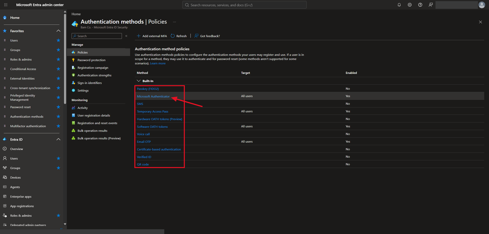
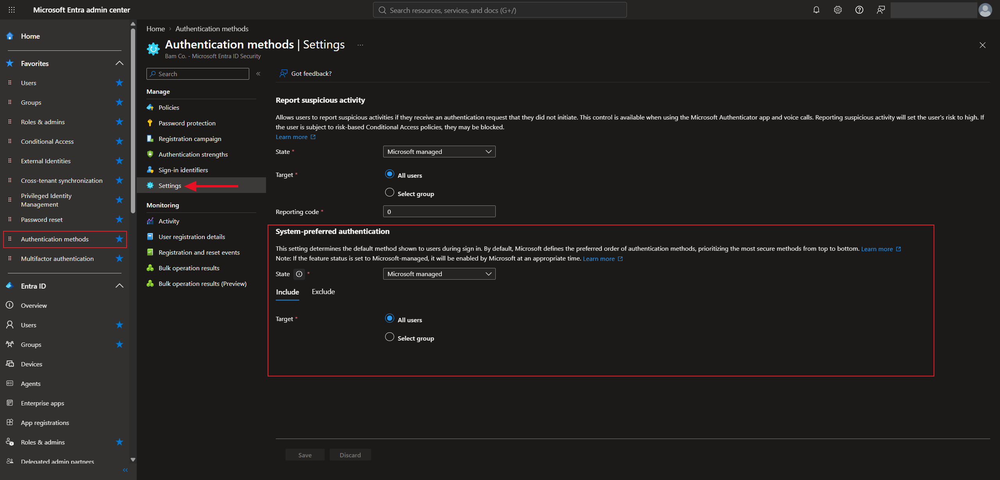
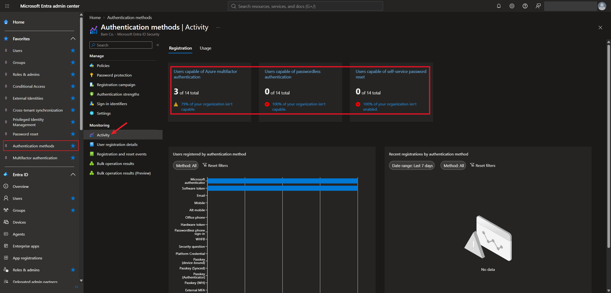
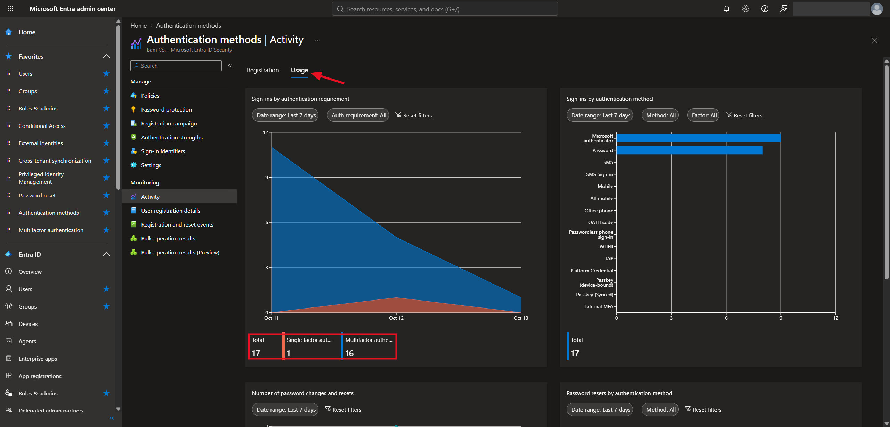
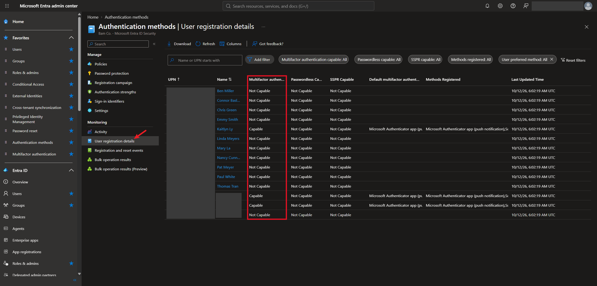

# Lab 6 — Authentication Methods: Passwordless, FIDO2, and Monitoring

## Overview

This is my sixth SC-300 lab. I did it in my own Microsoft Entra tenant for the made-up company **Bam Co.**

[Lab 5](../lab-05-multifactor-authentication/) was about turning MFA on. This one goes deeper into the **methods** themselves. Not every second factor is equally safe. Password attacks are still very common, attackers phish users, and even SMS codes can be stolen through SIM swapping or phishing kits. So it matters which method people actually use.

I compared the methods from weakest to strongest, learned how the passwordless ones work (FIDO2 security keys, Microsoft Authenticator, Windows Hello for Business, and certificates), and looked at the setting that makes Entra suggest each user's strongest method. Last, I used the **Activity** and **User registration details** reports to see which users in my tenant are actually set up for MFA.

The big takeaway is that the strongest methods are also the easiest ones for users. Passwordless sign-in is both more secure and more convenient than a password plus a code.

## Objectives

- Rank authentication methods from bad to best
- Check which methods can be used as the first sign-in step
- Understand how FIDO2, Microsoft Authenticator, Windows Hello for Business, and certificate-based authentication work
- Find the setting that makes users sign in with their strongest method
- Use the authentication methods reports to see who is registered for what

## Tools & Technologies

| Category | Tools |
|---|---|
| Identity platform | Microsoft Entra ID P2 |
| Portals | Microsoft Entra admin center |
| Features | Authentication methods policies, system-preferred MFA, report suspicious activity, Activity report, User registration details |
| Course | Microsoft Learn: SC-300 Identity and Access Administrator |

---

## Task 1 — Why the Method Matters

Microsoft sorts sign-in methods into four levels:

| Level | What it is | Examples |
|---|---|---|
| **Bad** | Password only | `123456`, `qwerty`, `password`, `iloveyou` |
| **Good** | Password and a code by phone | SMS text, voice call |
| **Better** | Password and an app or token | Microsoft Authenticator push notifications, software OTP tokens, hardware OTP tokens |
| **Best** | Passwordless | Microsoft Authenticator phone sign-in, Windows Hello for Business, FIDO2 security key, certificates |

SMS and voice calls are only "Good" because a text message can be intercepted, for example when an attacker talks a phone carrier into moving someone's number to a new SIM card.

The course also compared methods on two scales: how **secure** they are and how **convenient** they are.

```text
                        High security
                              │
     Password + 2nd factor    │     Passwordless
     (secure, but annoying)   │     (secure and easy)
                              │
  Inconvenient ───────────────┼─────────────── Convenient
                              │
                              │     Password only
                              │     (easy, but weak)
                              │
                        Low security
```

> You want security first, and convenience as well. Passwordless is the only option in the top right corner.

---

## Task 2 — Choosing Methods

### 2.1 Which methods are allowed

**Authentication methods → Policies** lists every method and whether it's turned on. My tenant has the same setup as in Lab 5: Microsoft Authenticator, Temporary Access Pass, software OATH tokens, and email OTP are enabled for all users.

Clicking a method opens its settings. That's where you can see whether it can be used as a **primary** sign-in method (instead of a password) or only as a second factor.



### 2.2 Making users use their strongest method

**Authentication methods → Settings** has two tenant-wide settings:

| Setting | My tenant | What it does |
|---|---|---|
| Report suspicious activity | Microsoft managed, all users | Lets users report an MFA request they didn't start. Reporting one marks the user as high risk, so risk-based Conditional Access can block them |
| System-preferred authentication | Microsoft managed, all users | At sign-in, Entra shows each user their **most secure** registered method first instead of the one they picked as their default |



System-preferred authentication matters because users tend to pick whatever is easiest, like SMS. This way, if someone has both SMS and the Authenticator app registered, Entra asks for the Authenticator app.

### 2.3 Microsoft's ranking

When system-preferred authentication is on, this is the order Entra uses, strongest first:

| Rank | Method | Category | Can be used for |
|---|---|---|---|
| 1 | Temporary Access Pass (TAP) | Recovery | First factor and MFA |
| 2 | Passkey | Phishing-resistant | First factor and MFA |
| 3 | Certificate-based authentication (CBA) | Phishing-resistant | First factor, or first factor and MFA |
| 4 | Microsoft Authenticator notifications | Passwordless | First factor and MFA |
| 5 | External multifactor authentication | | MFA |
| 6 | Time-based one-time password (TOTP) | | MFA |
| 7 | Telephony (SMS and voice) | | MFA |
| 8 | QR code | Frontline worker | First factor |
| 9 | Password | | First factor |

> The phone methods (SMS and voice calls) are near the bottom, and the password is last.

---

## Task 3 — How the Passwordless Methods Work

### 3.1 FIDO2 security keys

FIDO2 is an open standard for signing in without a password. A FIDO2 security key is usually a small USB device. It holds a **cryptographic credential** instead of a password, so there's nothing for an attacker to phish.

It works with a key pair:

| Key | Where it lives | What it does |
|---|---|---|
| Private key | Stays on the security key and never leaves it | Creates a digital signature |
| Public key | Registered with Entra ID | Checks that signature |

```text
  1. The user plugs in the USB security key and starts signing in
  2. Entra ID sends a unique challenge
  3. The user unlocks the key with a PIN or a fingerprint
  4. The key signs the challenge with its private key
  5. Entra ID checks the signature with the public key it has on file,
     and the user is signed in
```

> Since the private key never leaves the device and each challenge is different, a stolen or replayed signature is useless. That's why FIDO2 counts as **phishing-resistant**.

### 3.2 Microsoft Authenticator

The Authenticator app can verify a sign-in two ways:

| Option | How it works |
|---|---|
| Push notification | A prompt pops up on the phone. The user approves it, usually by typing the number shown on the sign-in screen |
| OATH verification code | The app shows a code that changes every 30 seconds, and the user types it into the sign-in page |

> Push notifications need the phone to be online. If the user is somewhere with no internet, the push won't arrive, but the OATH code still works because it's generated on the phone itself.

### 3.3 Windows Hello for Business

Windows Hello for Business replaces the password on a Windows PC with a PIN, facial recognition, or a fingerprint. It uses a key pair too:

| Step | What happens |
|---|---|
| 1. Initial setup | The user proves who they are. Windows creates a key pair and registers the public key with the identity provider, such as Entra ID |
| 2. Sign in | The PIN or biometric unlocks the private key on the computer. It signs a challenge, and the identity provider checks the signature |
| 3. Proof of sign-in | The identity provider sends back a token that proves the user signed in |
| 4. Access resources | Windows uses that token for single sign-on to apps and resources |

> The private key stays on the device, usually protected by its TPM security chip. The PIN and fingerprint never get sent to the identity provider. That's why a Windows Hello PIN is safer than a password, even though it's shorter: it only works on that one device.

### 3.4 Certificate-based authentication

Certificate-based authentication (CBA) lets users sign in with an **X.509 certificate**, often stored on a smart card, instead of a password. Entra ID checks that the certificate was issued by a certificate authority the tenant trusts, then signs the user in. It works for sign-ins in web browsers and in mobile apps, and admins can set rules based on who issued the certificate.

---

## Task 4 — Monitoring and Reporting

### 4.1 Registration

**Authentication methods → Activity → Registration** shows how many users have set up each kind of method:

| Report | My tenant |
|---|---|
| Users capable of Azure multifactor authentication | 3 of 14 (79% of the organization isn't capable) |
| Users capable of passwordless authentication | 0 of 14 |
| Users capable of self-service password reset | 0 of 14 |



The chart below the numbers shows which methods those users registered. In my tenant it's Microsoft Authenticator and software tokens.

### 4.2 Usage

The **Usage** tab shows how people actually signed in. Over the last 7 days my tenant had **17 sign-ins: 16 used multifactor authentication and 1 was single-factor.** The chart on the right shows the methods used, which were Microsoft Authenticator and password.



### 4.3 User registration details

**User registration details** lists every user and whether they are MFA capable, passwordless capable, and SSPR capable, plus their default method and the methods they've registered. This is how an admin finds the users who still need to set up MFA.



> Only 3 users in my tenant are MFA capable, and everyone else is "Not Capable". The registration campaign from Lab 5 is what would nudge those users to register.

---

## What I Learned

- Not all MFA is equal. SMS and voice calls are the weakest second factors because they can be intercepted
- The strongest methods are passwordless, and they are also the most convenient for users
- System-preferred authentication makes Entra ask for each user's strongest method, so they can't fall back to SMS if they have something better
- Report suspicious activity lets a user flag an MFA prompt they didn't start
- FIDO2 keys and Windows Hello for Business both use a private key that never leaves the device, which is why they can't be phished
- Authenticator push needs internet, but the OATH code works offline
- The Activity and User registration details reports show who is actually set up, which is how I saw that most of my test users still can't do MFA

---

> **Note:** Screenshots are from my personal lab tenant. The tenant domain, my admin account, user principal names, and my own accounts have been redacted. The users shown (Ben Miller, Kaitlyn Ly, etc.) are fictional test accounts for a made-up company. Microsoft's ranking table comes from its documentation and may change.

[← Back to Entra ID Labs](../)
