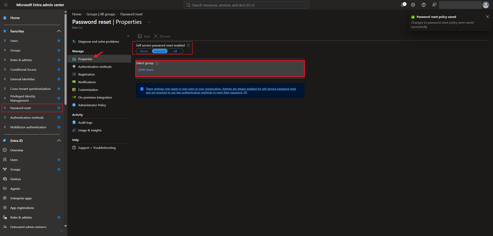
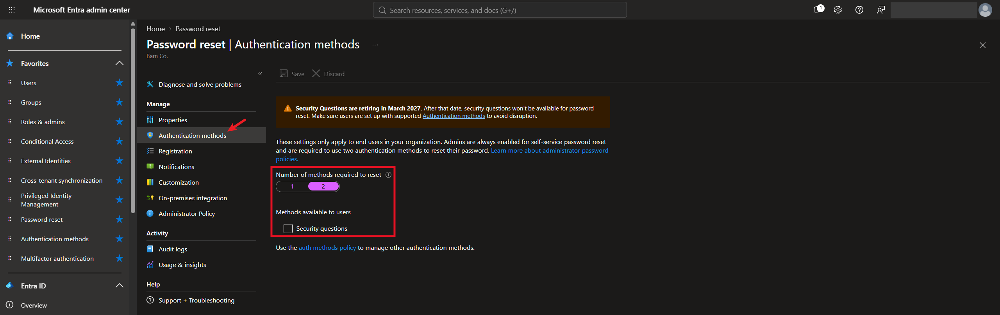
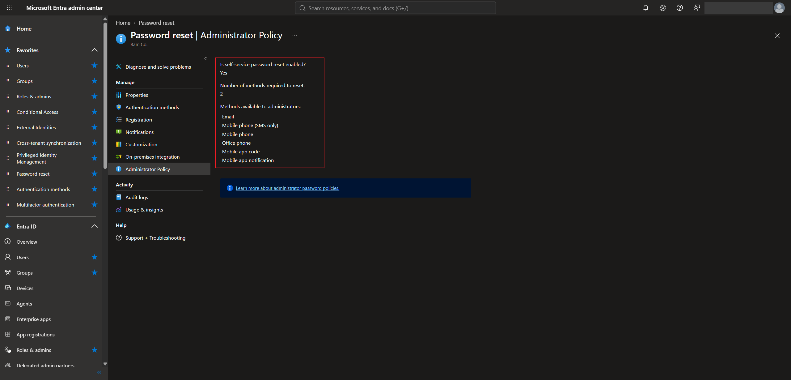
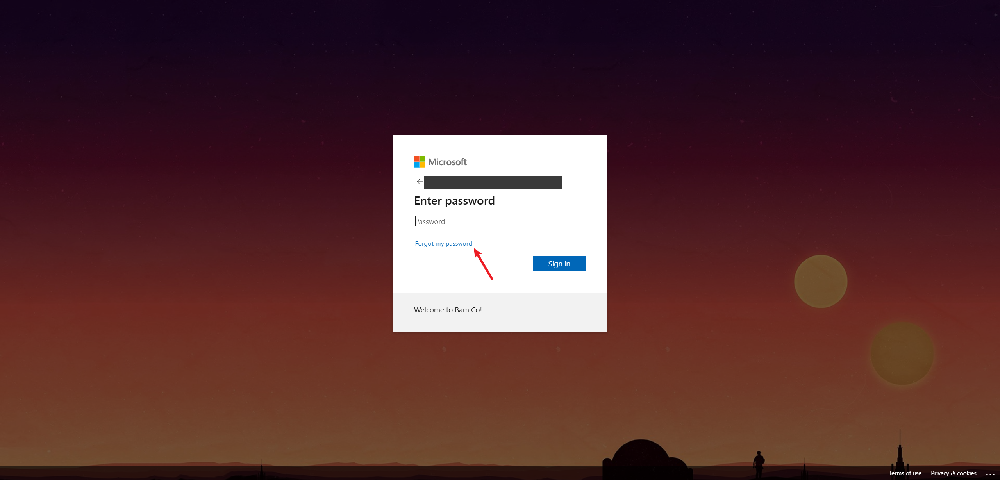
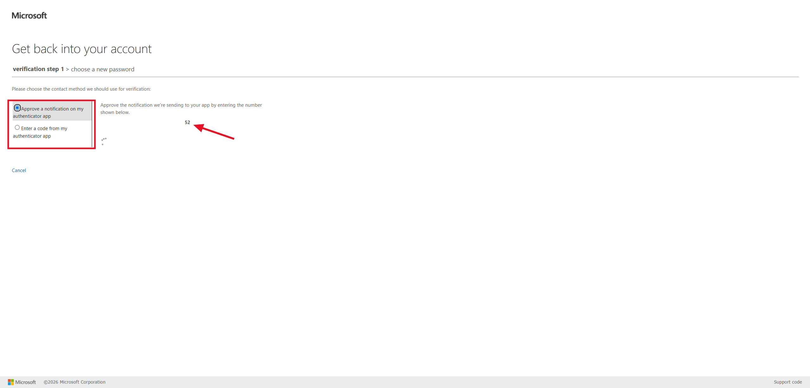
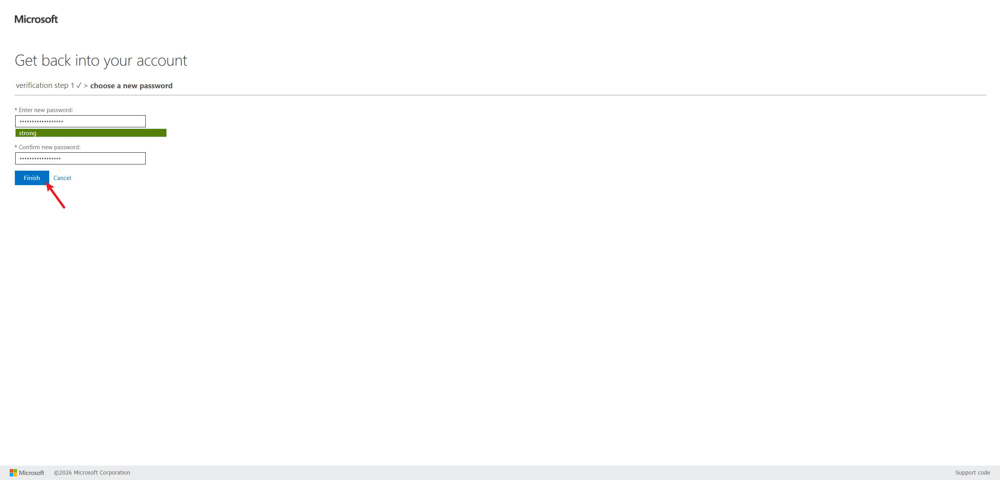

# Lab 7 — Self-Service Password Reset (SSPR)

## Overview

This is my seventh SC-300 lab. I did it in my own Microsoft Entra tenant for the made-up company **Bam Co.**

Forgotten passwords are one of the most common reasons people call the help desk. **Self-service password reset (SSPR)** lets users reset their own password after proving who they are, without waiting on an admin.

I turned SSPR on for one security group, set how many verification methods a user needs to reset, and looked at the separate policy that applies to admins. Then I tested it as a test user: I clicked "Forgot my password", verified with the Microsoft Authenticator app, and set a new password.

The big takeaway is that SSPR is only as safe as the methods it accepts. That's why it asks for two methods, and why easy-to-guess options like security questions are on the way out.

## Objectives

- Know which licenses include SSPR
- Turn on SSPR for a selected group of users
- Choose how many methods are needed and which methods are allowed
- Understand the administrator password reset policy
- Reset a password as a user with Microsoft Authenticator

## Tools & Technologies

| Category | Tools |
|---|---|
| Identity platform | Microsoft Entra ID P2 |
| Portals | Microsoft Entra admin center, My Apps (`myapps.microsoft.com`) |
| Features | Self-service password reset, administrator policy, Microsoft Authenticator |
| Course | Microsoft Learn: SC-300 Identity and Access Administrator |

---

## Task 1 — SSPR Licensing

What SSPR can do depends on the license:

| Feature | Entra ID Free | Microsoft 365 Business Standard | Microsoft 365 Business Premium | Entra ID P1 or P2 |
|---|---|---|---|---|
| **Cloud-only password change** (a cloud user knows their password and wants to change it) | ✅ | ✅ | ✅ | ✅ |
| **Cloud-only password reset** (a cloud user forgot their password) | | ✅ | ✅ | ✅ |
| **Hybrid password change or reset with on-prem writeback** (a user synced from on-prem Active Directory with Entra Connect) | | | ✅ | ✅ |

The last row ties back to [password writeback in Lab 4](../lab-04-hybrid-identity/). A synced user's new password has to be written back to on-prem AD, or the two passwords would no longer match.

---

## Task 2 — Turn On SSPR

**Entra admin center → Password reset → Properties.** The **Self service password reset enabled** setting has three choices, or scopes:

| Scope | Who can use SSPR |
|---|---|
| None | Nobody |
| Selected | Only members of one group you pick |
| All | Every user in the tenant |

I chose **Selected** and picked a security group called **SSPR Users**, then saved.

> The selected group has to be a single security group, but other groups can be nested inside it. That makes it easy to roll SSPR out to a pilot group first and add more teams later.

---

## Task 3 — Authentication Methods for SSPR

**Password reset → Authentication methods** controls how a user proves who they are before resetting:

| Setting | My tenant |
|---|---|
| Number of methods required to reset | 2 |
| Methods available to users | Security questions (not checked) |

I set it to require **2 methods** to reset a password. With only one, someone who stole a single method (like access to the user's email) could take over the account.

I left **Security questions** off. They're not strong, because answers like a pet's name or a hometown are easy to guess or look up. A banner on this page also says security questions are being retired in March 2027.

The page links to the **auth methods policy**. That's where the other methods (like the Authenticator app from [Lab 5](../lab-05-multifactor-authentication/)) are managed now, and SSPR uses them from there.

---

## Task 4 — Administrator Policy

The settings above only apply to regular users. A blue banner explains that **admins are always enabled for SSPR and always have to use two methods** to reset their password.

**Password reset → Administrator Policy** shows that policy:

| Setting | Value |
|---|---|
| Is self-service password reset enabled? | Yes |
| Number of methods required to reset | 2 |
| Methods available to administrators | Email, mobile phone (SMS only), mobile phone, office phone, mobile app code, mobile app notification |

> This policy can't be deleted or turned off. Admin accounts are the most valuable ones to an attacker, so Microsoft always makes them prove two things before a reset.

---

## Task 5 — Testing SSPR as a User

I signed in as a test user who is a member of the **SSPR Users** group, through My Apps.

**1.** On the password page, I clicked **Forgot my password** instead of signing in.

**2.** The **Get back into your account** page asked who I was. The username was already filled in.

**3.** For verification, I chose **Approve a notification on my authenticator app**. The page showed a number, and I typed that number into the Authenticator app on my phone.

**4.** After verifying, I picked a new password and clicked **Finish**.

The user was able to reset their own password without an admin getting involved.

> **It only asked for one method.** The top of the page says "verification step 1 ✓ > choose a new password", with no step 2. I had just changed **Number of methods required to reset** from 1 to 2 right before testing, and the change hadn't synced yet, so the reset still used the old setting. SSPR changes can take a while to apply. With 2 methods required, the page should show "verification step 1 > verification step 2 > choose a new password".

---

## What I Learned

- What SSPR can do depends on the license. Free only lets cloud users change a password they already know
- SSPR can be turned on for nobody, one selected group, or everyone, and other groups can be nested inside the selected group
- Requiring two methods to reset means one stolen method isn't enough to take over an account
- Security questions are weak because the answers are easy to guess, and Microsoft is retiring them
- Admins have their own SSPR policy that always requires two methods and can't be deleted
- From the user's side, resetting a password with the Authenticator app only takes a minute
- Policy changes don't apply right away. My test still used one method because I had just switched it to two

---

> **Note:** Screenshots are from my personal lab tenant. The tenant domain, my admin account, and the test user's sign-in name have been redacted. The test user is a fictional account for a made-up company.

[← Back to Entra ID Labs](../)
