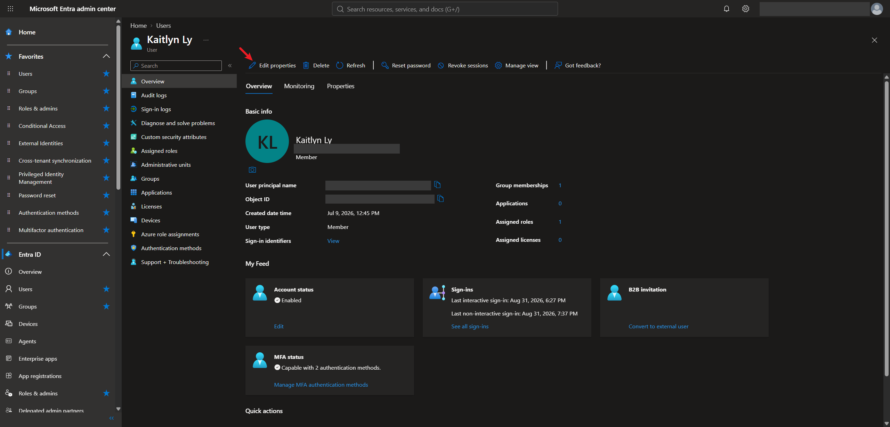
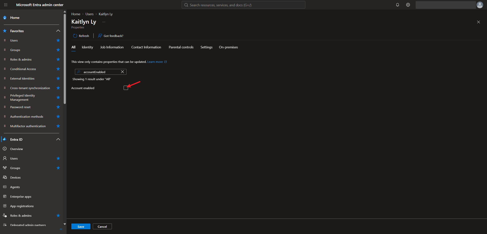
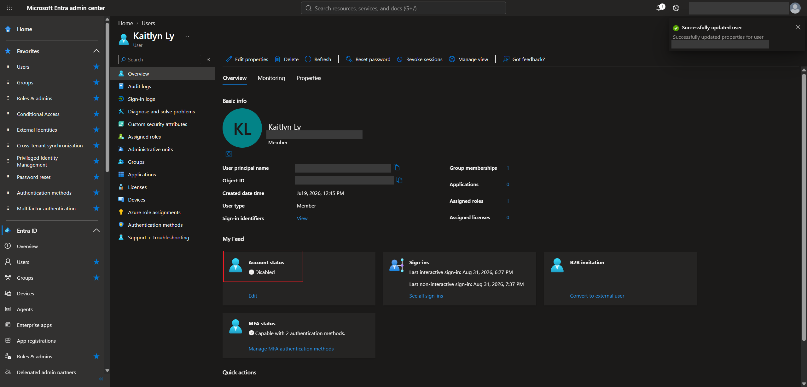
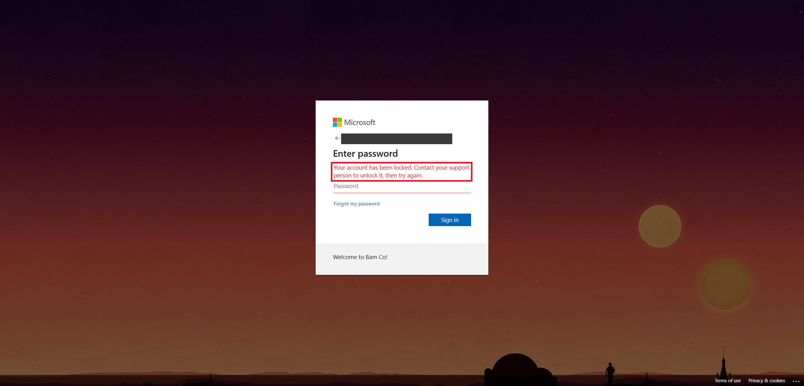
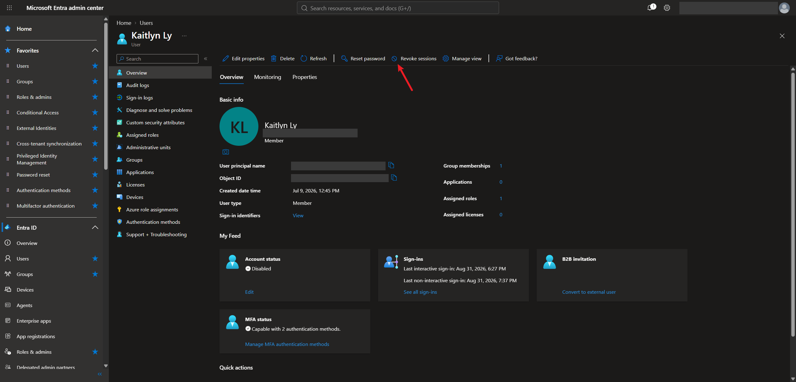
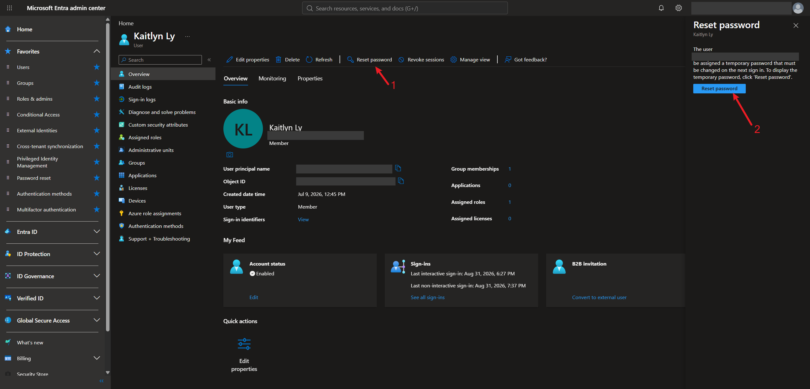
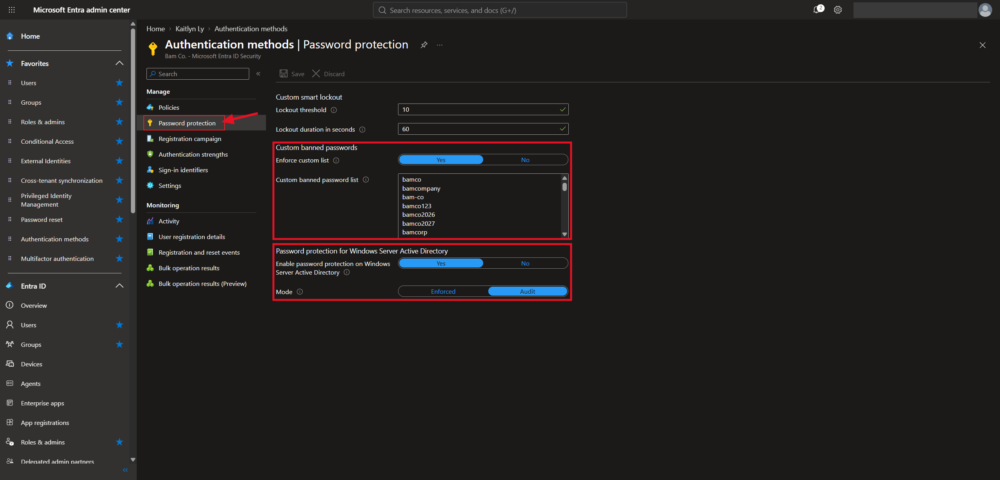
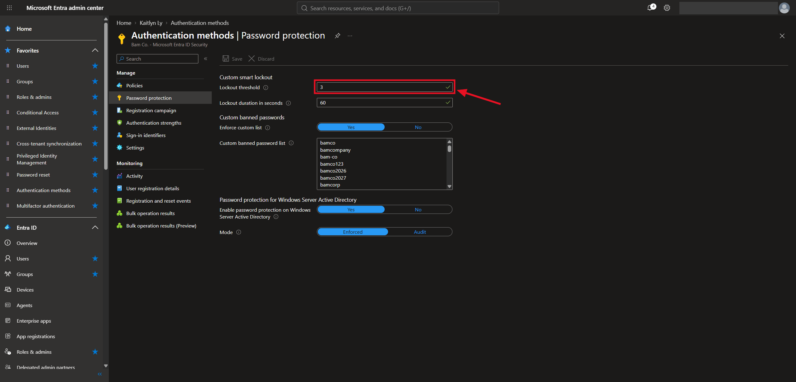

# Lab 8 — Disabling Accounts, Password Protection, and Smart Lockout

## Overview

This is my eighth SC-300 lab. I did it in my own Microsoft Entra tenant for the made-up company **Bam Co.**

The last few labs were about getting users signed in safely. This one is about what an admin does when an account needs to be **shut down fast**, like when someone leaves the company or an account gets compromised. I disabled a test user, saw the sign-in get blocked, and looked at revoking sessions and resetting the password.

After that I set up **password protection**, which stops users from picking weak passwords, and changed **smart lockout** so an account locks after fewer wrong guesses.

The big takeaway is that disabling an account isn't enough by itself. A user who is already signed in can keep working until their tokens run out, so you also have to revoke their sessions and reset the password.

## Objectives

- Know the steps for shutting down an account, for cloud users and hybrid users
- Disable a user in the Entra admin center and confirm they can't sign in
- Revoke a user's active sessions and reset their password
- Add a custom banned password list
- Understand how password protection works for on-prem Active Directory
- Change the smart lockout threshold

## Tools & Technologies

| Category | Tools |
|---|---|
| Identity platform | Microsoft Entra ID P2 |
| Portals | Microsoft Entra admin center |
| Features | Disable account, revoke sessions, reset password, password protection, custom banned passwords, smart lockout |
| Course | Microsoft Learn: SC-300 Identity and Access Administrator |

---

## Task 1 — Why Disabling Isn't Enough

When a user signs in, they get two tokens:

| Token | What it does |
|---|---|
| Access token | Lets them into apps. It's valid for about **one hour** |
| Refresh token | Gets them a new access token when the old one expires, without signing in again |

If I only disable the account, the user's current access token keeps working until it expires, and apps they already have open may stay usable for a while. That's why shutting down an account has three steps:

1. Disable the account
2. Reset the password
3. Revoke sessions and disable any devices or tokens tied to the user

### Doing it with PowerShell

The course showed the same steps as commands. For a **cloud user** in Entra:

```powershell
# 1. Disable the account
Set-AzureADUser -ObjectId user@contoso.com -AccountEnabled $false

# 2. Revoke refresh tokens (signs them out everywhere)
Revoke-AzureADUserAllRefreshToken -ObjectId user@contoso.com

# 3. Disable the user's registered devices
Get-AzureADUserRegisteredDevice -ObjectId user@contoso.com | Set-AzureADDevice -AccountEnabled $false
```

For a **hybrid user** that lives in on-prem Active Directory:

```powershell
# 1. Disable the account
Disable-ADAccount -Identity user

# 2. Reset the password
Set-ADAccountPassword -Identity user -Reset -NewPassword (Read-Host -AsSecureString "New password")
```

> For hybrid users, the course recommends resetting the password **twice**. That helps protect against pass-the-hash attacks, where an attacker reuses a stolen password hash instead of the actual password.

> The `AzureAD` PowerShell module in these examples is the older one. Microsoft has been moving to the Microsoft Graph PowerShell module, but the steps are the same.

---

## Task 2 — Disabling a User in the Portal

### 2.1 Edit the user

**Users → Kaitlyn Ly → Edit properties.** The overview shows her account status as **Enabled**.



### 2.2 Uncheck Account enabled

In **Edit properties** I searched for `accountEnabled`, unchecked **Account enabled**, and clicked **Save**.



### 2.3 Confirm it's disabled

The overview now shows **Account status: Disabled**.



### 2.4 What the user sees

When I tried to sign in as Kaitlyn, I got **"Your account has been locked. Contact your support person to unlock it, then try again."**



---

## Task 3 — Revoke Sessions and Reset the Password

### 3.1 Revoke active sessions

**Revoke sessions** is on the same toolbar. It invalidates the user's refresh tokens, so every app and device has to sign in again, which fails now that the account is disabled.



### 3.2 Reset the password

**Reset password** opens a panel that gives the user a **temporary password**. They have to change it the next time they sign in.



> Kaitlyn's account shows as Enabled again in this screenshot, because I turned it back on before resetting her password.

---

## Task 4 — Password Protection

People tend to pick easy-to-guess passwords, which makes them weak against dictionary attacks. **Microsoft Entra password protection** blocks weak passwords using two lists:

| List | Who controls it | What it does |
|---|---|---|
| Global banned password list | Microsoft | Microsoft keeps adding weak and commonly attacked passwords it sees across all of Entra. It's always on for every tenant and can't be turned off |
| Custom banned password list | The admin | Company-specific words you don't want in passwords |

Both lists are checked whenever a user changes or resets their password.

**Authentication methods → Password protection:**



### 4.1 Custom banned password list

I turned on **Enforce custom list** and added words related to the company, because attackers often guess passwords built from the company name. Specifics like the company name, team names, or department names belong here.

| Banned word |
|---|
| bamco |
| bamcompany |
| bam-co |
| bamco123 |
| bamco2026 |
| bamco2027 |
| bamcorp |

> Entra also catches common variations, like swapping letters for numbers, so a password like `B@mc0!` would still be rejected.

### 4.2 Password protection for Windows Server Active Directory

The same banned lists can protect **on-prem Active Directory** too, once Microsoft's password protection agents are installed on the domain controllers.

| Setting | What it does |
|---|---|
| Enable password protection on Windows Server Active Directory | Turns on banned-password checks for on-prem AD |
| Mode: Audit | Only logs passwords that would have been blocked, but still allows them |
| Mode: Enforced | Actually rejects passwords that fail the check |

> Audit mode is a safe way to start. You can see how many users would be affected before switching to Enforced. My first screenshot shows Audit, and the later one shows Enforced.

The course listed a few reasons this is easy to deploy for on-prem: domain controllers don't need to reach the internet directly, no new network ports are needed, no AD schema changes are required, and clear-text passwords never leave the domain controller.

---

## Task 5 — Smart Lockout

**Smart lockout** locks an account after too many wrong passwords, to slow down attackers guessing passwords.

- By default it locks the account for **1 minute after 10 failed attempts**
- If the wrong guesses keep coming, it locks again for longer and longer each time
- It's always on for every Entra tenant, and the defaults can be changed
- It tries to tell real users apart from attackers, so a user isn't locked out by attacks coming from somewhere else

Typing the **same wrong password again doesn't add to the count.** Entra tracks the hash of each failed password, so repeats only count once:

| Attempt | Wrong password | Failure count |
|---|---|---|
| 1 | `WrongPass123` | 1 |
| 2 | `WrongPass123` | 1 |
| 3 | `WrongPass123` | 1 |
| 4 | `Different456` | 2 |

That way, a user who keeps retrying an old saved password doesn't lock themselves out.

### Changing the threshold

In the same **Password protection** page, I changed **Lockout threshold** from 10 to **3**. The lockout duration stayed at **60 seconds**.



> A lower threshold stops guessing sooner, but it also makes it easier for a real user who mistypes to get locked out. 3 is pretty strict, so a real company would probably set it higher.

---

## What I Learned

- Disabling an account doesn't sign the user out. Their access token can keep working for up to an hour unless sessions are revoked
- Shutting down an account means disabling it, resetting the password, and revoking sessions and devices
- For hybrid users, resetting the password twice helps against pass-the-hash attacks
- Microsoft's global banned password list is always on, and a custom list adds company-specific words
- Password protection can also cover on-prem AD, and Audit mode lets you test before enforcing
- Smart lockout doesn't count the same wrong password twice, so it mostly catches guessing instead of users retyping an old password
- Changing the lockout threshold is a trade-off between stopping attackers and locking out real users

---

> **Note:** Screenshots are from my personal lab tenant. The tenant domain, my admin account, the test user's sign-in name, and her Object ID have been redacted. Kaitlyn Ly is a fictional test account for a made-up company. The PowerShell examples use placeholder names.

[← Back to Entra ID Labs](../)
