# Lab 9 — Conditional Access: Policies, Named Locations, Terms of Use, and Authentication Strengths

## Overview

This is my ninth SC-300 lab. I followed along in my own Microsoft Entra tenant for the made-up company **Bam Co.**

There wasn't much hands-on work in this one. It was mostly a walkthrough of every part of a **Conditional Access** policy, so this write-up is more notes than lab. I clicked through building a policy for a test user and looked at the extra pages that policies use: named locations, terms of use, and authentication strengths.

The big takeaway is that Conditional Access is basically an **if/then statement**. If a sign-in matches certain signals (who, what app, where, what device, how risky), then Entra allows it, asks for more proof, or blocks it.

## Objectives

- Understand why to move from security defaults to Conditional Access
- Understand how signals turn into an allow, require MFA, or block decision
- Walk through each part of a new policy: users, target resources, network, conditions, grant, and session
- Know what Report-only, On, and Off do
- Look at named locations, terms of use, and authentication strengths

## Tools & Technologies

| Category | Tools |
|---|---|
| Identity platform | Microsoft Entra ID P2 |
| Portals | Microsoft Entra admin center |
| Features | Conditional Access, security defaults, named locations, terms of use, authentication strengths, What If |
| Course | Microsoft Learn: SC-300 Identity and Access Administrator |

---

## Task 1 — Security Defaults vs Conditional Access

Every new Entra tenant comes with **security defaults** turned on. They're basic protections from Microsoft, like requiring MFA, so a brand-new tenant isn't wide open to password spray attacks.

They're all or nothing, though. You can't pick who gets MFA or when. For more control, the course recommends moving to **Conditional Access**, and you have to **turn security defaults off first**. Otherwise security defaults keep prompting people for MFA on their own schedule, which works against the policies you build.

> Security defaults live under **Entra ID → Overview → Properties**, at the bottom of the page. When I started a new policy, Entra showed a warning that I had to disable security defaults before turning a Conditional Access policy on (you can see it at the bottom of the screenshot in Task 3).

---

## Task 2 — How Conditional Access Works

Conditional Access looks at **signals** from each sign-in and makes a **decision**.

| Signal | Example |
|---|---|
| User and location | Who is signing in, and from where |
| Device | Which device, and whether it's managed or compliant |
| Application | Which app or resource they're trying to open |
| Real-time risk | Whether Entra thinks the sign-in or account looks compromised |

Based on those signals, the policy can **allow access**, **require MFA**, or **block access**.

Here's the example from my notes, using the same user each time:

| Situation | What changed | Decision |
|---|---|---|
| Work laptop, at the office | Nothing, everything looks normal | Allow access |
| Work laptop, at home | Location | Require MFA |
| Personal laptop, in another country | Device and location | Block access |

---

## Task 3 — Creating a Policy

**Conditional Access → Overview → Create new policy.**

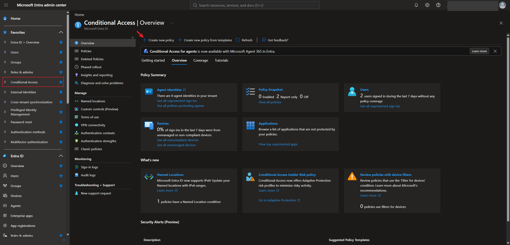

A new policy has two halves:

- **Assignments** is the **if** part: users, target resources, network, and conditions
- **Access controls** is the **then** part: grant and session

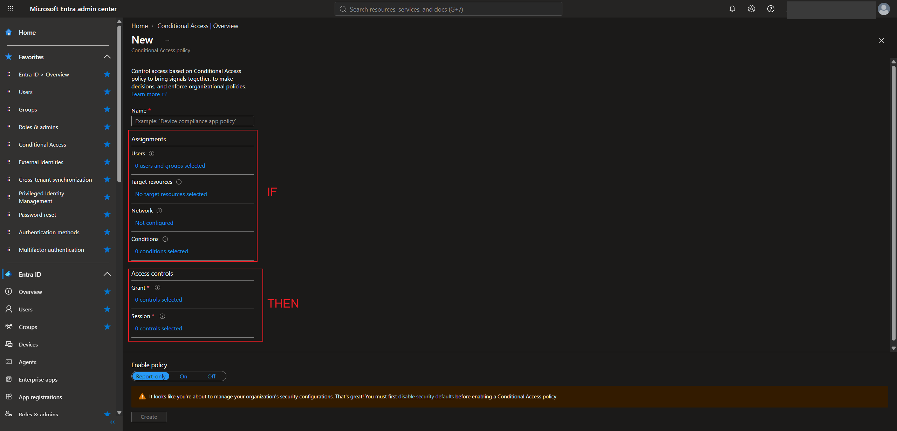

> In a real company you'd create several small policies, one per scenario, instead of one policy that does everything. The course walked through every section in one policy just to show what's there.

### 3.1 Users

This picks who the policy applies to. I chose **Select users and groups** and added one test user, **Kaitlyn Ly**.

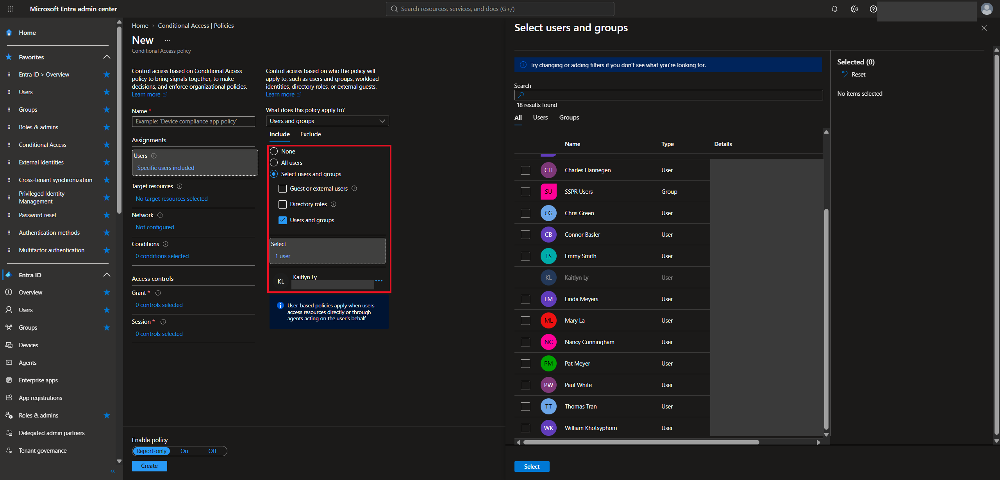

Other options here:

- **All users**, but be very careful with this. If a policy blocks access and you're included, you can **lock yourself out** of the tenant. That's why companies keep **break glass accounts** excluded from most policies.
- **Guest or external users**, for example to make guests go through extra checks
- **Directory roles**, for example stricter rules for admins
- **Exclude**, to leave specific users or groups out

### 3.2 Target resources

This picks which apps the policy protects. I chose **Select resources → Office 365**.

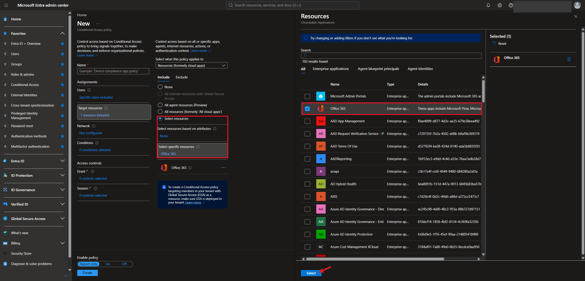

Other options:

| Option | What it covers |
|---|---|
| All resources | Every app, including the admin portals. This is another easy way to lock yourself out |
| Microsoft Admin Portals | Entra, Microsoft 365 admin, the security portals, and the other admin portals |
| Office 365 | Outlook, Teams, SharePoint, and the other Office apps |

You can also **filter resources by custom security attributes**, like only applying the policy to apps tagged with a certain clearance level. I opened the filter to see how it works but didn't keep it in my policy.

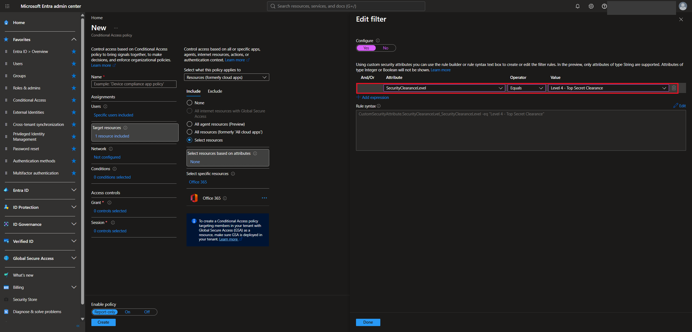

### 3.3 Network

This used to be the **Locations** condition, and Microsoft moved it to its own section. I left it on **Any network or location**.

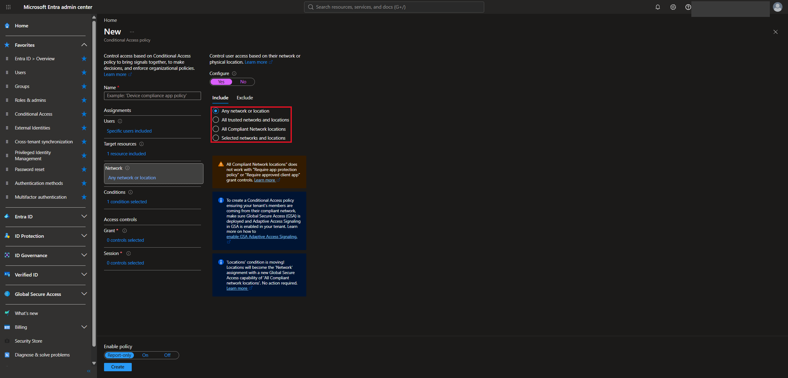

| Option | Meaning |
|---|---|
| Any network or location | Applies from everywhere: home, office, public Wi-Fi, or another country |
| All trusted networks and locations | Applies from locations marked as trusted, like the office's public IP range |
| All Compliant Network locations | Applies to connections verified through Global Secure Access. This needs extra setup |
| Selected networks and locations | Applies only to locations you pick, like specific IP ranges or countries |

### 3.4 Conditions

Conditions narrow down when the policy kicks in. I looked through them but didn't configure any.

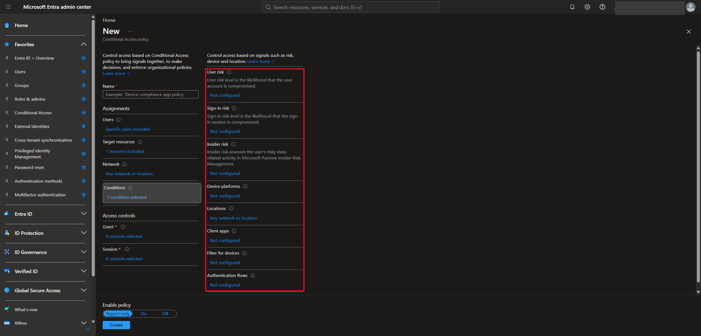

| Condition | What it checks |
|---|---|
| User risk | Is the account likely compromised? For example, leaked credentials |
| Sign-in risk | Does this specific sign-in look suspicious? |
| Insider risk | Has the user shown risky data activity flagged by Microsoft Purview? |
| Device platforms | Windows, macOS, Linux, Android, or iOS |
| Locations | Where the sign-in comes from. This is now handled in the Network section |
| Client apps | Browser, mobile and desktop apps, or legacy authentication clients |
| Filter for devices | Device properties, like name, ownership, or compliance |
| Authentication flows | Specific sign-in flows, like device code flow |

### 3.5 Grant

This is the main **then** part. I chose **Grant access** with **Require multifactor authentication**.

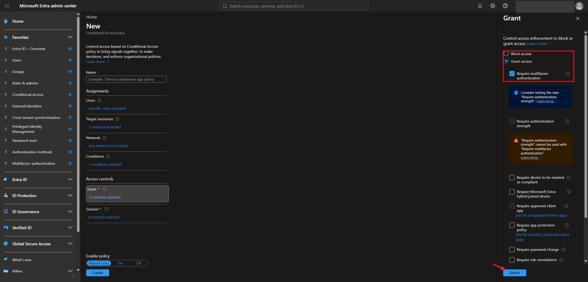

| Control | What it requires |
|---|---|
| Block access | Denies access completely |
| Multifactor authentication | MFA with any allowed method |
| Authentication strength | A specific set of methods, like phishing-resistant MFA. Can't be combined with "Require multifactor authentication" |
| Device marked as compliant | A device that meets the company's compliance rules, usually through Intune |
| Microsoft Entra hybrid joined device | A device joined to both on-prem AD and Entra |
| Approved client app | An approved app. Microsoft is retiring this in favor of app protection policies |
| App protection policy | An app protected by Intune rules, like blocking copy and paste into personal apps |
| Password change | A password reset. Mostly used for risky users |
| Risk remediation | Microsoft's recovery process for a risky account |
| Terms of use | The user has to accept the company's terms (see Task 5) |

At the bottom you pick **Require all the selected controls** or **Require one of the selected controls**.

> The course gave a few lockout examples. Requiring a **compliant device** for all users could block someone who comes back from vacation with a device that's behind on updates. Requiring a **hybrid joined device** for everyone blocks anyone working from a personal device. **Require password change** on a normal policy would make the user reset their password on every sign-in, so it belongs in a policy for risky users only.

### 3.6 Session

Session controls change what the user's session looks like **after** they're let in. I named the policy `SC-300-pol1` and left these all unchecked.

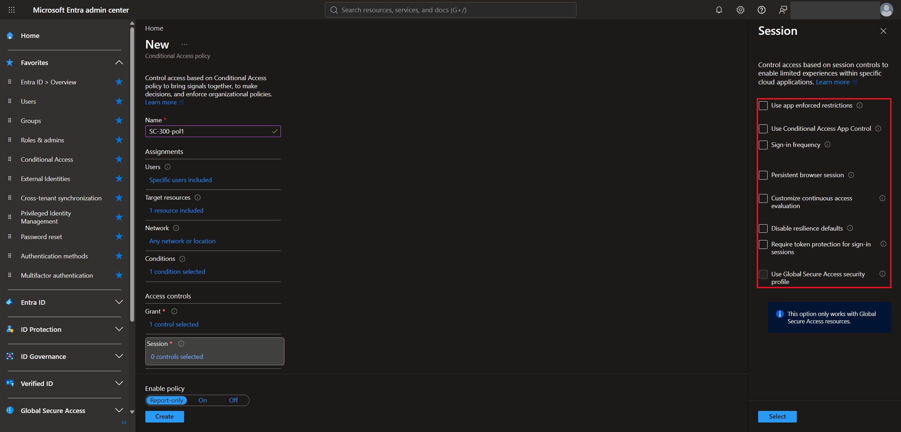

| Session control | What it does |
|---|---|
| Use app enforced restrictions | Lets supported apps like SharePoint limit access, like browser-only with no downloads |
| Use Conditional Access App Control | Uses Defender for Cloud Apps to monitor sessions or block downloads. The policy itself lives in Defender for Cloud Apps |
| Sign-in frequency | How often users have to sign in again, like every 8 hours |
| Persistent browser session | Whether users stay signed in after closing and reopening the browser |
| Customize continuous access evaluation | Lets Entra react in real time if something changes, like the account getting disabled, without waiting up to an hour for the token to expire |
| Disable resilience defaults | Stops Entra from extending sessions during an outage. Users have to wait to sign in again instead |
| Require token protection for sign-in sessions | Binds the sign-in token to the device, so a stolen token can't be replayed somewhere else |
| Use Global Secure Access security profile | Applies network security policies, like web filtering, through Global Secure Access |

> Continuous access evaluation ties back to Lab 8. Disabling an account doesn't end the user's access token right away, and CAE is one way to close that gap.

### 3.7 Enable policy

| Setting | What happens |
|---|---|
| Report-only | The policy logs who it would have applied to, but doesn't actually enforce anything |
| On | The policy is enforced |
| Off | The policy is saved but does nothing |

> Report-only is the safe way to test. You can roll a policy out to a small group, check the logs, and then switch it on.

---

## Task 4 — Named Locations

**Conditional Access → Named locations.** Saving locations here lets you reuse them in any policy, like marking the office as trusted or blocking certain countries.

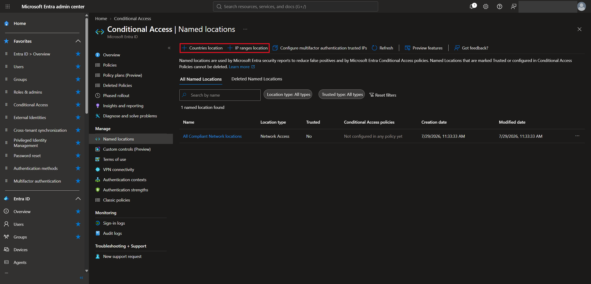

| Type | Example | How Entra identifies it |
|---|---|---|
| Countries location | United States | Public IP geolocation, or GPS through Authenticator if configured |
| IP ranges location | "Bam Co Office" | The office's **public** IP range, not private addresses like `192.168.1.x` |

---

## Task 5 — Terms of Use

**Conditional Access → Terms of use → New terms.** Terms of use make users accept the company's rules before they can open an app.

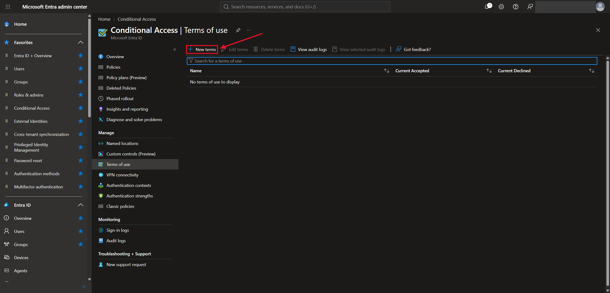

For example, Bam Co could show: *"Company data must not be shared with unauthorized people. Activity may be monitored."*

1. Upload a **PDF** with the terms under **New terms**
2. Add the terms as a **Grant** requirement in a Conditional Access policy
3. Users see an acceptance prompt when they open the protected app
4. **Accept** meets the requirement (other requirements in the policy still apply)
5. **Decline** means they can't get in

You can also make users expand every section before accepting, accept again on every device, or accept again after a set number of days.

---

## Task 6 — Authentication Strengths

**Conditional Access → Authentication strengths.** An authentication strength decides exactly which sign-in methods count for a policy. There are three built-in ones:

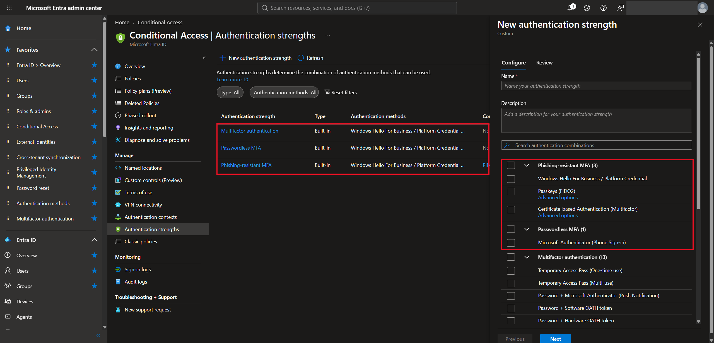

| Strength | Accepted methods include |
|---|---|
| Multifactor authentication | Password + Authenticator push, password + SMS, and everything stronger |
| Passwordless MFA | Authenticator phone sign-in, FIDO2 passkeys, Windows Hello for Business, and certificate-based authentication |
| Phishing-resistant MFA | FIDO2 passkeys, Windows Hello for Business, and certificate-based authentication. Authenticator push and phone sign-in don't count |

**New authentication strength** makes a custom one:

- Give it a name, like "Bam Co Passkey Only"
- Pick which method combinations count. Picking more than one means users can use any of them
- The method also has to be turned on for the user in the tenant's authentication methods policy
- Creating it doesn't enforce anything. You apply it through **Grant → Require authentication strength** in a policy

> For example, if only **Passkeys (FIDO2)** is selected, a password + Authenticator push can't meet the requirement. I used the built-in **Phishing-resistant MFA** strength this way in my [Zero Trust PIM lab](../../labs/lab-03-pim-phishing-resistant-mfa/).

---

## Task 7 — Templates and What If

Two more tools on the Conditional Access page:

- **Create new policy from templates** builds a policy from Microsoft's recommended templates. It's a good way to learn, because you can open the policy afterward and see how each section was set up.
- **What If** tests which policies would apply to a sign-in. You pick a user, an app, and details like device platform or location, and it lists the policies that would and wouldn't apply. It's the main tool for figuring out why someone is getting blocked or why a policy isn't kicking in.

> I didn't take screenshots of What If in this lab, but I used it to validate the policy in my [Zero Trust PIM lab](../../labs/lab-03-pim-phishing-resistant-mfa/).

---

## What I Learned

- Conditional Access is an if/then statement: signals in, then allow, require MFA, or block
- Security defaults have to be turned off before Conditional Access policies can be turned on
- Assignments (users, resources, network, conditions) are the "if", and grant and session controls are the "then"
- Targeting all users or all resources can lock you out, so break glass accounts should be excluded
- Grant controls like compliant device or hybrid joined device can block real users if they're applied too broadly
- Report-only is the safe way to test a policy before turning it on
- Named locations, terms of use, and authentication strengths are built separately and then used inside policies
- What If shows which policies apply to a sign-in, which makes troubleshooting a lot easier

---

> **Note:** Screenshots are from my personal lab tenant. My admin account, the tenant name, and user sign-in names have been redacted. Kaitlyn Ly and the other users shown are fictional test accounts for a made-up company. The app IDs in the resources list are Microsoft's standard first-party app IDs, not tenant-specific.

[← Back to Entra ID Labs](../)
