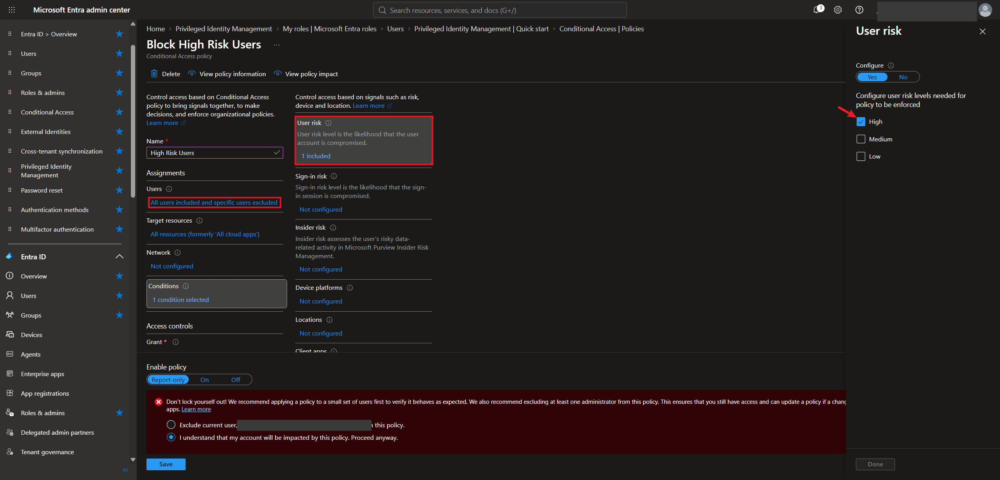
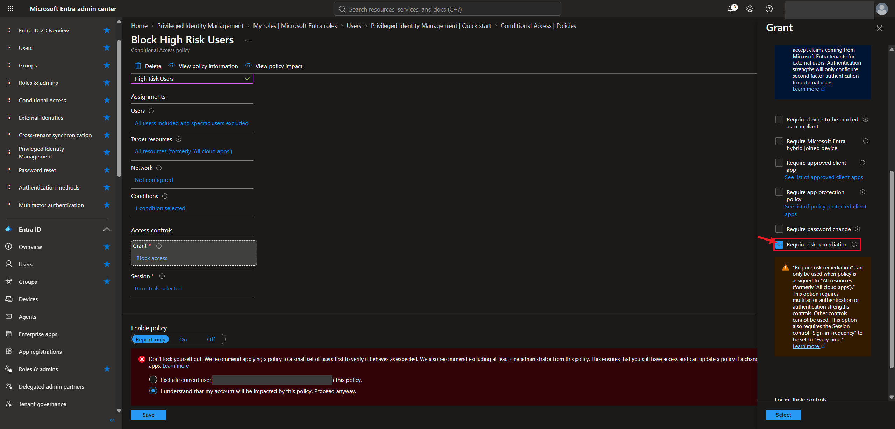
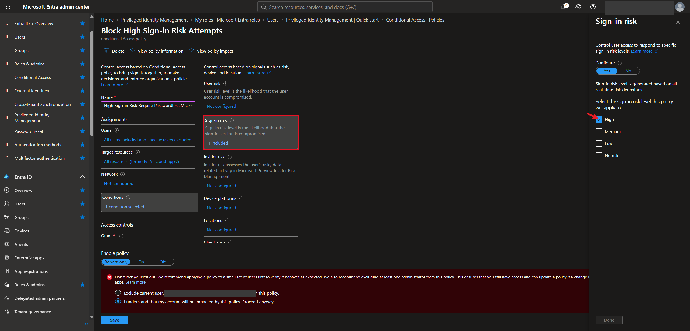
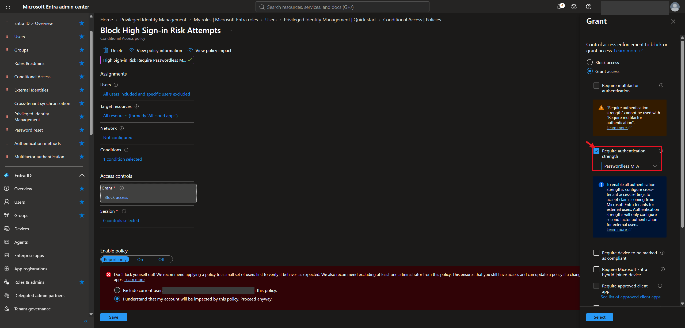
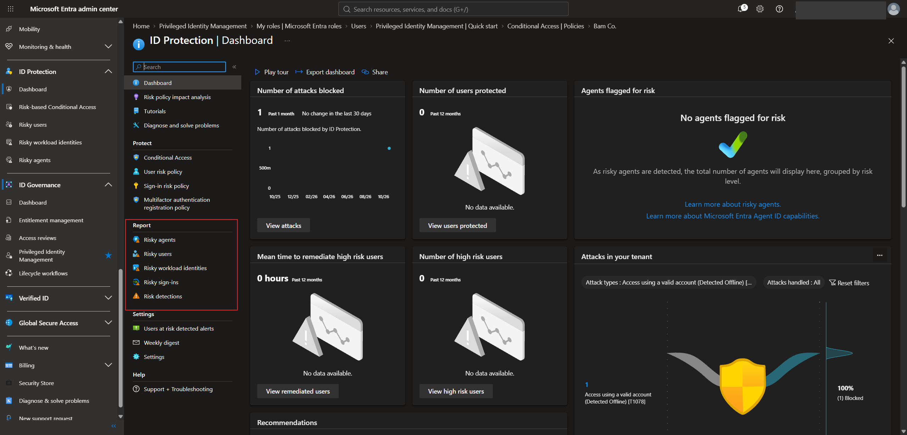

# Lab 10 — Microsoft Entra ID Protection: Risk Detections, Risk Policies, and Reports

## Overview

This is my tenth SC-300 lab. I did it in my own Microsoft Entra tenant for the made-up company **Bam Co.**

**Microsoft Entra ID Protection** watches sign-ins and accounts for signs of compromise and gives them a risk level of **low, medium, or high**. Those risk levels can then be used in Conditional Access, so a risky sign-in gets challenged and a risky user has to fix their account before getting back in.

Most of this lab was reading about the roles, licensing, and the different risk detections. The hands-on part was building two risk-based Conditional Access policies, one for **user risk** and one for **sign-in risk**, and looking at the ID Protection reports.

The big takeaway is that sign-in risk and user risk are different problems with different fixes. A risky sign-in can usually be cleared with a strong MFA prompt, but a risky user probably has a leaked password, so they need to secure the account.

## Objectives

- Know which roles can view, manage, and act on ID Protection
- Understand the license needed
- Understand the difference between sign-in risk and user risk, and the common detections for each
- Create a Conditional Access policy for high user risk
- Create a Conditional Access policy for high sign-in risk
- Find the risk reports in the ID Protection dashboard

## Tools & Technologies

| Category | Tools |
|---|---|
| Identity platform | Microsoft Entra ID P2 |
| Portals | Microsoft Entra admin center |
| Features | ID Protection, risk detections, risk-based Conditional Access, authentication strengths, risk reports |
| Course | Microsoft Learn: SC-300 Identity and Access Administrator |

---

## Task 1 — Roles and Licensing

### 1.1 Roles

ID Protection is split across several roles, so it's a good place to think about **least privilege**: give each person only the role they need.

| Role | Can do | Can't do |
|---|---|---|
| Global Reader | Read-only access to ID Protection | Make any changes |
| User Administrator | Reset user passwords | Read or write to ID Protection |
| Conditional Access Administrator | Create policies that use user or sign-in risk as a condition | Read or write to the legacy ID Protection policies |
| Security Reader | View all ID Protection reports and the overview | Change policies, reset passwords, configure alerts, give feedback on detections |
| Security Operator | View all reports, dismiss user risk, confirm a sign-in is safe, confirm a compromise | Change policies, reset passwords, configure alerts |
| Security Administrator | Full access to ID Protection | Reset a user's password |

> Even a **Global Administrator** only gets read access to ID Protection by default. The Security Administrator is the one who sets it up, but they can't reset passwords. That's the User Administrator's job.

### 1.2 License

ID Protection needs **Microsoft Entra ID P2**. It isn't available with the free tier or P1.

---

## Task 2 — Sign-in Risk vs User Risk

|  | Sign-in risk | User risk |
|---|---|---|
| Question | "Is this particular sign-in unauthorized?" | "Is this user's account compromised?" |
| Scope | One sign-in attempt | The whole user account |
| Example | A sign-in from an anonymous IP address | The user's real password shows up in a credential leak |
| Usual fix | Prove it's you with strong MFA | Secure the account, like resetting the password |

Detections are either **real-time** (caught during the sign-in) or **offline** (found later). Most are **premium**, which means you need P2 to see the full details.

### 2.1 Common sign-in risk detections

| Detection | What it means |
|---|---|
| Anonymous IP address | The sign-in came through Tor or an anonymizing VPN |
| Atypical travel | Sign-ins from far-apart places with unusual timing for that user |
| Impossible travel | Activity from two places too far apart to travel between in that time |
| New country | Activity from a country the organization rarely or never sees |
| Malicious IP address | The source IP is known for malicious activity |
| Password spray | The attacker guessed the password by trying common passwords across many accounts |
| Suspicious MFA authentication approval | Signs that the user was tricked into approving an MFA prompt |
| Anomalous token | The token's lifetime or use looks unusual, which could mean it's being replayed |
| Unfamiliar sign-in properties | The IP, device, browser, or location is different from the user's history |
| Suspicious inbox forwarding or manipulation rules | Inbox rules that forward mail outside the company or hide messages |
| Verified threat actor IP | The sign-in came from an IP tied to known nation-state or cybercrime groups |
| Microsoft Entra threat intelligence | The activity matches known attack patterns |
| Admin confirmed user compromised | An admin manually marked the account as compromised |

> The course gave a good example of impossible travel triggering by accident. If you're signed in from the UK and then sign in to a service from inside a virtual machine hosted in the US, it can look like you jumped across the ocean in minutes. That's why many of these start as **low** risk.

### 2.2 Common user risk detections

| Detection | What it means |
|---|---|
| Leaked credentials | The user's username and password were found in a leak, like on the dark web, and the password is still valid |
| Attacker in the Middle | The sign-in went through a malicious proxy that could steal credentials and tokens |
| Anomalous user activity | Unusual admin-type behavior, like suspicious directory changes |
| Anomalous token (user) | Unusual session or refresh token behavior that could mean replay |
| Possible attempt to access Primary Refresh Token (PRT) | Defender for Endpoint saw a possible attempt to steal the token used for device single sign-on |
| Suspicious API traffic | Unusual Microsoft Graph requests that look like an attacker mapping out the directory |
| Suspicious credential addition | A new sign-in method was added under suspicious circumstances, which could give an attacker ongoing access |
| Suspicious sending patterns | Defender for Office 365 saw suspicious outgoing email |
| User reported suspicious activity | The user denied an MFA prompt and reported it as suspicious |
| Microsoft Entra threat intelligence (user) | The user's activity matches known attack patterns |

---

## Task 3 — Policy for High-Risk Users

ID Protection has its own legacy **user risk policy** and **sign-in risk policy**, but you only get one of each and can't add extra conditions like location. Microsoft recommends building these in **Conditional Access** instead, so that's what I did.

### 3.1 Assignments

I created a Conditional Access policy for high-risk users:

- **Users:** all users, with specific users excluded so a break glass account can't get locked out
- **Target resources:** all resources
- **Conditions → User risk:** **High**

### 3.2 Grant

In **Grant**, I selected **Require risk remediation**. This lets the user fix the problem themselves instead of being blocked until an admin steps in.

> The warning in the screenshot explains the rules for this control. It only works when the policy targets **all resources**, it has to be paired with MFA or an authentication strength, and it needs **Sign-in frequency** set to **Every time**.

I left the policy in **Report-only**.

---

## Task 4 — Policy for High Sign-in Risk

### 4.1 Assignments

Same setup, but this time the condition is **Sign-in risk → High**.

### 4.2 Grant

In **Grant**, I chose **Grant access** with **Require authentication strength → Passwordless MFA**. A user with a risky sign-in can still get in, but only if they prove it's them with a passwordless method.

> "Require authentication strength" can't be used together with "Require multifactor authentication". You pick one or the other.

This policy is also in **Report-only**.

### 4.3 Block or remediate?

Blocking both high-risk sign-ins and high-risk users is a valid strict approach, but then an admin has to investigate and restore access every time. Microsoft's usual recommendation is to let users fix it themselves:

| Risk | Recommended response |
|---|---|
| Medium or high sign-in risk | Require MFA to verify identity |
| High user risk | Require risk remediation to secure the account |

> It's better to keep user risk and sign-in risk in **separate policies**, because the fix for each one is different.

---

## Task 5 — Investigating Risk Reports

**ID Protection → Dashboard.** The **Report** section has the places to investigate risk:

| Report | What it shows |
|---|---|
| Risky users | Users Entra thinks may be compromised, with their risk level and history |
| Risky sign-ins | Individual sign-ins that were flagged |
| Risk detections | Every detection that was raised |
| Risky workload identities | Risky service principals and apps |
| Risky agents | Risky AI agent identities |

My lab tenant is quiet, so most of the dashboard says "No data available." It did show one blocked attack in the past month.

From **Risky users**, an admin can act on a user directly:

| Action | Who can do it |
|---|---|
| Reset password | User Administrator (it's grayed out for the security roles) |
| Confirm user compromised | Security Administrator, Security Operator |
| Confirm user safe / Dismiss user risk | Security Administrator, Security Operator |
| Block user | Security Administrator, Security Operator |

> If a policy blocks a risky user, dismissing the user's risk here is how a Security Operator or Security Administrator lets them back in.

### How long the data is kept

| Data | How long |
|---|---|
| Normal Entra sign-in logs | 30 days |
| Risky sign-ins (with P2) | 90 days |
| Risky users and their risk history | No time limit |

> To keep risky sign-ins longer than 90 days, you have to export them, for example to a storage account or another security tool.

---

## What I Learned

- ID Protection needs Entra ID P2, and its permissions are split across several roles, which helps with least privilege
- The Security Administrator manages ID Protection but can't reset passwords, and a Global Administrator only gets read access by default
- Sign-in risk is about one sign-in, and user risk is about the whole account, so they need different fixes
- Risk-based policies are better built in Conditional Access than in the legacy ID Protection policies, because you get more conditions and more than one policy
- Require risk remediation only works on all resources and needs Sign-in frequency set to Every time
- Risky sign-ins are kept for 90 days with P2, while risky users stay until they're dealt with

---

> **Note:** Screenshots are from my personal lab tenant. My admin account and the tenant name have been redacted. The policy names in the screenshots are my own test policies for a made-up company.

[← Back to Entra ID Labs](../)
