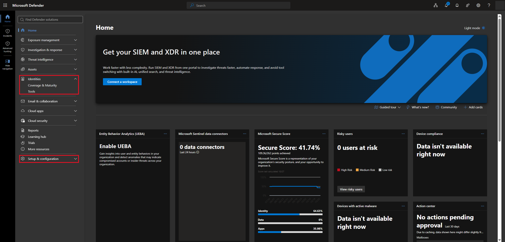
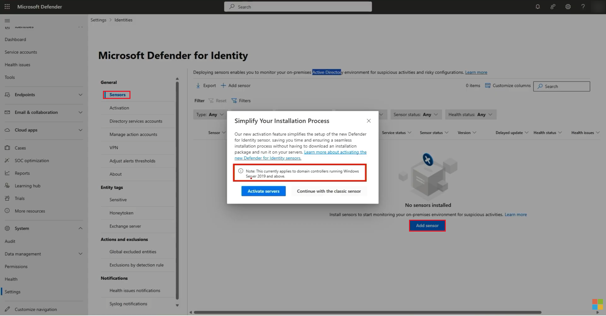
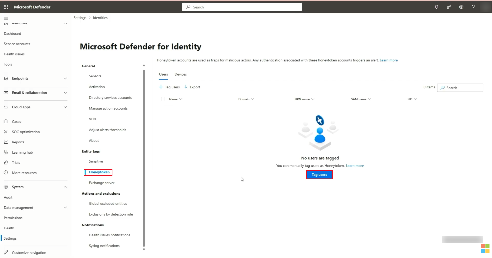

# Lab 11 — Microsoft Defender for Identity: Threat Detection, Sensors, and Honeytokens

## Overview

This is my eleventh SC-300 lab. It was a short one, mostly concepts, plus a look around the **Microsoft Defender portal** in my own tenant for the made-up company **Bam Co.**

**Microsoft Defender for Identity** protects identities in **on-premises Active Directory**. It isn't for cloud-only Entra users. It watches what users and devices do on the domain, learns what normal looks like, and raises alerts when something looks like an attack, like an intruder quietly moving between systems with a stolen account.

The big takeaway is that Defender for Identity is managed from the cloud but needs a **sensor** running on-prem, on a server that can see Active Directory. I don't have a sensor connected yet, so this write-up covers how it works and where things are set up.

## Objectives

- Understand what Defender for Identity protects and how it detects threats
- Understand the stages of an attack (the kill chain) that it looks for
- Find Defender for Identity in the Defender portal
- Understand the two ways to install a sensor
- Understand honeytokens and why you'd tag them

## Tools & Technologies

| Category | Tools |
|---|---|
| Security platform | Microsoft Defender portal |
| Features | Microsoft Defender for Identity, sensors, entity tags, honeytokens |
| Related | On-premises Active Directory, domain controllers, AD FS |
| Course | Microsoft Learn: SC-300 Identity and Access Administrator |

---

## Task 1 — How Defender for Identity Works

### 1.1 What it does

- **Watches users and devices continuously**, looking for things like suspicious sign-ins, unusual resource access, and abnormal admin actions
- **Learns normal behavior** for each user and device, then flags anything that doesn't fit
- **Protects credentials** stored in Active Directory
- **Recognizes specific attack techniques**, like pass-the-hash, reconnaissance, lateral movement, and privilege escalation
- **Raises real-time alerts** with context and a timeline, so the security team can investigate quickly
- **Catches rogue on-prem resources**, like a fake DNS server pretending to be a normal one

### 1.2 How the pieces connect

```text
 On-premises                                  Cloud
┌─────────────────────────┐            ┌──────────────────────────────┐
│ Domain controller       │            │ Microsoft Defender           │
│   + Defender for        │──activity─►│ for Identity                 │
│     Identity sensor     │   alerts   │            │                 │
│                         │  identity  │            ▼                 │
│ AD FS server            │  metadata  │ Microsoft Defender portal    │
│   + sensor              │            │ (alerts, incidents, reports) │
└─────────────────────────┘            └──────────────────────────────┘
```

The sensors read Active Directory activity, network traffic, and Windows events on the servers they're installed on, and send what they find up to the cloud.

> Even though you configure everything from the cloud portal, the sensor has to run **on-prem** on a server with access to Active Directory. Without one, Defender for Identity has nothing to watch.

### 1.3 The kill chain

Defender for Identity is tuned to spot attackers at each stage of an attack. Here's what each stage could look like against Entra and AD:

| Stage | Example |
|---|---|
| Reconnaissance | Finding employee usernames and figuring out who the admins are |
| Initial access | Signing in with a stolen password or session token |
| Persistence | Adding an authentication method or app credential to keep access |
| Privilege escalation | Getting a powerful role, like Global Administrator |
| Lateral movement | Using the compromised account to reach more apps and resources |
| Objective | Stealing data, changing settings, or disrupting services |

> Lateral movement is the scary one. An attacker using a real account blends in with normal activity, which is exactly what behavior-based detection is meant to catch.

---

## Task 2 — The Defender Portal

Defender for Identity lives in the **Microsoft Defender portal** at `security.microsoft.com`, not the Entra admin center.

The **Identities** section is where hybrid and on-prem identities show up once a sensor is connected, along with how secure they are and recommendations to improve them. Defender for Identity's settings are under **Setup & configuration → Settings → Identities**.



> My tenant doesn't have an on-prem Active Directory connected to Defender for Identity yet, so the Identities section has no hybrid or on-prem users to show.

---

## Task 3 — Installing a Sensor

**Settings → Identities → General → Sensors → Add sensor.** Clicking **Add sensor** opened a prompt about the newer activation method, which only works on domain controllers running Windows Server 2019 and above.



There are two ways to get a sensor onto a server:

| Option | When to use it | How it works |
|---|---|---|
| Activate servers (new sensor) | Domain controllers running **Windows Server 2019 or later** | Turn the sensor on from the portal. No installer to download |
| Classic sensor | Older Windows Server versions | Download an installer and an **access key**, then run the installer on the server and enter the key |

Once a sensor is installed and connected, the server shows up in the Sensors list and Defender for Identity starts tracking activity from that Active Directory.

> My [Hybrid Identity lab](../../labs/lab-01-hybrid-identity-ad-entra-connect/) has a domain controller running Windows Server 2022, so it would qualify for the newer activation method.

---

## Task 4 — Honeytokens

**Settings → Identities → Entity tags → Honeytoken.** No accounts are tagged yet, and **Tag users** is where you'd add one.



A **honeypot** is a trap: fake users or devices set up on purpose to attract attackers, so the security team can watch what they do and learn from it. A **honeytoken** is one of those decoy accounts or devices.

Tagging them in Defender for Identity matters for two reasons:

- Defender for Identity knows they're decoys, so it doesn't treat them like normal accounts
- **Any sign-in with a honeytoken account triggers an alert**, because no real person should ever use it

You can tag **users** or **devices**. The same Entity tags section also has a **Sensitive** tag for accounts and devices that need extra attention, like admin accounts.

---

## What I Learned

- Defender for Identity protects identities in on-prem Active Directory, not cloud-only Entra users
- It learns normal user and device behavior and alerts on anything that doesn't fit
- It's tuned to catch attacks at each stage of the kill chain, including lateral movement with a real account
- It's managed in the Defender portal, but needs a sensor on-prem on a server that can see Active Directory
- Domain controllers on Windows Server 2019 or later can activate the new sensor from the portal, and older servers use the classic installer and access key
- Honeytokens are decoy accounts or devices, and any sign-in with one triggers an alert

---

> **Note:** Screenshots are from my personal lab tenant, with my account initials redacted. Bam Co. is a made-up company.

[← Back to Entra ID Labs](../)
