# Lab 12 — Azure Roles and Managed Identities

## Overview

This is my twelfth SC-300 lab. I did it in my own Azure subscription and Microsoft Entra tenant for the made-up company **Bam Co.**

So far these labs have been about **Entra roles**, like Global Administrator. This one moves over to **Azure roles**, which control what someone can do to Azure resources like virtual machines and databases. I looked at the built-in roles, walked through building a custom role, and checked the setting that lets a Global Administrator take control of Azure subscriptions.

The second half is about **managed identities**, which give an Azure resource its own identity in Entra so it can authenticate without a stored username and password. I created a user-assigned managed identity and went through assigning it to a virtual machine.

The big takeaway is that Entra roles and Azure roles are separate systems. Being a Global Administrator doesn't automatically give you access to Azure resources, and being an Owner in Azure doesn't give you any power in Entra.

## Objectives

- Understand the difference between Entra roles and Azure roles
- Understand the four levels of scope in Azure
- Know what Owner, Contributor, Reader, and User Access Administrator can do
- Choose the right role and scope for a scenario
- Read a role definition in JSON and walk through building a custom role
- Understand how a Global Administrator can take control of Azure subscriptions
- Understand system-assigned and user-assigned managed identities
- Create a user-assigned managed identity and assign it to a virtual machine

## Tools & Technologies

| Category | Tools |
|---|---|
| Identity platform | Microsoft Entra ID |
| Cloud platform | Microsoft Azure |
| Portals | Azure portal, Microsoft Entra admin center |
| Features | Azure RBAC, Access control (IAM), custom roles, managed identities |
| Course | Microsoft Learn: SC-300 Identity and Access Administrator |

---

## Task 1 — Azure RBAC Basics

### 1.1 Entra roles vs Azure roles

|  | Entra roles | Azure roles (RBAC) |
|---|---|---|
| Controls | Identity stuff, like users, groups, and tenant settings | Azure resources, like VMs, databases, and storage |
| Applies at | The tenant | A scope you choose (see below) |
| Example | Global Administrator | Owner |

> A regular Entra user can be an Owner in Azure, and a Global Administrator can have no access to Azure resources at all. The two only connect through one setting, which I cover in Task 4.

### 1.2 Scope

Scope decides **who gets access and at what level**. Azure has four levels, and access given at one level is inherited by everything under it.

```text
Management groups
      │
      ▼
Subscriptions
      │
      ▼
Resource groups
      │
      ▼
Resources (VMs, machine learning, databases)
```

### 1.3 The general roles

| Role | What it can do | What it can't do |
|---|---|---|
| Owner | Perform any action, including assigning roles to other people | Nothing is off limits |
| Contributor | Perform any action on resources, like create, edit, and delete | Assign roles or change permissions |
| Reader | View resources | Make any changes |
| User Access Administrator | See all resources within its scope and grant RBAC permissions | Make changes to the resources themselves |

Least privilege applies here too. Say I own a VM and want a teammate to help manage it. Owner would be too much, since they could change the permissions and even remove me. **Contributor** lets them do the work but not touch permissions.

### 1.4 Picking the right role and scope

The course walked through a scenario like this one:

```text
Subscription 1
└── RG1
    ├── VM1
    ├── VM2
    ├── VM3
    ├── Databases
    └── App service
```

**Scenario:** a teammate needs to manage all the VMs in RG1.

| Option | Result |
|---|---|
| Contributor on each VM, one at a time | Works, but it's slow and a lot of admin work |
| Contributor on RG1 | Quick, but they also get access to the databases and app service in RG1 |
| **Virtual Machine Contributor on RG1** | They can manage every VM in RG1 and can't touch anything else |

> This was the main thing I wrote down from this section. Assigning a role at the resource group level gives access to **everything** in that group, so be careful with general roles there. A specific role is the better fit.

**Scenario:** the only Owner goes on vacation, nobody else can change permissions, and a new project manager needs access. Contributors can't help, since they can't assign roles. Someone with **User Access Administrator** can give the project manager the role they need.

---

## Task 2 — Looking at Roles in the Portal

**Subscription → Access control (IAM).** The IAM page is available at each scope: management groups, subscriptions, resource groups, and resources. **Check access** shows what I have on this subscription, which is **Owner**.

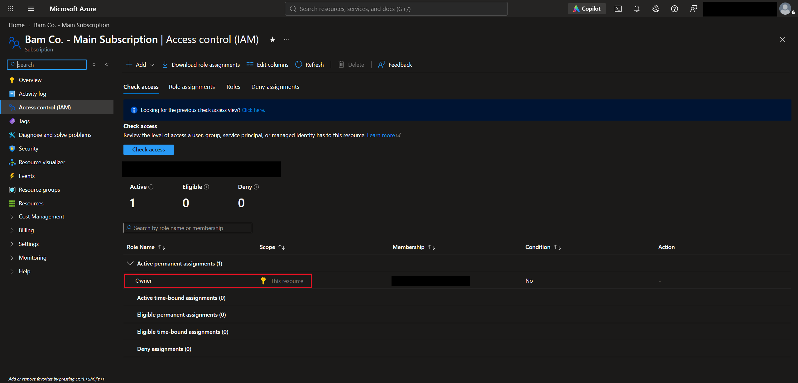

The **Roles** tab lists every built-in role. Owner, Contributor, and Reader are at the top as the general roles. Below them are the more specific ones, like Virtual Machine Contributor.

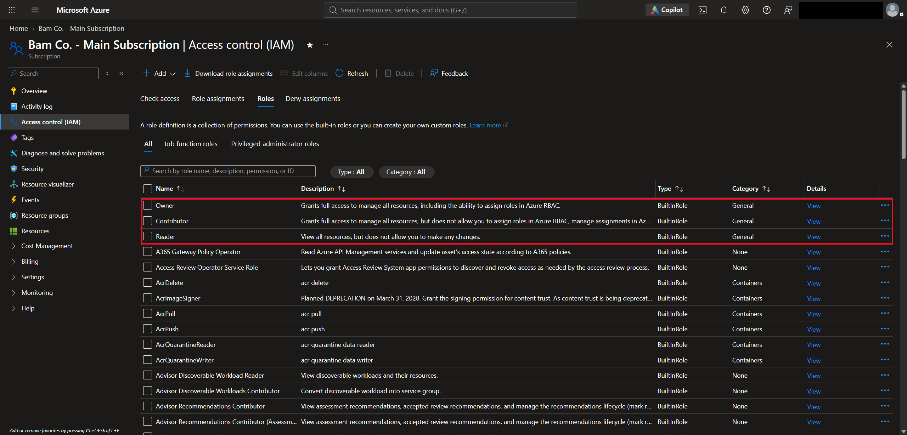

Clicking **View** on a role shows what it can do, and the **JSON** tab shows the definition.

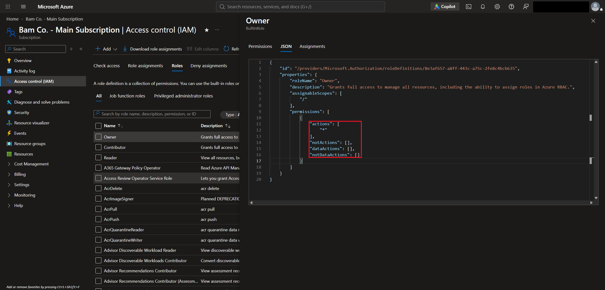

| JSON field | What it means |
|---|---|
| `actions` | What the role can do. `*` means everything |
| `notActions` | What's taken away from `actions`. It's empty for Owner, so there are no limits |
| `assignableScopes` | Where the role can be assigned. `/` means the root, so everywhere |

---

## Task 3 — Building a Custom Role

If no built-in role fits, you can make your own. **Access control (IAM) → Add → Add custom role.**

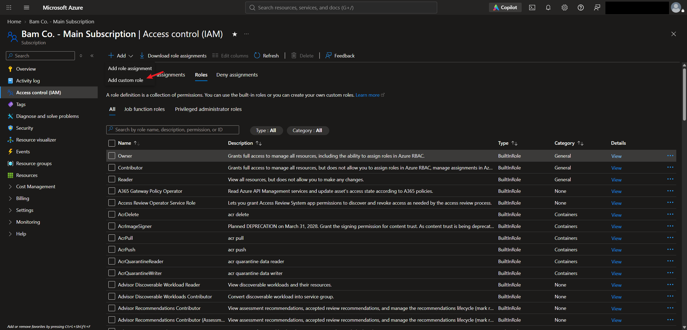

### 3.1 Basics

I named the role **Special Resource Admin**, gave it a description, and chose **Start from scratch**. You can also **clone a role** that's close to what you need, or **start from a JSON file**.

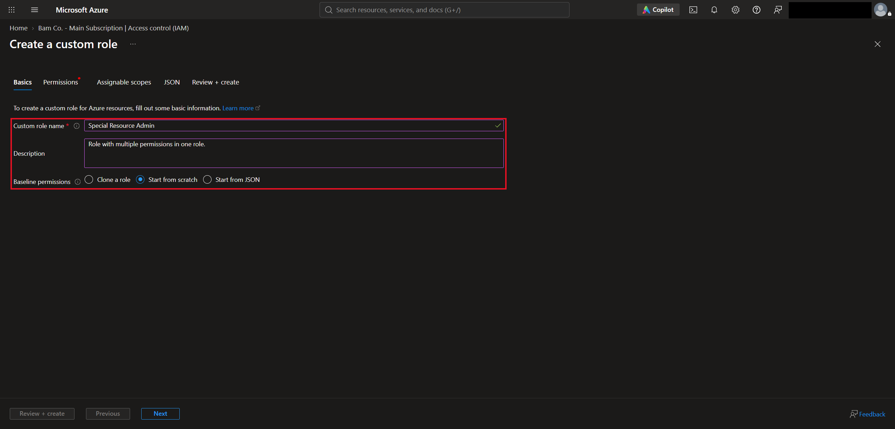

### 3.2 Permissions

**Add permissions** lets you search by resource provider. I picked four from **Microsoft.Advisor** as an example.

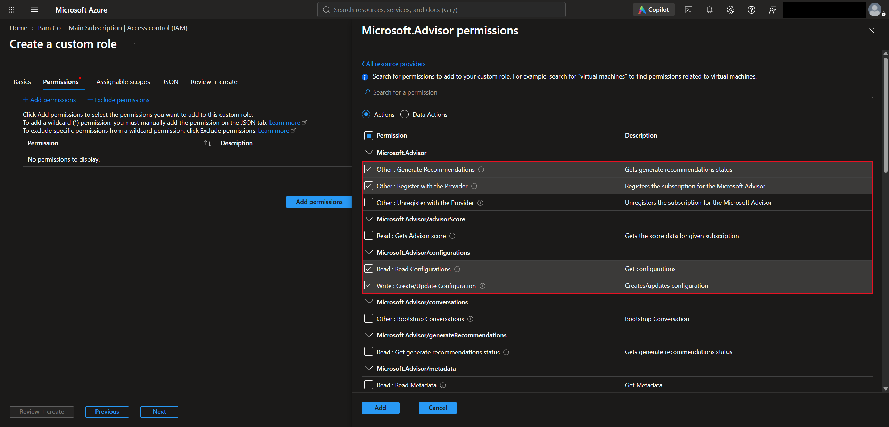

### 3.3 Assignable scopes

This sets where the role can be assigned. I left it on my subscription.

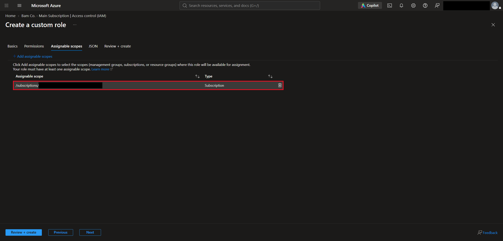

### 3.4 JSON

The **JSON** tab shows the finished role in the same format as the built-in ones, with the four permissions listed under `actions`.

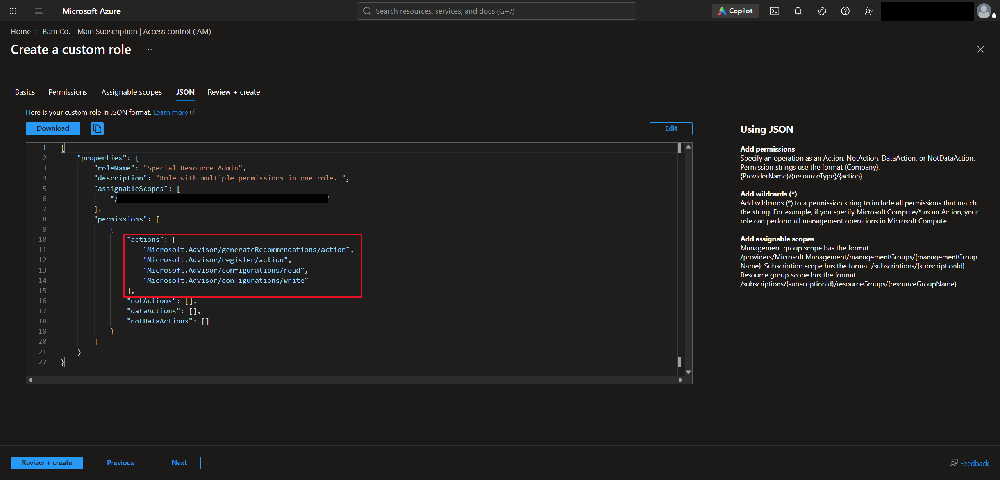

The last tab, **Review + create**, shows a summary and has the **Create** button.

---

## Task 4 — Global Administrator and Azure Resources

A Global Administrator has no special access to Azure resources by default. There's one setting that changes that.

**Entra ID → Overview → Properties → Access management for Azure resources.**

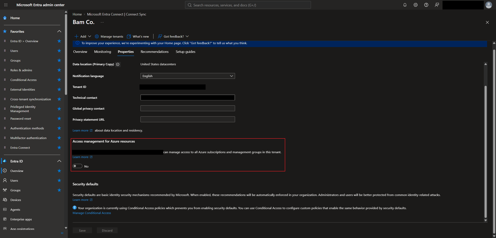

When it's set to **Yes** and saved:

- You get **User Access Administrator** at the **root scope (`/`)**, which covers all subscriptions and management groups in the tenant
- You can then assign Azure roles, including Owner, to yourself or others
- It doesn't make you Owner or let you change VMs directly. You have to assign yourself a role that does

For example, a Global Administrator who can't get into a subscription can turn this on, assign themselves Owner on that subscription, and manage its resources.

> This is how a Global Administrator could take over any subscription, which is another reason to protect that role. I left the toggle on **No**. If you do use it, the course says to remove the role when you're done.

---

## Task 5 — Managed Identities

### 5.1 The problem

Say someone needs to sign in to a Windows VM. The usual way is a local admin username and password, but if 20 admins need access, you end up sharing that password over email or chat, which isn't secure.

The better way is to sign in with **Entra**, since the user is already authenticated there. But Entra needs to know **who the VM is** first, and by default it's just a resource with no identity. A managed identity fixes that.

```text
Without a managed identity:
  User ──► local admin username + password ──► VM

With a managed identity:
  User ──► signed in to Entra ID ──► Entra knows the VM's identity ──► VM
```

The same idea works between resources. If an app needs to reach a database, and both have managed identities, they can authenticate without anyone creating or sharing a password.

> Signing in to a VM with Entra also needs an RBAC role on the VM, like **Virtual Machine Administrator Login** or **Virtual Machine User Login**. The managed identity gets the VM known to Entra, and the role decides what the user is allowed to do.

### 5.2 Two types

| Feature | System-assigned | User-assigned |
|---|---|---|
| Created | Turned on directly on an Azure resource | Created as a separate Azure resource |
| Used by | Only the resource it belongs to | One or more supported resources |
| Lifecycle | Tied to its resource | Managed independently |
| Resource deleted? | The identity is deleted automatically | The identity stays |

A user-assigned identity is useful when a resource comes and goes. If a VM gets deleted and rebuilt, the same identity can be assigned to the new one.

Managed identities don't cost extra, and you never see or manage the credentials yourself.

---

## Task 6 — Creating and Assigning a Managed Identity

### 6.1 Create the identity

**Managed Identities → Create.**

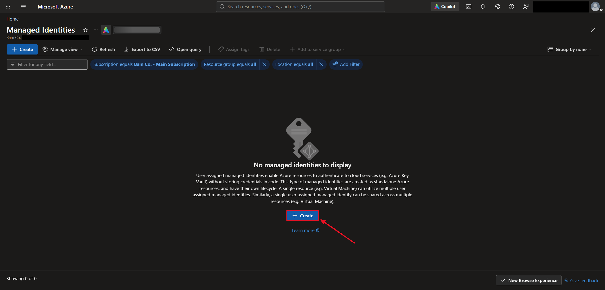

I created a user-assigned identity named **MI1** in a new resource group, **SC-300demo**.

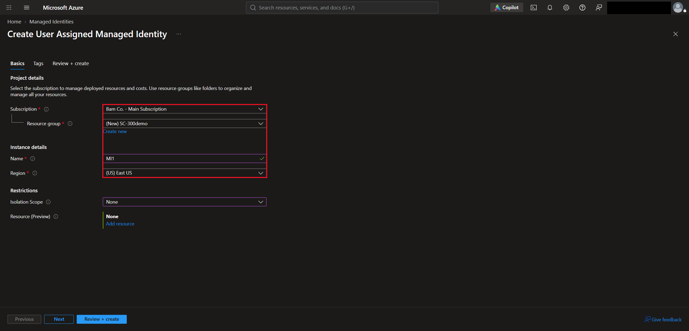

### 6.2 Assign it to a VM

**Virtual machine → Security → Identity → User assigned → Add user assigned managed identity.** My test VM is named `sc300-demo`.

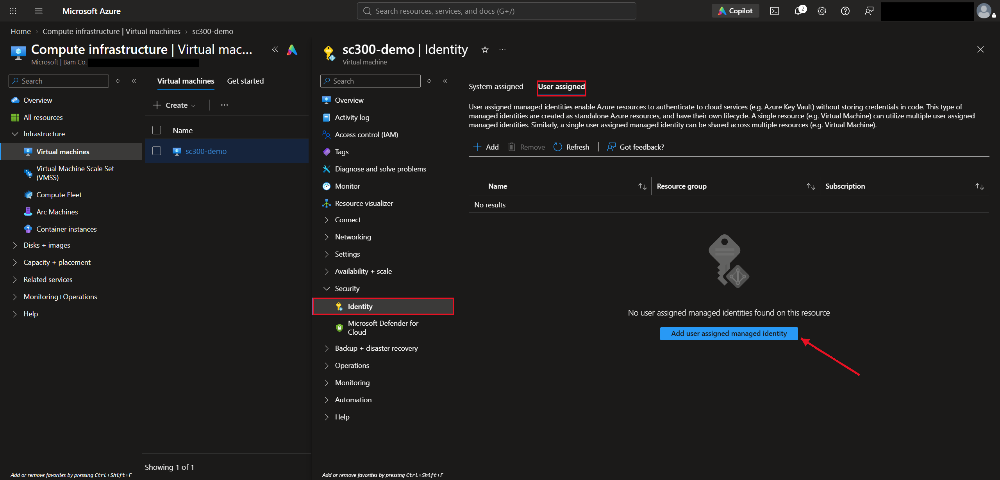

In the panel, I checked **MI1** and clicked **Add**.

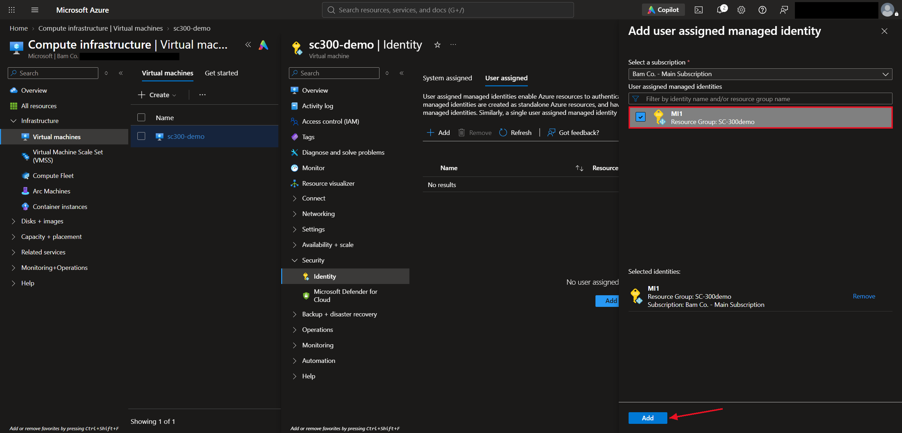

> The **System assigned** tab on the same page is where you'd turn on a system-assigned identity instead. Web apps and other resources have the same **Identity** page.

---

## What I Learned

- Entra roles and Azure roles are separate. Entra roles cover identity, and Azure roles cover resources
- Azure access is set at a scope: management group, subscription, resource group, or resource
- Owner can do everything, Contributor can do everything except assign roles, and Reader can only look
- User Access Administrator can grant access but can't change the resources themselves
- A general role on a resource group applies to everything in it, so a specific role like Virtual Machine Contributor is often the better choice
- If no built-in role fits, you can clone one, start from scratch, or start from JSON
- A Global Administrator has no Azure access by default, but can turn on a setting to get User Access Administrator at the root scope
- Managed identities let resources authenticate without stored passwords
- A system-assigned identity is deleted with its resource, and a user-assigned identity stays and can be reused

---

> **Note:** Screenshots are from my personal lab tenant. My name, admin account, email, tenant domain, tenant ID, and subscription ID have been redacted. Bam Co. is a made-up company, and the role and identity names are my own test resources.

[← Back to Entra ID Labs](../)
