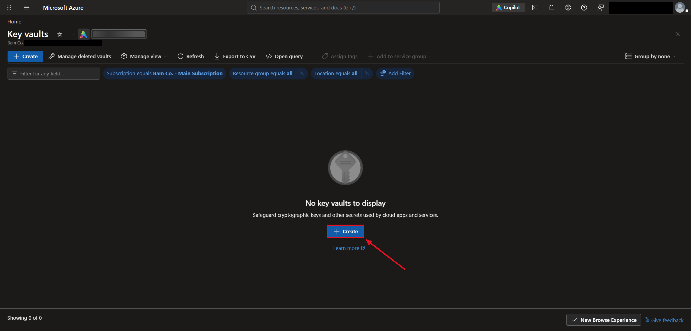
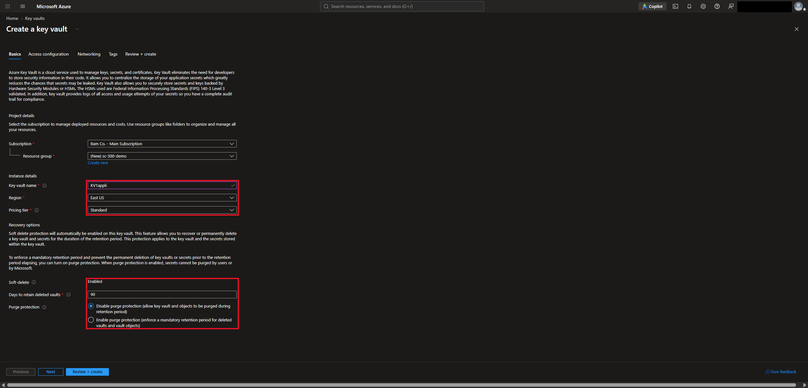
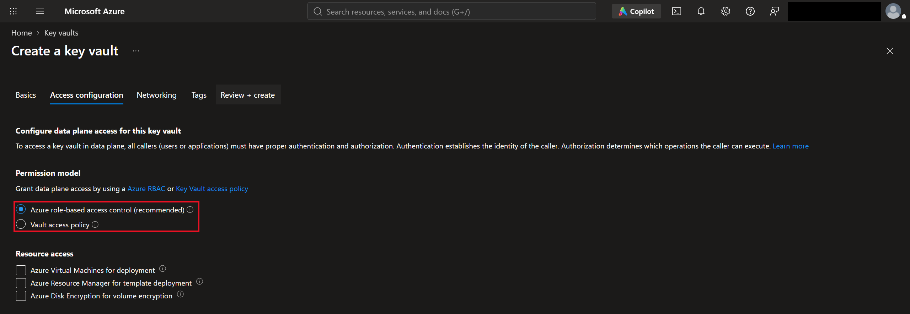
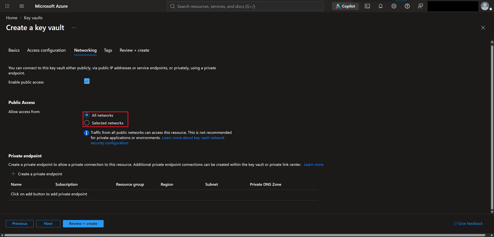
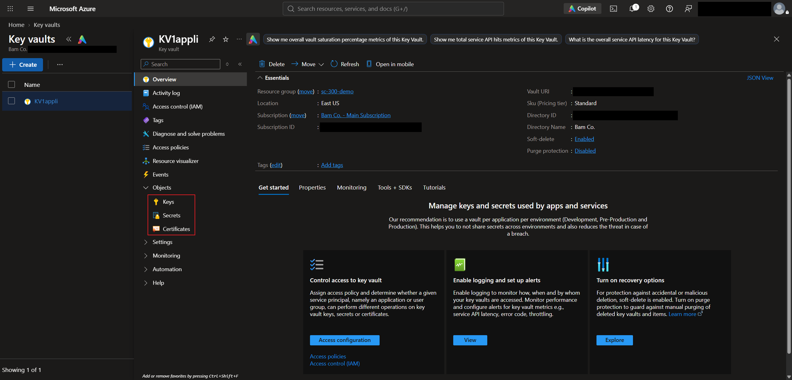
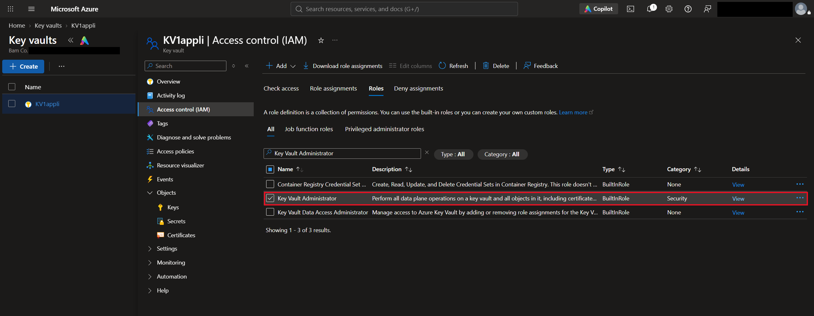
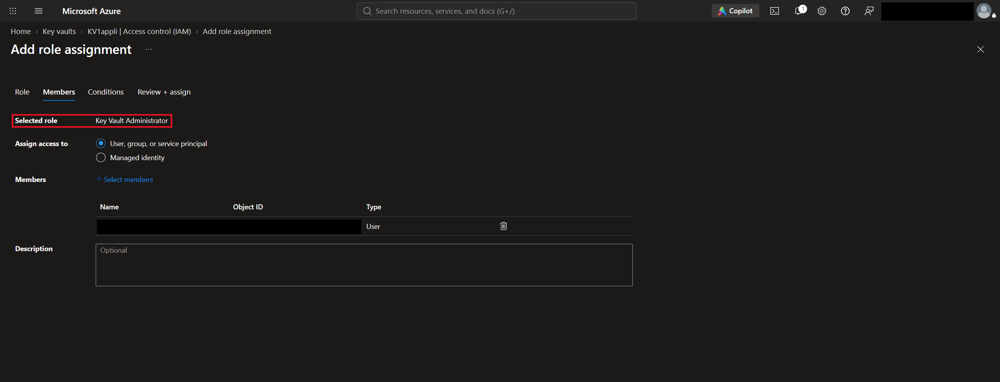
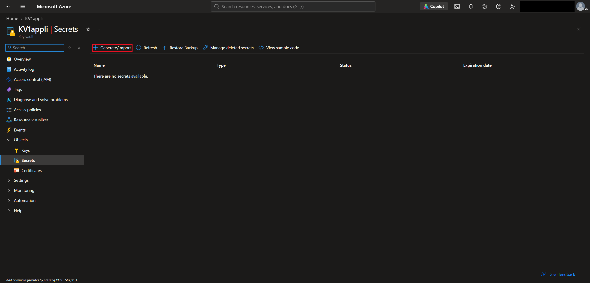
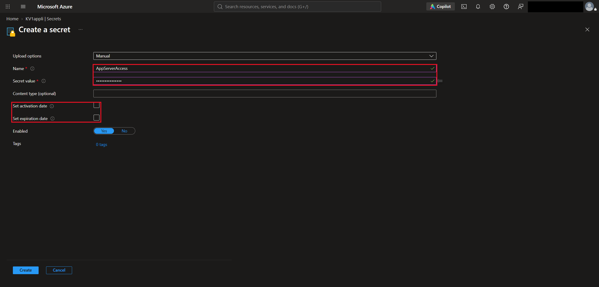

# Lab 13 — Azure Key Vault: Creating a Vault, RBAC Roles, and Secrets

## Overview

This is my thirteenth SC-300 lab. I did it in my own Azure subscription for the made-up company **Bam Co.**

**Azure Key Vault** is a secure place to store **keys, secrets, and certificates**, so apps and admins don't have to keep passwords and keys in code, config files, or chat messages. I created a key vault, gave myself a Key Vault role so I could work inside it, and set up a secret.

The big takeaway is that creating a key vault doesn't let you use it. Access to what's inside is controlled with **RBAC roles**, so I had to give myself a Key Vault role before I could create anything in it.

## Objectives

- Create a key vault and understand its settings (pricing tier, soft delete, purge protection, networking)
- Understand the two permission models: Azure RBAC and vault access policies
- Know the built-in Key Vault roles and pick the least-privileged one for the job
- Assign a Key Vault role
- Create a secret, and understand why secrets should have expiration dates
- Understand how a VM can pull its sign-in password from Key Vault

## Tools & Technologies

| Category | Tools |
|---|---|
| Cloud platform | Microsoft Azure |
| Portals | Azure portal |
| Features | Azure Key Vault, Azure RBAC, Access control (IAM), Azure Bastion |
| Course | Microsoft Learn: SC-300 Identity and Access Administrator |

---

## Task 1 — Creating a Key Vault

**Key vaults → Create.**

### 1.1 Basics

I created the vault **KV1appli** in a new resource group, **sc-300-demo**.

| Setting | What I chose | What it means |
|---|---|---|
| Region | East US | Where the vault is hosted |
| Pricing tier | Standard | **Premium** adds keys protected by hardware security modules (HSMs). Standard is fine unless you need that |
| Soft delete | Enabled (always on) | Deleted vaults and secrets can be recovered |
| Days to retain deleted vaults | 90 | How long deleted items can be recovered |
| Purge protection | Disabled | When enabled, nobody can permanently delete the vault or its secrets until the retention period ends |

> The course recommends turning **purge protection** on in a real environment. With it off, someone with the right permissions can permanently delete a vault early. I left it off for the lab.

### 1.2 Access configuration

This sets the **permission model**, which decides how people and apps get access to the keys, secrets, and certificates inside the vault.

| Permission model | How it works |
|---|---|
| **Azure RBAC (recommended)** | Access is given through IAM roles, like **Key Vault Secrets User**. This is what I chose |
| Vault access policy | The older way. Key, secret, and certificate permissions are set directly inside the vault |

The **Resource access** checkboxes let specific Azure services pull from the vault:

| Option | What it allows |
|---|---|
| Azure Virtual Machines for deployment | Azure can pull certificates when deploying a VM |
| Azure Resource Manager for template deployment | Templates can pull secrets to use as parameters |
| Azure Disk Encryption for volume encryption | Disk encryption can use the vault's secrets and keys |

### 1.3 Networking

| Option | What it does |
|---|---|
| All networks | Anyone can reach the vault's public endpoint, though they still need to sign in and have permission |
| Selected networks | Only approved IP addresses and virtual networks can reach it |
| Private endpoint | Connects through a private IP inside your virtual network |

> I left it on **All networks** for the lab. For a real vault, the course recommends **Selected networks** or a private endpoint, so the vault isn't open to the internet. Even the portal warns that all networks isn't recommended for private environments.

### 1.4 The vault

Once it was created, the vault's **Objects** section has the three things it can store.

| Object | What it is | Example |
|---|---|---|
| Keys | Cryptographic keys for encrypting, decrypting, and signing. Apps can use a key without ever seeing the private part | A key that protects a storage account's encryption |
| Secrets | Sensitive values that authorized apps can read | Database passwords, API keys, connection strings |
| Certificates | Digital certificates that tie an identity to a public key. Key Vault handles storage, versions, and renewal | A TLS certificate for an HTTPS website |

---

## Task 2 — Key Vault Roles

Creating the vault doesn't give you access to what's inside it. Without a Key Vault role, opening **Keys** or **Secrets** shows **"The operation is not allowed by RBAC."**

### 2.1 The built-in roles

| Role | What it can do |
|---|---|
| Key Vault Administrator | Everything inside the vault: keys, secrets, and certificates. It **can't** manage the vault resource itself or assign roles to other people |
| Key Vault Certificates Officer | Anything with certificates, except managing permissions |
| Key Vault Crypto Officer | Anything with keys, except managing permissions |
| Key Vault Crypto Service Encryption User | Read key metadata and wrap or unwrap keys |
| Key Vault Crypto User | Use keys for cryptographic operations |
| Key Vault Secrets Officer | Anything with secrets, except managing permissions |
| Key Vault Secrets User | Read the contents of secrets |
| Key Vault Reader | Read metadata about keys, secrets, and certificates, but **not** the actual secret values |

> Least privilege applies here too. An app that only needs to read one password should get **Key Vault Secrets User**, not Key Vault Administrator. A **Key Vault Reader** can see that a secret exists but can't see its value.

### 2.2 Assigning the role

**KV1appli → Access control (IAM) → Roles**, then I searched for **Key Vault Administrator**.

**Add role assignment → Members**, I added my own account.

> I gave myself Key Vault Administrator so I could work with everything in the demo. In a real environment, a person would get only the role they need.

---

## Task 3 — Creating a Secret

With the role assigned, I could work in **Secrets**. **Secrets → Generate/Import.**

I named the secret **AppServerAccess** and entered the password as the secret value.

> I left the **activation and expiration dates** blank for the lab. In production, the course recommends setting them. It's the just-in-time idea from Zero Trust applied to secrets: if a secret expires, it has to be refreshed, which limits how long a leaked one stays useful.

---

## Task 4 — Using a Secret to Sign In to a VM

This part was a demo in the course, so I don't have my own screenshots of it.

The idea is that a VM's password can live in Key Vault, so nobody has to type it or share it. When connecting to a VM through **Azure Bastion**:

1. Set **Authentication Type** to **Password from Azure Key Vault**
2. Enter the username
3. Pick the subscription, the key vault, and the secret (like AppServerAccess)
4. Click **Connect**

Bastion pulls the password straight from the vault and signs in. The password never gets typed into a browser or passed to anyone.

> To see a secret's actual value in the portal, you need at least **Key Vault Secrets User**. Anyone with only Key Vault Reader just sees that the secret exists.

---

## What I Learned

- Key Vault stores keys, secrets, and certificates so they don't end up in code or shared in messages
- Creating a vault doesn't give you access to what's inside. With the RBAC permission model, you need a Key Vault role
- Key Vault Administrator can manage everything inside the vault but can't manage the vault itself or assign roles
- Key Vault Reader can see that secrets exist, but Key Vault Secrets User is needed to read their values
- Soft delete is always on, and purge protection stops anyone from permanently deleting a vault early
- A real vault should be limited to selected networks or a private endpoint instead of all networks
- Secrets should have expiration dates so a leaked one doesn't stay useful forever
- A VM can pull its sign-in password from Key Vault through Bastion, so the password never has to be shared

---

> **Note:** Screenshots are from my personal lab tenant. My name, admin account, tenant domain, tenant ID, subscription ID, object ID, and the vault URI have been redacted. Bam Co. is a made-up company, and the vault and secret are my own test resources.

[← Back to Entra ID Labs](../)
