# Lab 14 — Microsoft Defender for Cloud Apps: Cloud Discovery, App Risk, and Policies

## Overview

This is my fourteenth SC-300 lab. I did it in the **Microsoft Defender portal** for my lab tenant, using a practice traffic log for the made-up company **Bam Co.**

Cloud apps are like highways full of sensitive data and constant connections, and every connection is a risk. **Microsoft Defender for Cloud Apps** gives visibility into which cloud apps people are actually using, how risky those apps are, and who's using them, and lets you control them with policies.

I looked at the ways to get data into Defender for Cloud Apps, uploaded a practice traffic log as a **Cloud Discovery snapshot report**, and then dug into the results: the risk score of each app, which users used an app, and which IP address a user came from.

The big takeaway is **shadow IT**. These are apps people use that admins can't see. Defender for Cloud Apps can only find them if you feed it traffic data, like firewall or proxy logs.

## Objectives

- Understand the Defender for Cloud Apps architecture and what a CASB does
- Know the ways to bring data in: connectors, automatic log upload, log collectors, and manual uploads
- Create a Cloud Discovery snapshot report from an uploaded log
- Read the Cloud Discovery dashboard and each app's risk score
- Understand sanctioned and unsanctioned apps
- Investigate an app down to its users and their IP addresses
- Know where Cloud Apps policies and templates are

## Tools & Technologies

| Category | Tools |
|---|---|
| Security platform | Microsoft Defender portal |
| Features | Defender for Cloud Apps, Cloud Discovery, snapshot reports, custom log parser, app risk scores, policy templates |
| Related | Microsoft Defender for Endpoint, Conditional Access |
| Course | Microsoft Learn: SC-300 Identity and Access Administrator |

---

## Task 1 — How Defender for Cloud Apps Works

### 1.1 The CASB

Defender for Cloud Apps is a **Cloud Access Security Broker (CASB)**. It sits between users and their cloud apps, so it can see what's going on between the two and add security controls in the middle.

| Feature | What it does |
|---|---|
| Cloud Discovery | Finds which apps are being used, including shadow IT |
| Sanctioning | Marks apps as allowed or not allowed |
| Connectors | Connect to apps through their APIs for deeper protection |
| Conditional Access | Sets requirements for accessing apps |
| Policy control | Defines what user behavior is allowed in apps |

### 1.2 Getting data in

Defender for Cloud Apps can only show what it's fed. Here's how traffic from on-prem gets to it:

```text
 On-prem                                          Cloud
┌──────────────────────────┐                ┌─────────────────────────────┐
│ Users and devices        │                │ Defender for Cloud Apps     │
│         │                │                │                             │
│         ▼                │   connectors   │  ┌───────────────────────┐  │
│ Firewall / proxy  ───────┼───────────────►│  │ Cloud Discovery       │  │
│         │                │                │  │ (apps, users, IPs,    │  │
│         ▼                │   automatic    │  │  risk scores)         │  │
│ Log collector     ───────┼───────────────►│  └───────────────────────┘  │
│ (usually a Linux VM)     │   upload       │                             │
│                          │                │                             │
│ Exported log file ───────┼── manual ─────►│                             │
└──────────────────────────┘    upload      └─────────────────────────────┘
```

---

## Task 2 — Data Sources

### 2.1 App connectors

**Setup & configuration → Data & connectors → Add a connector.** Connectors plug into well-known services through their APIs. My tenant doesn't have any connected yet, but the list shows what's available.

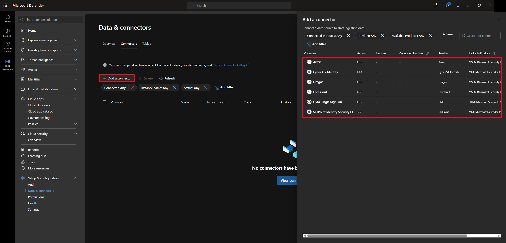

> If a service you need isn't on the list, you can suggest it to Microsoft, but the course mentioned that adding new connectors takes a while.

### 2.2 Automatic log upload

**Settings → Cloud apps → Cloud Discovery → Automatic log upload → Data sources.** A data source tells Defender for Cloud Apps what kind of device the logs come from, like a Check Point, Cisco, or Palo Alto firewall.

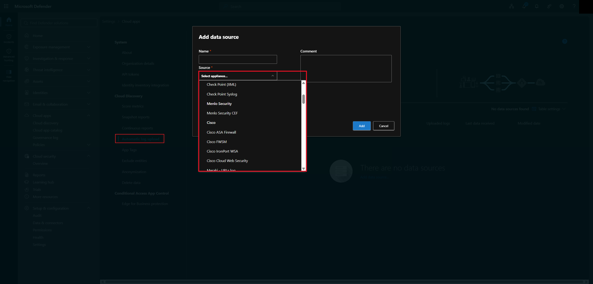

If the firewall or proxy can't send logs to the cloud directly, a **log collector** sits in between. It's usually a Linux VM that collects the logs and pushes them up.

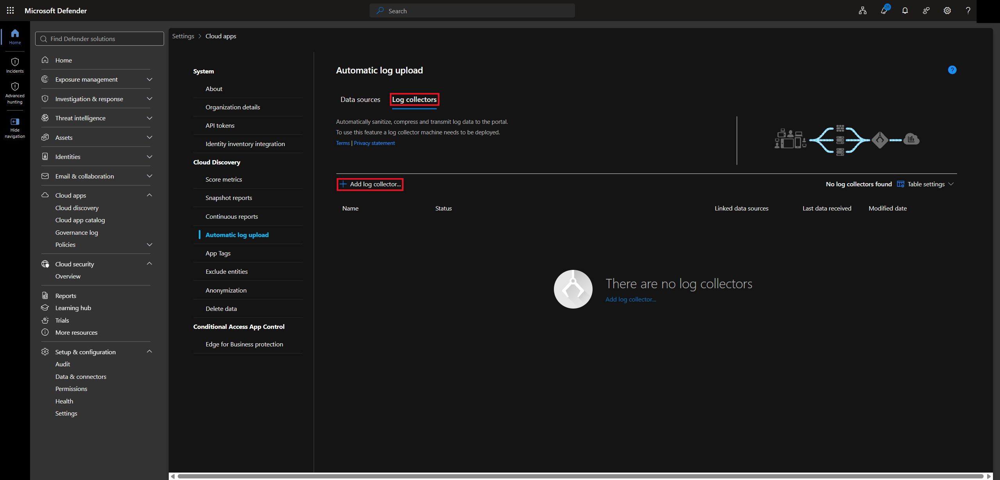

### 2.3 Cloud Discovery settings

| Setting | What it does |
|---|---|
| Score metrics | Changes how much things like MFA, encryption, and compliance count toward an app's risk score |
| Snapshot reports | A one-time analysis of firewall or proxy logs you upload yourself |
| Continuous reports | Tracks app usage over time from an ongoing flow of logs |
| Automatic log upload | Sets up data sources and log collectors to send logs automatically |
| App Tags | Labels apps as Sanctioned (approved), Unsanctioned (not approved), or a custom tag |
| Exclude entities | Leaves certain users, groups, IP addresses, or devices out of discovery |
| Anonymization | Hides identifying info in discovery data to protect user privacy |
| Delete data | Permanently clears Cloud Discovery data (not the apps themselves or their files) |

---

## Task 3 — Creating a Snapshot Report

A snapshot report is the quickest way to try Cloud Discovery: export a log, upload it, and let Defender for Cloud Apps analyze it.

**Cloud apps → Cloud discovery → Create a new report.**

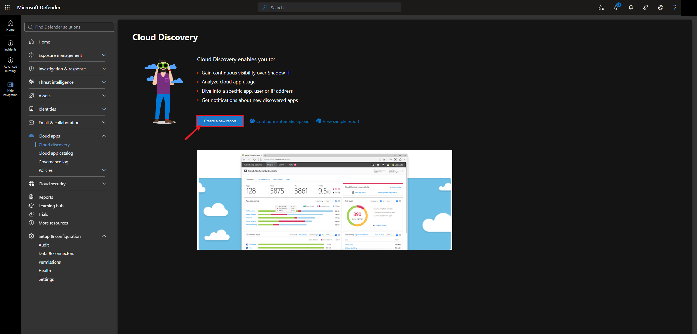

### 3.1 Custom log format

My practice log wasn't from a real firewall, so I set up a **custom CSV parser** that tells Defender for Cloud Apps which column is which: date, time, source IP, destination URL, username, traffic, and action.

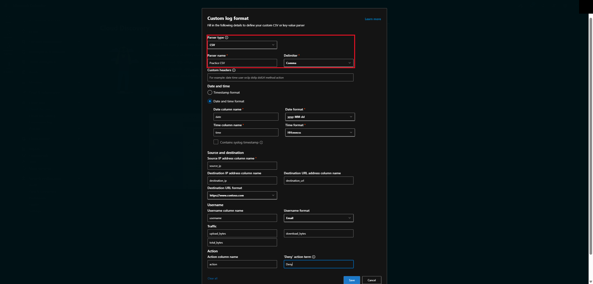

### 3.2 Upload the log

I uploaded `cloud_discovery_sample.log`. Log files can have up to 90 days of activity and be up to 1 GB each.

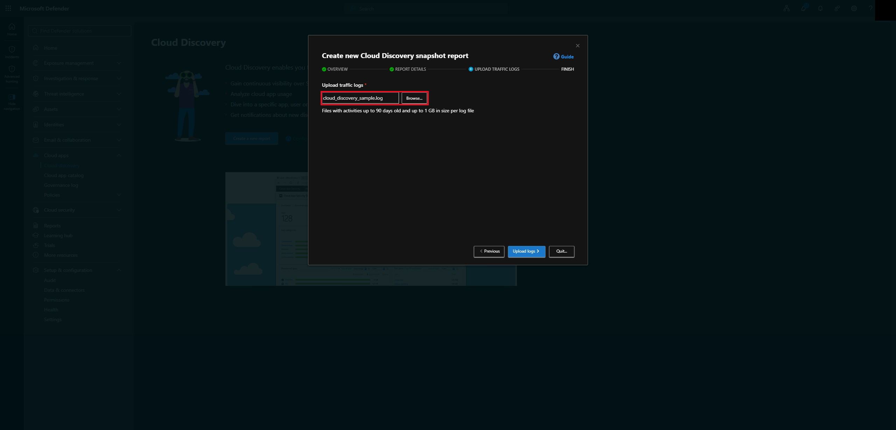

The report showed up under **Snapshot reports** as **Processing**.

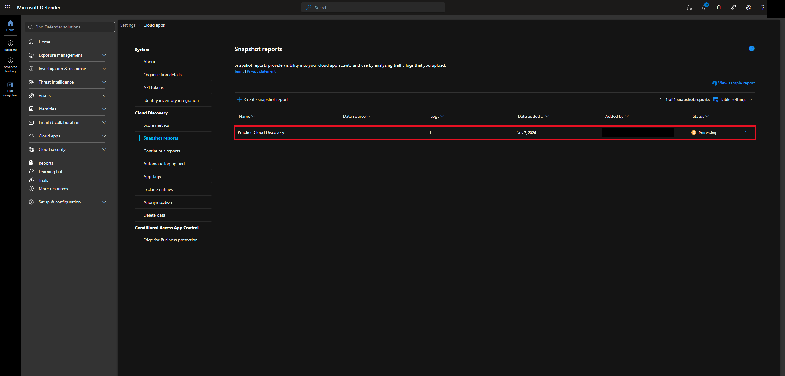

> The course said a snapshot report can take up to about 24 hours to finish processing.

---

## Task 4 — Reading the Results

### 4.1 Dashboard

My practice log found **10 apps, 12 IP addresses, 12 users, and 883 MB of traffic**. The dashboard also breaks traffic down by app category, shows the risk levels, lists the top users, and maps where each app is headquartered.

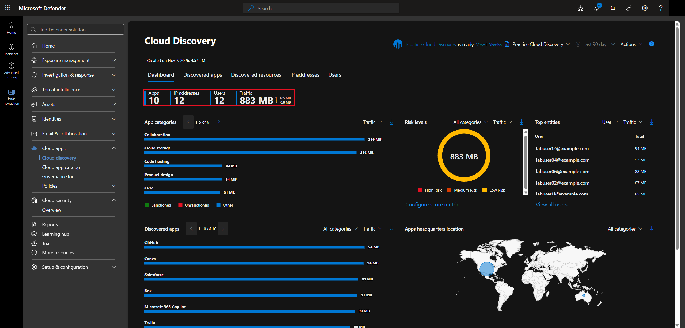

### 4.2 App risk scores

**Discovered apps** lists every app with a **risk score from 0 to 10**, where higher is safer. All the apps in my practice log were well-known ones, so they all scored 9 or 10.

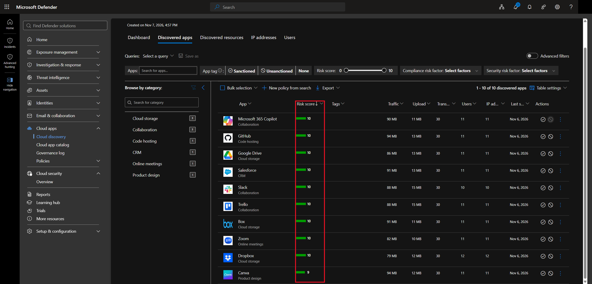

Clicking an app shows how its score breaks down into **General, Security, Compliance, and Legal**. Canva scored 9/10.

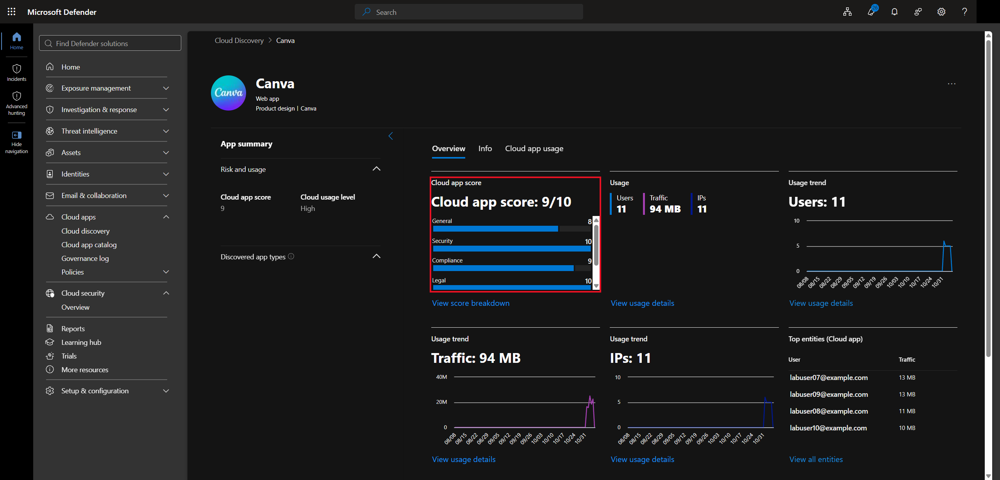

**Info → Compliance** shows which standards the app meets, like ISO 27001 and SOC 2. **Security** shows things like MFA support and encryption, and **Legal** covers data protection laws like GDPR.

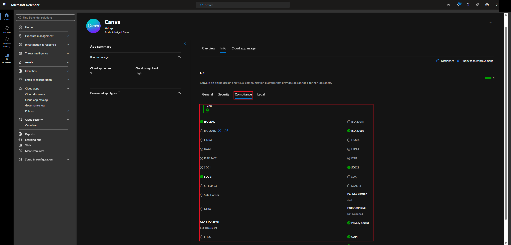

> Compliance matters because using an app that doesn't meet a standard your company follows can take your company out of compliance too. The course showed an app scoring as low as 2 for missing a disaster recovery plan, security controls, and compliance standards. My practice data didn't have any apps that risky.

### 4.3 Sanctioned and unsanctioned apps

Each app has buttons to tag it as **Sanctioned** or **Unsanctioned**.

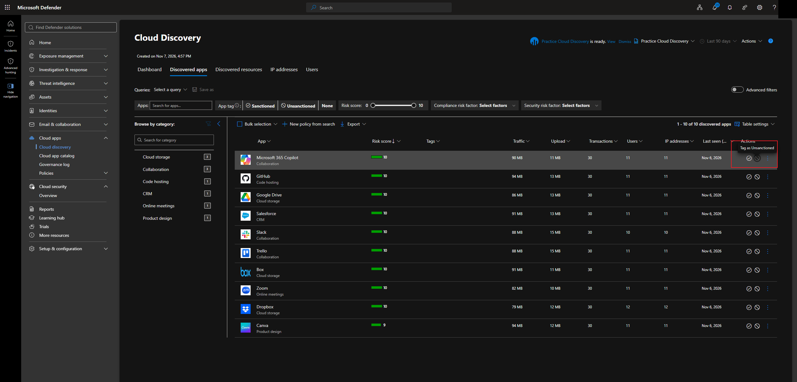

When you tag an app as unsanctioned, a confirmation says that apps with the **Unsanctioned** tag will be **blocked by Microsoft Defender for Endpoint**. If the two are connected, unsanctioning an app blocks it on every device Defender for Endpoint manages.

---

## Task 5 — Investigating Users and IP Addresses

From an app, you can follow the trail down to who used it and where they were.

**Canva → Cloud app usage → Users** shows every user of the app, with their traffic, uploads, and when they were last seen.

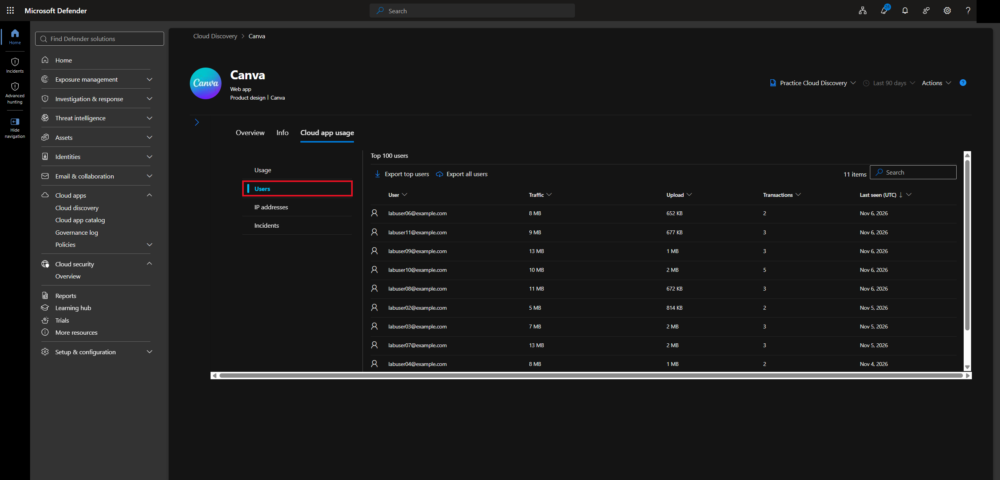

Clicking a user shows their own **Overview** (app usage over time) and **Discovered apps** (every app they used). The **IP address history** tab shows which IP address they were signing in from each day.

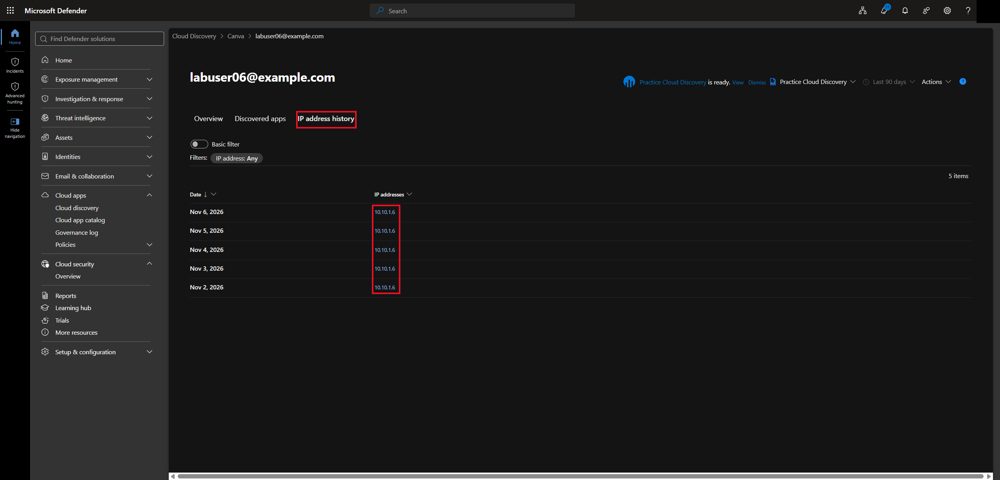

Clicking the IP address shows how many users and apps were on that IP at that time. My data came from a practice firewall log, so it's an internal IP.

> The course used this for following up with users. If someone keeps using risky apps, you can see every app they use and send them training or reminders about company data policies.

---

## Task 6 — Policies

**Cloud apps → Policies → Policy templates.** Policies work like an if/then statement: **if** an app or activity matches the conditions, **then** take an action, like sending an alert. Templates give you a starting point, like alerting when a new cloud storage app is discovered with lots of users.

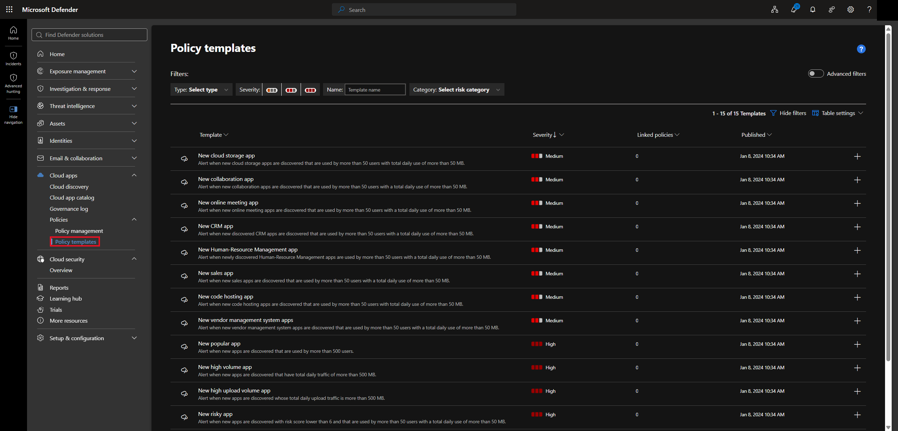

The course also mentioned data loss prevention policies, like blocking downloads, uploads, or copy and paste in an app.

> Some of these policies are **triggered by Conditional Access**. You build the policy in Defender for Cloud Apps, then point a Conditional Access policy at it using the **Use Conditional Access App Control** session control from [Lab 9](../lab-09-conditional-access/).

---

## What I Learned

- Defender for Cloud Apps is a CASB that sits between users and cloud apps
- Shadow IT is apps admins can't see, and Cloud Discovery finds them from traffic logs
- Data can come in through connectors, automatic log upload, a log collector, or a manually uploaded log
- A snapshot report is a one-time analysis of an uploaded log, and a custom parser can read a log in any CSV format
- Every app gets a risk score from 0 to 10, broken down into general, security, compliance, and legal
- Using an app that doesn't meet your company's compliance standards can put your company out of compliance
- Unsanctioning an app can block it on devices through Defender for Endpoint
- You can go from an app to its users to their IP addresses to investigate risky usage
- Cloud Apps policies can be triggered from Conditional Access

---

> **Note:** Screenshots are from my lab tenant. My account and initials have been redacted. The users (labuser@example.com), traffic, and internal IP addresses all come from a practice log file, not real activity.

[← Back to Entra ID Labs](../)
