# Lab 15 — App Registration in Microsoft Entra ID

## Overview

This is my fifteenth SC-300 lab. I did it in my own Microsoft Entra tenant for the made-up company **Bam Co.**

**App registration** is how you tell Entra ID about an application, so Entra can sign users into it, control what it can access, and manage its permissions. I registered a made-up HR app called **AskBamCoHR** and went through each part of its settings: branding, certificates and secrets, token claims, API permissions, app roles, the manifest, and owners.

The big takeaway is the difference between the **application object** and the **service principal**. The application object is the master copy of the app, and a service principal is that app's identity inside a specific tenant. The app registration says what an app wants, and each tenant decides what to actually grant it.

## Objectives

- Know which roles can manage applications
- Understand why to integrate apps with Entra ID
- Understand application objects and service principals, and what happens when another tenant uses an app
- Find the setting that controls who can register apps
- Register an application and look at its IDs
- Configure branding, credentials, optional claims, and API permissions
- Understand delegated vs application permissions and admin consent
- Create app roles and see them in the manifest
- Understand app owners and app-level admin roles

## Tools & Technologies

| Category | Tools |
|---|---|
| Identity platform | Microsoft Entra ID |
| Portals | Microsoft Entra admin center |
| Features | App registrations, service principals, Microsoft Graph API permissions, admin consent, app roles, manifest, owners |
| Course | Microsoft Learn: SC-300 Identity and Access Administrator |

---

## Task 1 — Who Manages Applications

Two built-in roles manage applications. Least privilege still applies, so pick the one that's just enough.

| Role | What it can do |
|---|---|
| Application Administrator | Manage every part of enterprise apps, including app registrations and **application proxy** settings |
| Cloud Application Administrator | The same, but **without** application proxy. So, basically every part of apps, but only in the cloud |

**Microsoft Entra Application Proxy** is what lets users reach **internal web apps from outside the company without a VPN**. Users sign in through Entra ID, so MFA and Conditional Access still apply, and a private network connector links the internal app to Entra using an outbound connection, so no inbound firewall ports have to be opened. For example, an employee could open the company's internal HR site from home with their Entra account.

## Task 2 — Why Integrate Apps with Entra ID

Adding an app to Entra ID lets you:

- **Centralize sign-ins and resources** for cloud and on-prem apps in one place
- Apply **consistent security policies** to every app
- Turn on **single sign-on**
- **Automate provisioning and deprovisioning**, so new employees get access automatically and leavers lose it just as easily
- Use modern protocols like **OAuth**, plus auditing and monitoring

---

## Task 3 — Application Objects and Service Principals

|  | Application object | Service principal |
|---|---|---|
| What it is | The **blueprint** or master copy of the app | The app's **local instance** inside a tenant |
| What it defines | Sign-in settings, redirect URLs, which APIs the app wants, and the application ID | Which users and groups are assigned, the permissions actually granted, and local policies like Conditional Access |
| Where it lives | The app's **home tenant** only | **Every tenant** that uses the app |
| Where you manage it | **App registrations** | **Enterprise applications** |

> Requested permissions aren't the same as granted permissions. The app registration says what the app wants, and each tenant decides what to give it.

### What happens when another tenant uses the app

Say an app is registered in Tenant A, and a user from Tenant B opens it for the first time:

```text
 Tenant A (home tenant)                    Tenant B
┌───────────────────────┐            ┌──────────────────────────┐
│ Application object    │            │ 1. User opens the app    │
│ (the master copy)     │            │ 2. User signs in         │
│                       │            │ 3. User or admin consents│
│                       │──creates──►│ 4. Service principal     │
│                       │            │    (visible under        │
│                       │            │    Enterprise apps)      │
└───────────────────────┘            │ 5. Token returned        │
                                     └──────────────────────────┘
```

1. **Request:** the user opens the app, and the app asks Entra for a token
2. **Authentication:** the user signs in with their Tenant B account
3. **Consent:** the user or an admin approves the permissions the app is asking for, depending on Tenant B's settings
4. **Service principal created:** Entra creates the app's identity in Tenant B
5. **Token returned:** the user gets a token and can use the app

The app itself is never copied into Tenant B. Only its identity is.

---

## Task 4 — Who Can Register Apps

**Users → User settings.** By default, **Users can register applications** is set to **Yes**, so any user in the tenant can register an app.

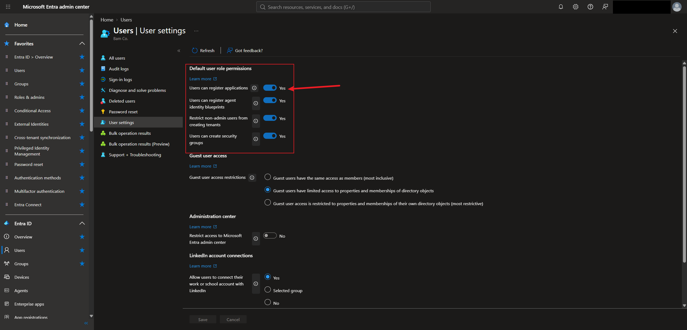

> If that's a risk for your organization, turn it off. Leaving it on also raises questions about consent, like whether a user can approve an app's permissions or whether an admin has to.

---

## Task 5 — Registering an App

**App registrations → New registration.**

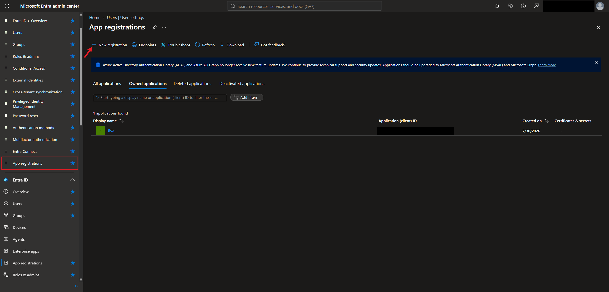

I named the app **AskBamCoHR**, chose **Single tenant only - Bam Co.**, and gave it a **Web** redirect URI.

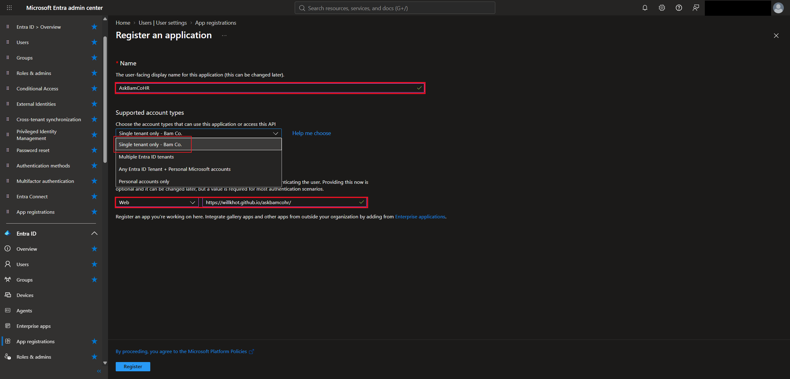

| Supported account type | Who can sign in |
|---|---|
| Single tenant only | Only people in my tenant |
| Multiple Entra ID tenants | People in any Entra tenant |
| Any Entra ID tenant + personal Microsoft accounts | Any Entra tenant plus personal accounts, like Xbox or Skype |
| Personal accounts only | Only personal Microsoft accounts |

After registering, the **Overview** shows the **Application (client) ID** and the **Object ID**. The application ID identifies the app everywhere, and the object ID identifies this application object in my tenant.

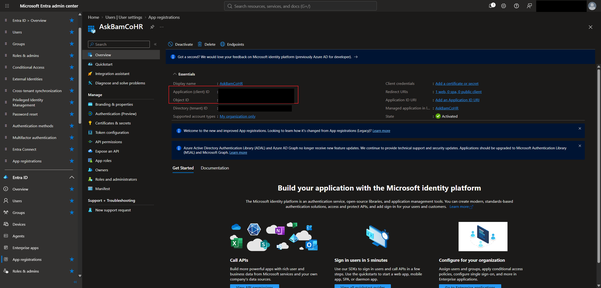

---

## Task 6 — Configuring the App

### 6.1 Branding & properties

I uploaded a logo (1), added a home page URL (2), added an internal note saying it's an HR app for employees' pay and benefits questions (3), and saved (4).

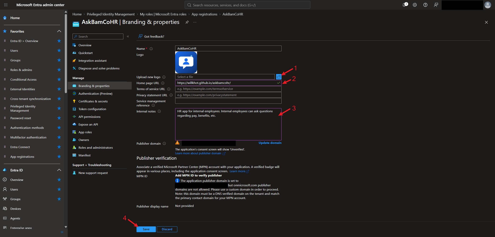

> The publisher domain shows a warning because it's an `onmicrosoft.com` domain, so the consent screen will say **Unverified**. A verified publisher needs a custom domain.

### 6.2 Certificates & secrets

Credentials let an app **prove its identity** to Entra ID when it asks for a token. I didn't create any for this app.

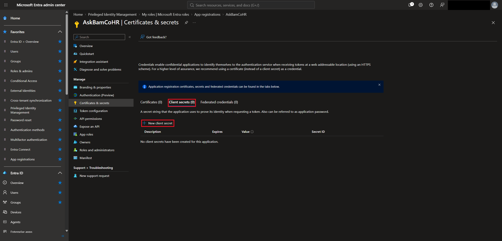

| Credential | What it is |
|---|---|
| Client secret | An application password. Keep it private and replace it before it expires |
| Certificate | Uses a public/private key pair. Stronger than a client secret, and what Microsoft recommends |
| Federated credential | Lets the app trust an outside identity, like a GitHub Actions workflow, without storing a secret at all |

> Credentials prove **who the app is**. API permissions decide **what it can access**.

### 6.3 Token configuration

A **claim** is a piece of information inside a token, like the user's email or name. **Optional claims** add extra ones. I picked `acct`, `email`, `family_name`, and `fwd` for the ID token.

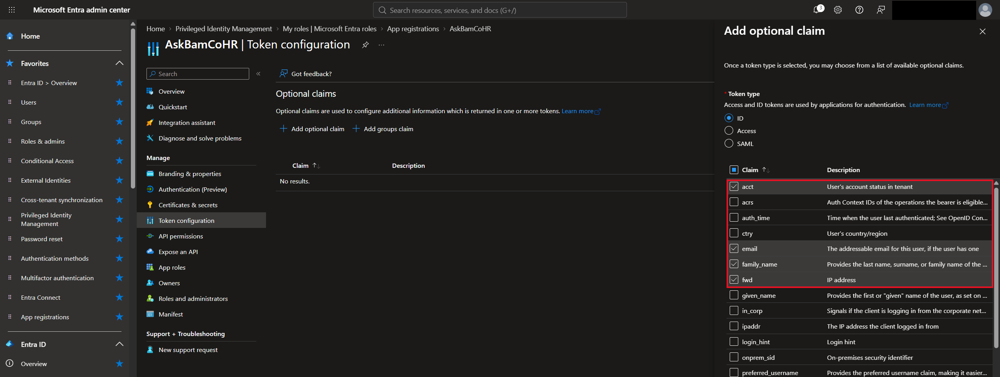

| Token type | What it's for |
|---|---|
| ID token | Tells the app who signed in |
| Access token | Shown to an API to access protected resources |
| SAML token | Carries identity info for apps that use SAML sign-in |

> Only add claims the app actually needs. Modern apps try to keep tokens small, so extra claims just add data. An example where it makes sense is an app that greets users by name when they sign in.

---

## Task 7 — API Permissions and Consent

API permissions decide **what an app can access or do through an API**, like reading a profile or sending email. New apps start with **User.Read** from Microsoft Graph.

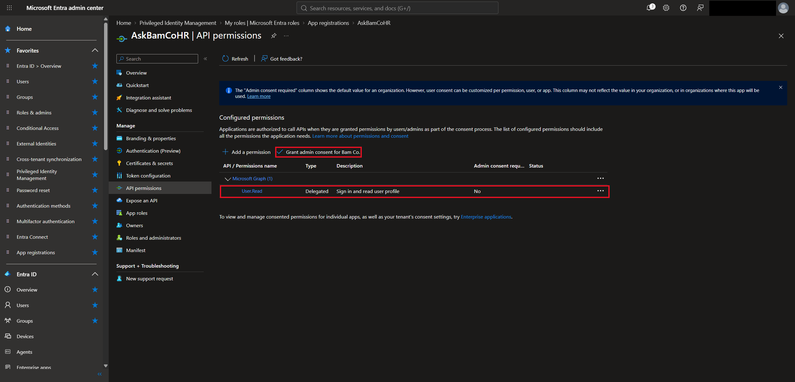

| Permission type | How it works | Example |
|---|---|---|
| Delegated | The app acts **on behalf of a signed-in user**. It's limited to what both the app and the user are allowed to do | You sign in, and the app reads your email address |
| Application | The app acts **on its own**, with no signed-in user. **Needs admin consent** | A background service reads calendars across every mailbox |

> Delegated = app + user. Application = app alone.

### 7.1 Adding a delegated permission

**Add a permission → Microsoft Graph → Delegated permissions.** I added **email**, which doesn't need admin consent.

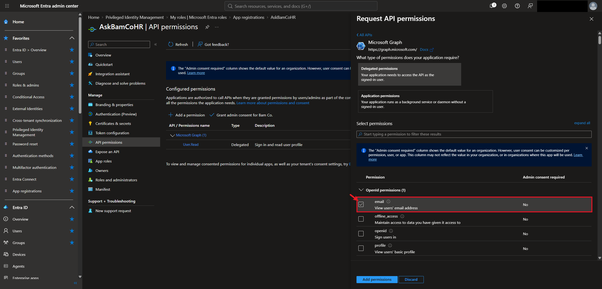

### 7.2 Adding an application permission

**Application permissions** → I added **Calendars.Read** (read calendars in all mailboxes), which **does** need admin consent.

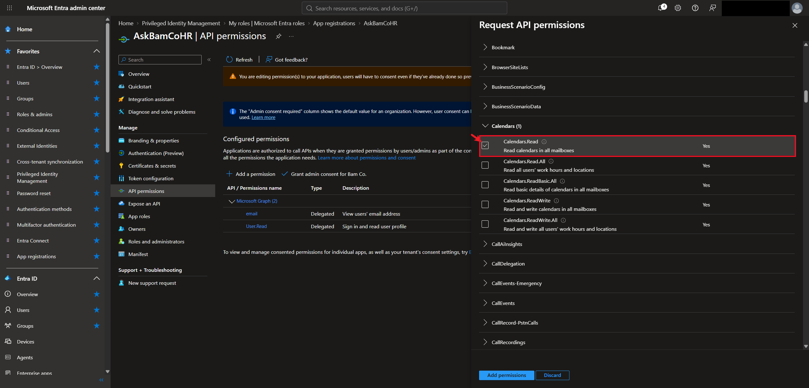

> Adding a permission to the list doesn't grant it. Permissions that need admin consent can be approved for the whole organization with **Grant admin consent for Bam Co.** If an admin doesn't do that up front, users have to request admin approval the first time they use the app.

---

## Task 8 — App Roles, Manifest, and Owners

### 8.1 App roles

App roles define **what users or other apps can do inside the app**. I created two:

| Display name | Allowed member types | Value | Description |
|---|---|---|---|
| Analyst | Users/Groups + Applications | `Task.Write` | Can edit the app |
| EndUsers | Users/Groups + Applications | `Task.Read` | Can only read |

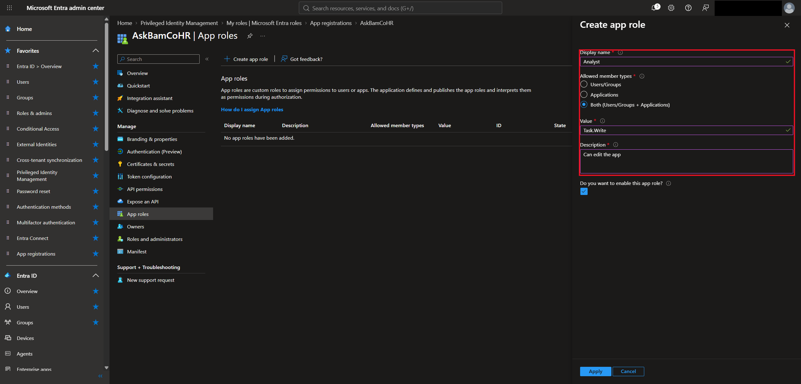

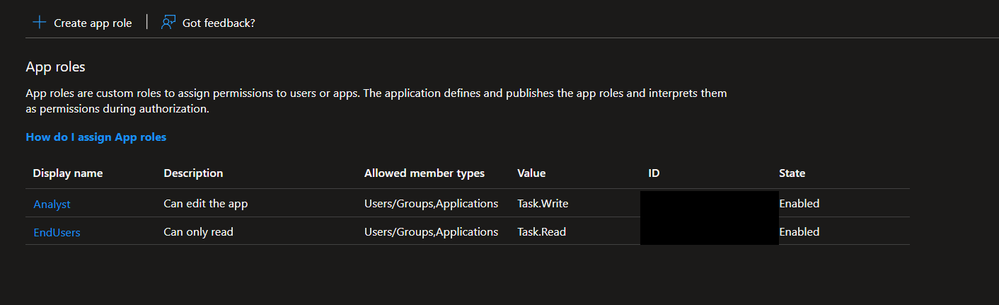

> The **value** is what shows up in the token's `roles` claim. Creating a role doesn't enforce anything on its own. The app's code has to check the role and allow or block actions based on it.

### 8.2 Manifest

The **manifest** is the app registration in **JSON**. The two roles I created show up in the `appRoles` section, and editing them here changes the same roles on the App roles page.

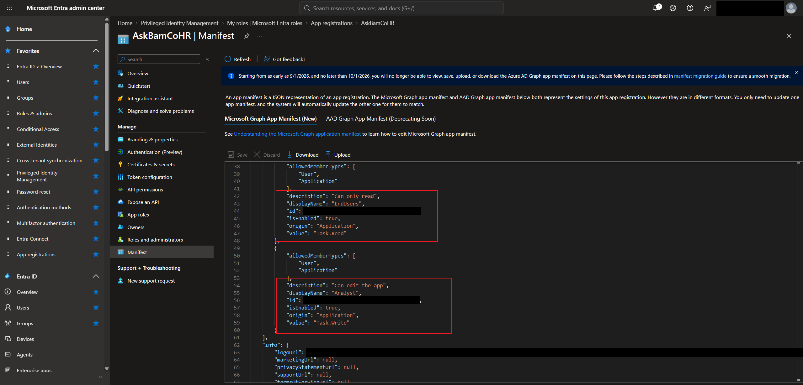

### 8.3 Owners

**Owners** can manage just this one app registration, like changing redirect URIs, adding certificates and secrets, and setting up roles and permissions. I didn't add any.

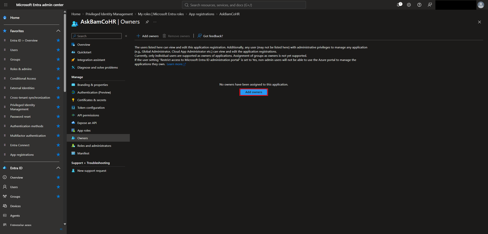

> Making a developer an owner lets them maintain AskBamCoHR without giving them Application Administrator, which would cover every app in the tenant. That's least privilege. Ownership doesn't automatically grant admin consent or access to data inside the app.

### 8.4 Roles and administrators

This page lists the Entra admin roles that can be assigned to manage this app, both built-in ones like **Cloud Application Administrator** and custom roles.

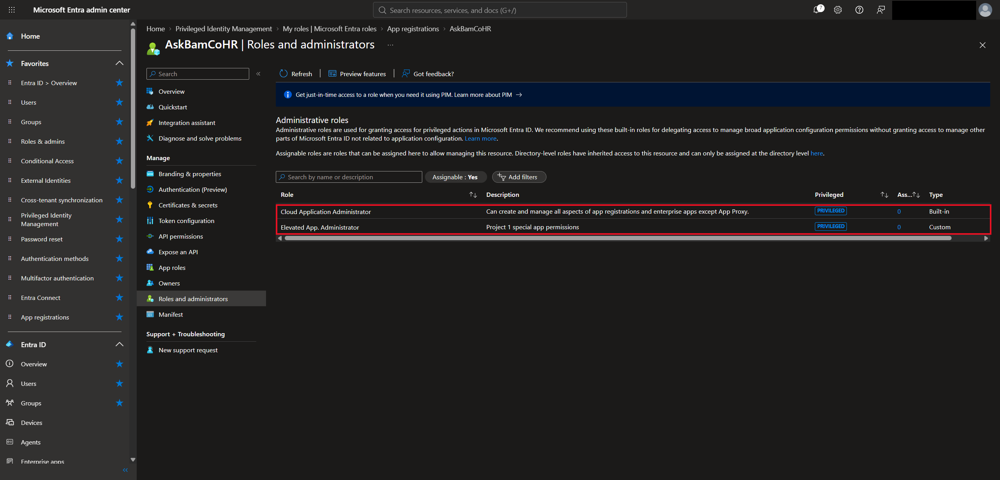

| Feature | Purpose |
|---|---|
| Owners | Manage this one app registration |
| Roles and administrators | Give admin rights over the app through Entra roles |
| App roles | Control what users or apps can do inside the app |

---

## What I Learned

- Application Administrator and Cloud Application Administrator both manage apps, but only Application Administrator covers application proxy
- The application object is the app's blueprint in its home tenant, and a service principal is its identity in each tenant that uses it
- By default any user can register apps, which is worth turning off if it's a risk
- Single tenant, multitenant, and personal account options decide who can sign in to an app
- Credentials prove who the app is, and certificates are stronger than client secrets
- Optional claims add info to tokens, but only add what the app needs
- Delegated permissions act as the signed-in user, and application permissions act as the app alone and need admin consent
- Adding a permission doesn't grant it, so admin consent is a separate step
- App roles define what users can do inside the app, and the app's code has to enforce them
- Making someone an owner of one app is a least-privilege alternative to an app admin role

---

> **Note:** Screenshots are from my personal lab tenant. My admin account, the tenant ID, the application and object IDs, the app role IDs, and the publisher domain have been redacted. Bam Co. is a made-up company, and AskBamCoHR is a test app.

[← Back to Entra ID Labs](../)
