# Lab 17 — Entitlement Management in Microsoft Entra ID

## Overview

This is my seventeenth SC-300 lab. I did it in my own Microsoft Entra tenant for the made-up company **Bam Co.**

**Entitlement management** is part of Microsoft Entra ID Governance. Instead of an admin adding someone to every group and app one at a time, you bundle those resources into an **access package**. Users request the package, an approver signs off, and the access is removed automatically when it expires.

I created a **SecOps** catalog, built a **Security Analyst** access package with a group and two apps in it, and then requested it as my test user. I approved the request as the admin and checked that the user was added to every resource in the package. I finished by looking at separation of duties, connected organizations, and what happens to external users when their access ends.

The big takeaway is that one approved request handles all the access, and the package's policy decides who can request it, who approves it, and how long it lasts. That's just enough access, just in time.

## Objectives

- Understand identity lifecycle management and why entitlement management helps
- Learn the four main terms: resource, catalog, access package, and policy
- Create a catalog and add resources to it
- Create an access package with resource roles, a request policy, approvals, requestor questions, expiration, and access reviews
- Request the package as a user and approve it as an admin
- Confirm the user was added to every resource in the package
- Understand separation of duties, connected organizations, and the lifecycle of external users

## Tools & Technologies

| Category | Tools |
|---|---|
| Identity platform | Microsoft Entra ID |
| Portals | Microsoft Entra admin center, My Access (`myaccess.microsoft.com`) |
| Features | Identity Governance, entitlement management, catalogs, access packages, policies, approvals, access reviews, separation of duties, connected organizations, control configurations |
| Licensing | Microsoft Entra ID P2 at minimum. Some features need Microsoft Entra ID Governance or the Microsoft Entra Suite |
| Course | Microsoft Learn: SC-300 Identity and Access Administrator |

---

## Task 1 — Identity Lifecycle and Entitlement Management

**Identity lifecycle management** covers an account from creation to deletion: provisioning, granting access, sign-in, monitoring, and deprovisioning when someone leaves.

A clear lifecycle means:
- Users get the right access **quickly**, and **lose it** when they no longer need it
- Less security risk, more organized systems, and better protection for sensitive information

**Entitlement management** automates that for groups, apps, and SharePoint Online sites, for both employees and people outside the company.

- Most useful in **large organizations** or ones that work with a lot of outside partners
- Sets up **clear workflows** for access requests, so users know what to ask for and who approves it, which saves admin time
- Improves security by making sure users have the **right access at the right time** (just enough access + just in time)

> To manage Identity Governance you need the **Identity Governance Administrator** role.

## Task 2 — Terminology

| Term | Simple meaning | Example |
|---|---|---|
| Resource | One thing users need access to | A security group, an app, or a SharePoint site |
| Catalog | A container that holds related resources and access packages. Management of it can be delegated | A "SecOps" catalog for the security team |
| Access package | A bundle of resource access needed for a role or project. Always lives in a catalog | "Security Analyst" gives access to the SOC group, Slack, and the HR app |
| Policy | The rules for a package: who can request it, who approves it, and how long access lasts | Members can request it, I approve it, and access expires after 365 days |

> A catalog can have many access packages, and an access package can have more than one policy, like one for employees and another for external users.

---

## Task 3 — Creating a Catalog

**Identity Governance → Catalogs → New catalog** (1). I named it **SecOps**, with the description "This is for the Security Operations team," left **Enabled for users to request** on, and turned on **Enabled for external users to request** so those options would be available later. Then I clicked **Create** (2).

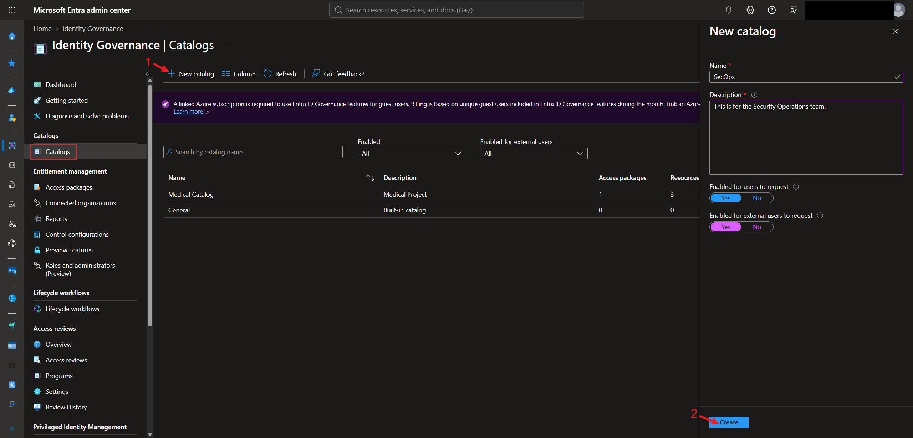

A catalog can be for a whole project, a team, or one set of users. The new catalog starts empty.

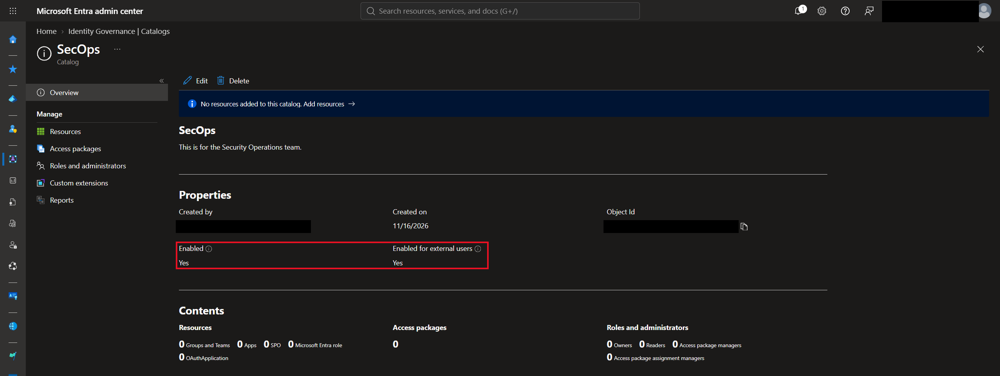

### 3.1 Adding resources to the catalog

**Resources → Add resources.** Catalogs can hold groups and teams, applications, SharePoint sites, and Entra roles (preview, which needs the Entra Suite license). I added two groups (**Cloud Security** and **SOC**) and two apps (**AskBamCoHR** from [Lab 15](../lab-15-app-registration/) and **Slack** from [Lab 16](../lab-16-enterprise-apps/)).

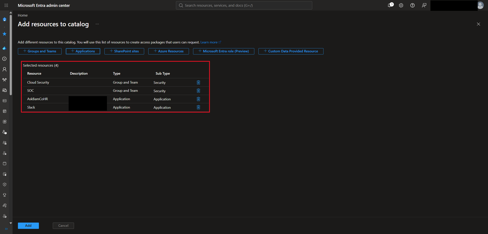

---

## Task 4 — Creating an Access Package

**Identity Governance → Access packages → New access package.**

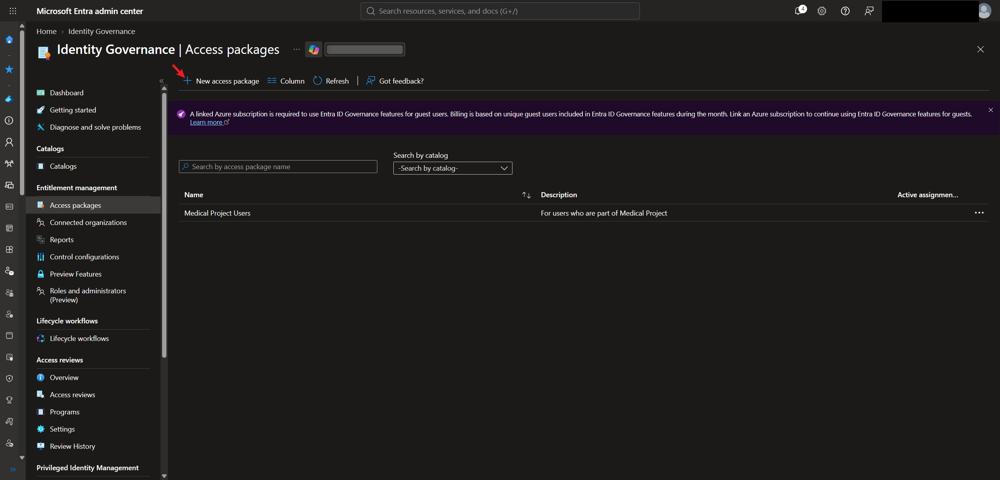

### 4.1 Basics

I named it **Security Analyst**, with the description "Just for Security Analysts in SOC," and put it in the **SecOps** catalog. A clear name and description help users figure out whether a package is meant for them.

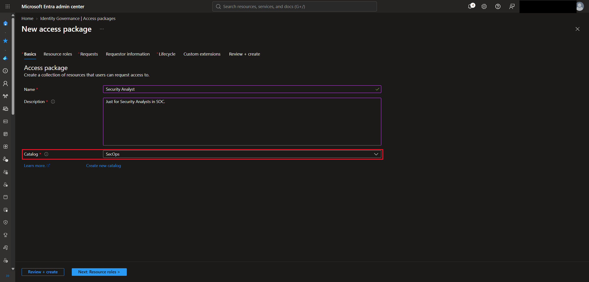

### 4.2 Resource roles

I added three resources and picked what level of access each one gives:

| Resource | Type | Role |
|---|---|---|
| SOC | Group | Member |
| Slack | Application | User |
| AskBamCoHR | Application | EndUsers (the read-only app role from Lab 15) |

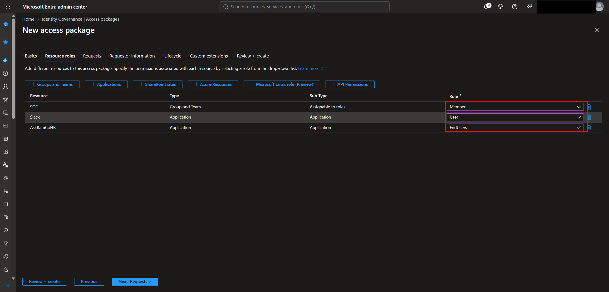

> You **can** add resources here that aren't in the catalog yet, and they get added to the catalog automatically. But it's best practice to map resources at the **catalog** level first and then pick them from there.

### 4.3 Requests (the first policy)

The next few tabs build the package's **first policy**.

**Who can get access:** users in my directory, scoped to **All members (excluding guests)**. Other choices are users in connected organizations, or **None**, where only an admin can assign the package directly. A second policy could be added later just for guests, with different rules.

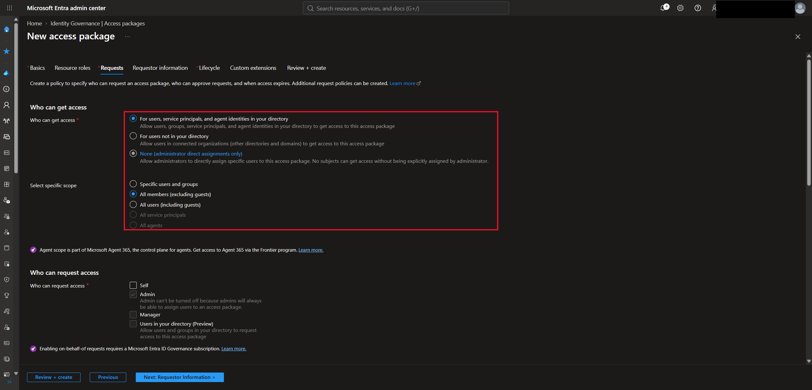

**Approval:**

| Setting | What I chose |
|---|---|
| Require requestor justification | Yes, so the approver knows **why** the user wants access |
| Require approval | Yes |
| How many stages | 1. Up to 3 stages lets you build a chain, like manager → security team → IT |
| First approver | A specific approver (myself). It could also be the user's **manager**, which only works if managers are filled in on user profiles |
| Decision must be made in how many days | 5 (the max is 14) |
| Require approver justification | Yes |
| If no action taken, forward to alternate approvers | No. Useful if the approver is on leave |
| Disable assignment emails | No, so delivery and expiry emails still go out |

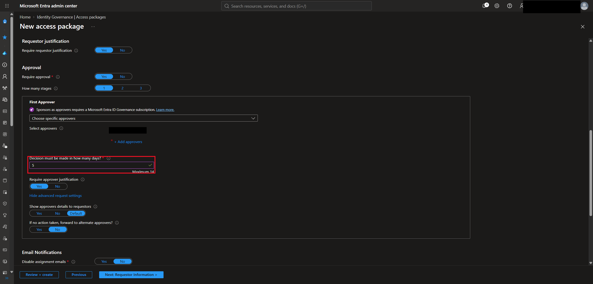

> There's also a preview setting that lets **managers request a package on behalf of an employee**, like a new hire starting Monday who should have access on day one.

### 4.4 Requestor information

I added a required question, **Badge ID**, as short text. Justification is already required, so asking "why do you need this?" again would be pointless. A **regex pattern** could also check the format of the answer.

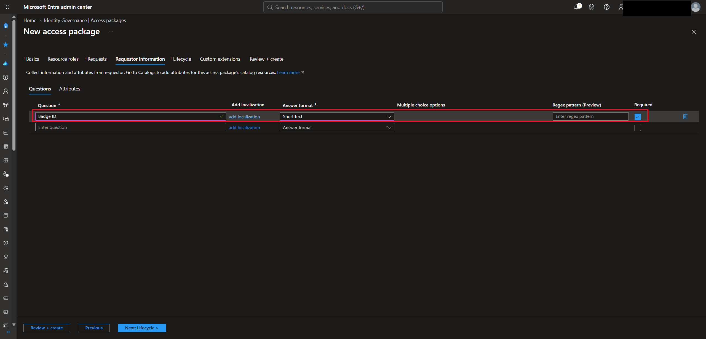

### 4.5 Lifecycle and access reviews

| Setting | What I chose |
|---|---|
| Access package assignments expire | After **365 days**. "Never" is an option, but having an end date makes you review the package |
| Users can request specific timeline | Yes. Users can ask for only the days they need, which follows just in time and limits damage if their account is compromised |
| Allow users to extend access | Yes, and extensions require approval |
| Require access reviews | Yes, starting 11/16/2026, **monthly**, for 14 days |
| Reviewers | A specific reviewer (myself). Self-review and Manager are the other options |
| If reviewers don't respond | Take recommendations |
| Show reviewer decision helpers | Yes |
| Require reviewer justification | Yes |

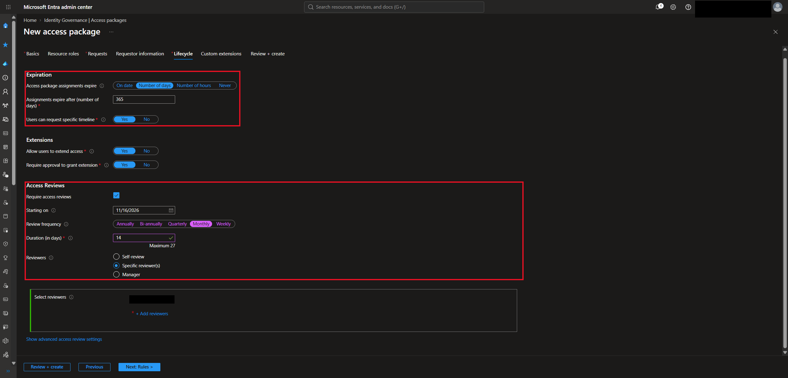

> Access reviews catch **stale access**. If someone has the package but isn't using it, the reviewer can remove it, and the user can request it again when they actually need it.

### 4.6 Review + create

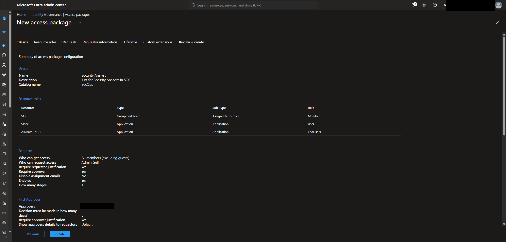

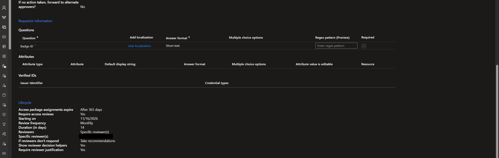

After creating it, the package has a **link** you can share, but users don't need it. They can find the package themselves in My Access.

---

## Task 5 — Requesting Access as a User

As my test user, **Kaitlyn Ly**, I went to **My Access** (`myaccess.microsoft.com`) → **Access packages**. **Security Analyst** was listed, along with its resources: Slack, SOC, and AskBamCoHR.

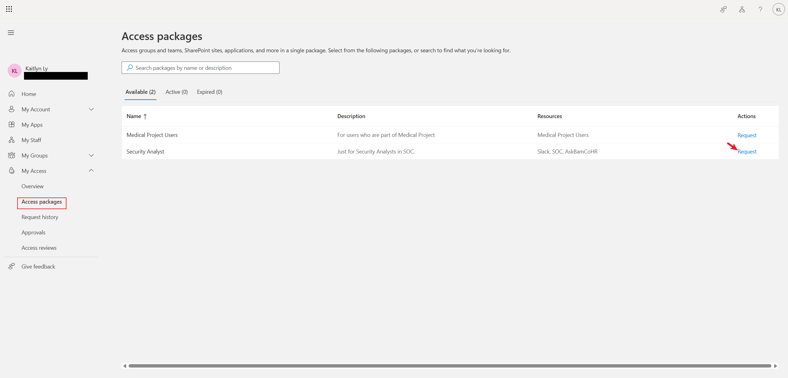

I clicked **Request**, chose to request it for **Yourself**, and clicked **Continue**.

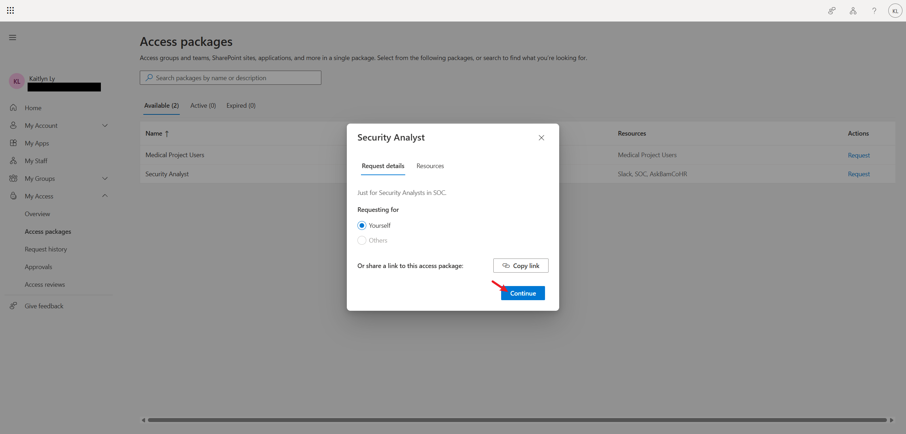

The form asked for the **Badge ID**. I turned on **Request for specific period** and asked for one week (Nov 17 to Nov 24), added a business justification, and submitted the request.

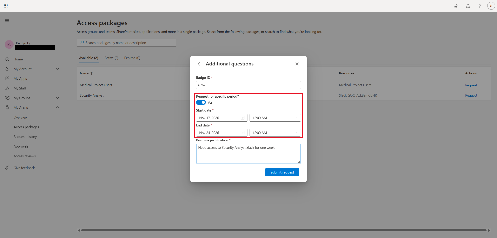

---

## Task 6 — Approving the Request

As the admin, I opened **My Access → Approvals**. Kaitlyn's request was pending.

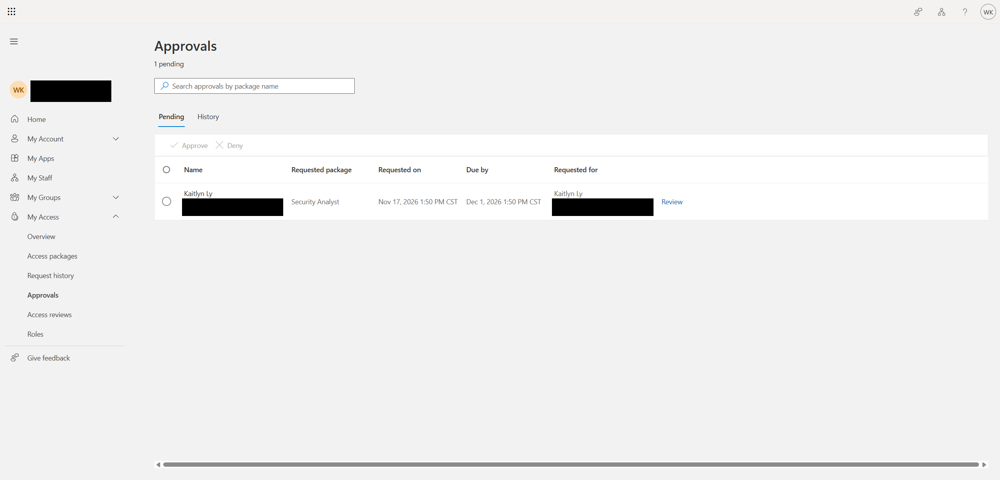

> Here I approved it in My Access, but day to day an approver would usually get an **email** and approve it from there.

I reviewed the request, chose **Approve**, gave a reason ("Confirmed user is on the project"), and submitted.

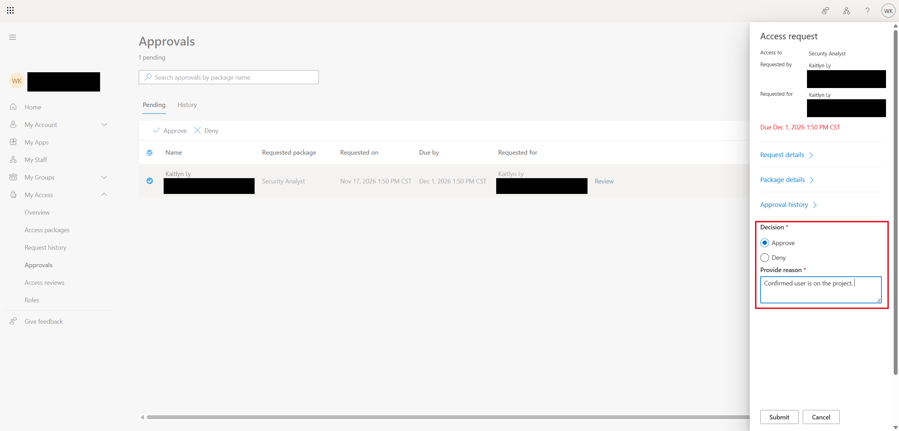

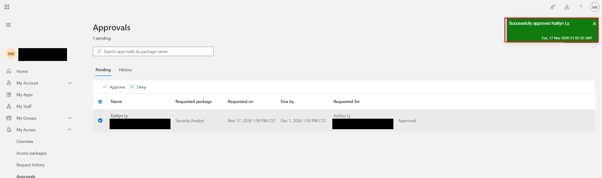

---

## Task 7 — Confirming Access

Without me adding her to anything by hand, Kaitlyn was added to each resource in the package:

**SOC group → Members:**

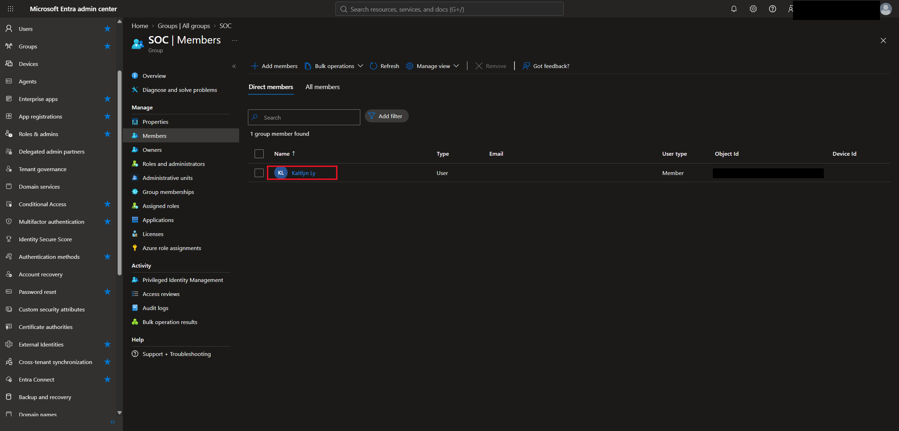

**Slack → Users and groups**, with the **User** role:

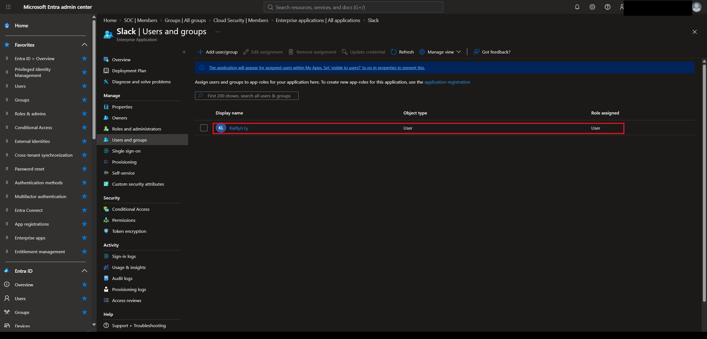

**AskBamCoHR → Users and groups**, with the **EndUsers** role:

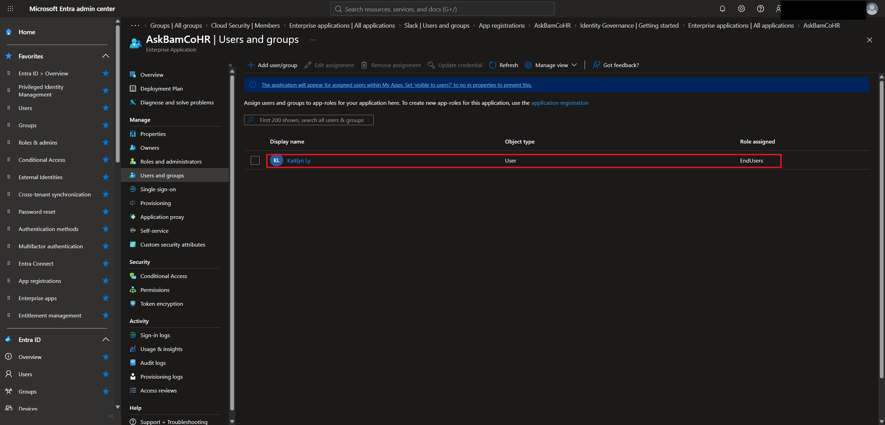

> I'd already assigned Kaitlyn to AskBamCoHR with the EndUsers role in [Lab 16](../lab-16-enterprise-apps/), so that one doesn't prove much on its own. The SOC group and Slack show the package doing its job.

---

## Task 8 — Separation of Duties

**Access package → Separation of Duties.** This stops one user from holding conflicting access, which reduces fraud and errors. For example, someone who submits payments shouldn't also approve them. I didn't set any rules.

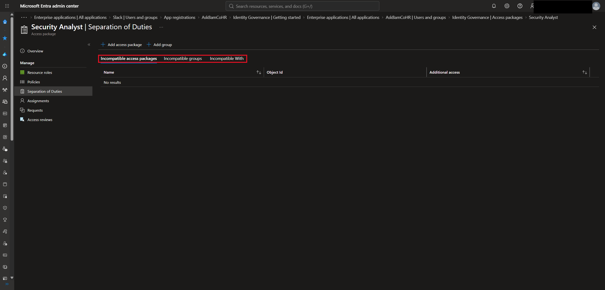

| Option | What it does |
|---|---|
| Incompatible access packages | Users who have these packages **can't request** Security Analyst |
| Incompatible groups | Members of these groups **can't request** Security Analyst |
| Incompatible With | Shows other packages that block requests from users who have Security Analyst |

> Rules only go **one way**, so set them on both packages if you want them to block each other. Users who already have conflicting access **aren't removed automatically**.

---

## Task 9 — Connected Organizations

A **connected organization** is an outside organization you work with, so its users can request your access packages without being invited one by one.

**Identity Governance → Connected organizations → Add connected organization.**

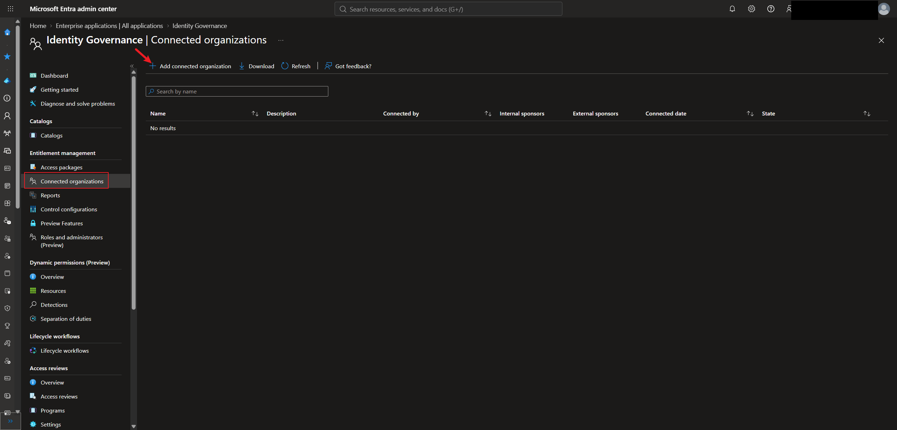

I named it **Partner Co.** with the description **Vendor**.

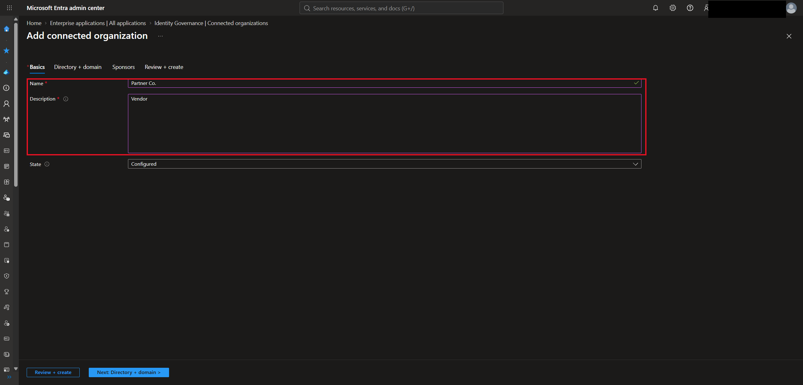

On **Directory + domain**, I looked up **contoso.com**. It was found as an existing **Microsoft Entra ID** tenant, with no connection yet.

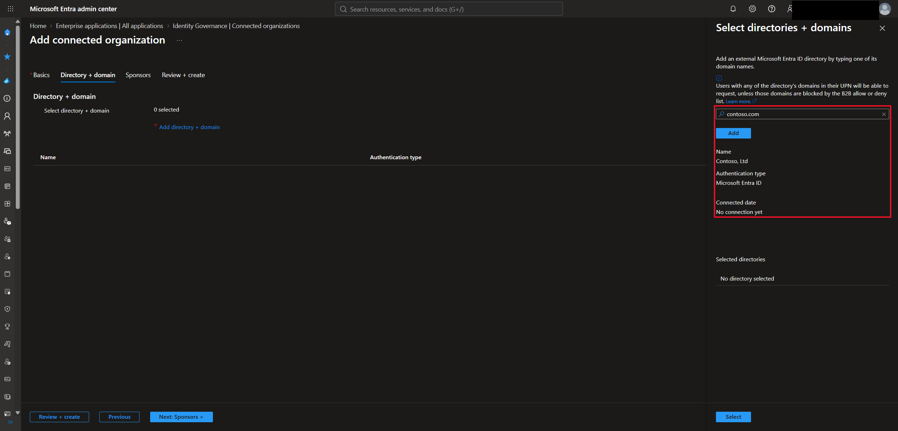

| Scenario | How users sign in |
|---|---|
| The domain is an Entra tenant | Users sign in with their own Entra account |
| The domain isn't Entra | Users sign in with a **one-time passcode** or a Microsoft account |
| The tenant has other verified domains | Users from those domains can also request, since they're in the same tenant |

Internal and external **sponsors** (points of contact) can be added too. I left them blank and created the connected organization.

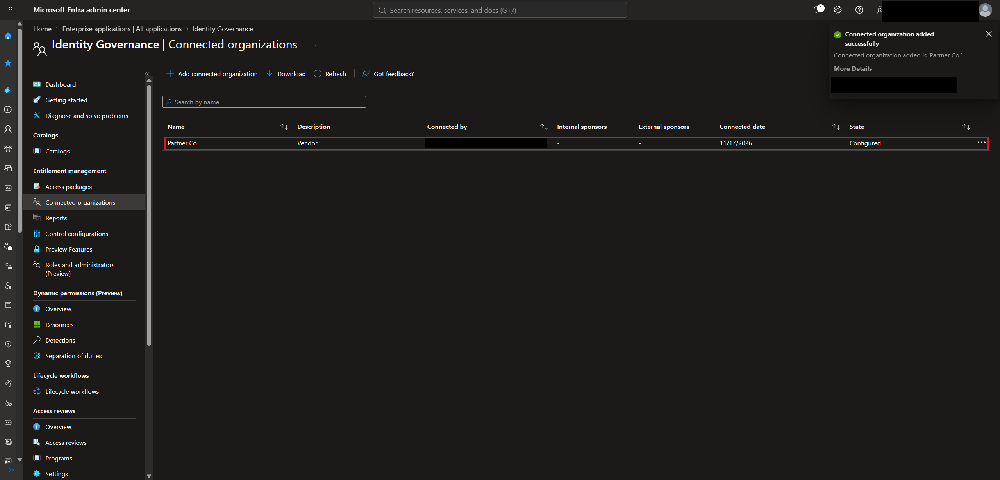

> For other ways to bring in outside users, like B2B invitations and cross-tenant access, see [Lab 3](../lab-03-external-identities/).

---

## Task 10 — Control Configurations

**Identity Governance → Control configurations** holds settings for all of entitlement management.

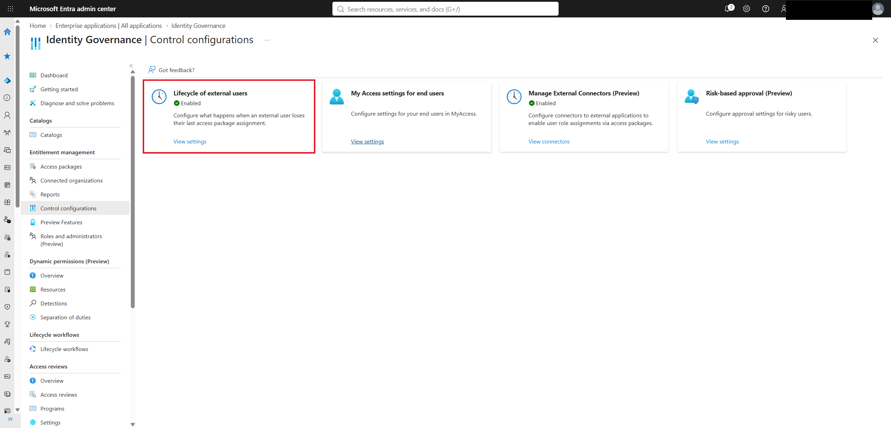

| Option | What it does |
|---|---|
| Lifecycle of external users | What happens to an external user's account after their **last** access package assignment ends |
| My Access settings for end users | Customizes what users see in the My Access portal |
| Manage External Connectors (preview) | Connects outside apps so access packages can assign their app roles |
| Risk-based approval (preview) | Approval settings for users flagged as risky |

**Lifecycle of external users** was set to remove the external user, block them from signing in, and remove them from the directory after **30 days**.

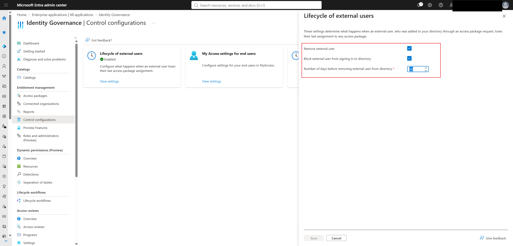

> A removed external user stays in a deleted state for 30 days, then is permanently deleted, like any deleted user. If they get a new access package within those 30 days, their account comes back.

---

## What I Learned

- Identity lifecycle management means giving access quickly and taking it away when it's no longer needed
- Entitlement management bundles groups, apps, and SharePoint sites into access packages that users request themselves
- Catalogs hold resources and access packages, and policies decide who can request, who approves, and how long access lasts
- It's best practice to add resources to the catalog first, then build access packages from them
- Requestor justification, extra questions like a badge ID, and approver justification all leave a clear record of why access was given
- Expiration, specific timelines, and access reviews keep access just in time instead of permanent
- One approved request added my test user to the group and apps in the package automatically
- Separation of duties blocks conflicting access, but the rules only go one way
- Connected organizations let partner users request packages, and control configurations decide what happens to them when access ends

---

> **Note:** Screenshots are from my personal lab tenant. My admin account, my name, the test user's sign-in name, the object IDs, the app IDs, and a correlation ID have been redacted. Kaitlyn Ly is a fictional test account, Bam Co. is a made-up company, and Partner Co. is a test connected organization.

[← Back to Entra ID Labs](../)
