# Lab 2 — Building a Hybrid Identity Lab: Entra Connect Sync with Password Hash Sync (Part 2)

## Overview

This is Part 2 of my hybrid identity lab. In [Part 1](../lab-01-hybrid-identity-ad-entra-connect/) I built an on-premises Active Directory domain, `bamco.internal`, on Hyper-V and joined a Windows 11 workstation to it. In this part I connected that domain to my Microsoft Entra ID tenant with **Microsoft Entra Connect Sync**, so users created on-prem show up in the cloud as the same identity.

In the [hybrid identity exercise](../../entra/lab-04-hybrid-identity/) I could only read about this, because I didn't have an on-prem directory. Now I do. I created an OU with three test users and a security group called `St. Louis On Prem Users`, installed Connect Sync on the domain controller, walked through the **Customize** setup, and confirmed the three users landed in Entra ID with **On-premises sync enabled: Yes**.

For sign-in I chose **password hash synchronization (PHS)**. I also turned on **Seamless SSO**, **password writeback**, and **group writeback**.

The main issue I ran into was naming. My domain ends in `.internal`, which can't be verified in Entra ID because nobody can own it on the public internet. The wizard warned me about this twice. The users still synced, but Entra gave them `@<tenant>.onmicrosoft.com` sign-in names instead of `@bamco.internal`. In a real company that would mean users sign in to the cloud with a different name than they use at work.

## Objectives

- Create an OU, users, and a security group in AD to use as the sync scope
- Download and install Microsoft Entra Connect Sync on the domain controller
- Configure password hash synchronization with the custom installation
- Limit sync to one OU with domain and OU filtering
- Understand the UPN suffix problem with a non-routable domain
- Turn on Seamless SSO, password writeback, and group writeback
- Verify the users synced to Microsoft Entra ID

## Tools & Technologies

| Category | Tools |
|---|---|
| Virtualization | Hyper-V on Windows 11 |
| Server | `BAM-DC01`, Windows Server 2022 (domain controller from Part 1) |
| Identity platform | Microsoft Entra ID P2 |
| Sync tool | Microsoft Entra Connect Sync |
| Sign-in method | Password hash synchronization + Seamless SSO |
| Tools | Active Directory Users and Computers, Microsoft Entra admin center, Entra Connect Sync wizard |

## Lab Environment

```text
        ON-PREMISES (Hyper-V on my PC)                          CLOUD

  ┌─────────────────────────────────────┐            ┌──────────────────────────┐
  │  BAM-DC01  (Windows Server 2022)    │            │                          │
  │  AD DS + DNS + Entra Connect Sync   │            │   Microsoft Entra ID     │
  │                                     │            │   (Bam Co. tenant)       │
  │  bamco.internal                     │            │                          │
  │   └─ OU: Entra Connect Sync  ───────┼── sync ──► │   Jerry Jones   ✔ synced │
  │       · Jerry Jones   (Sales)       │  (PHS)     │   Phil Palleto  ✔ synced │
  │       · Phil Palleto  (Finance)     │            │   Sally Salzo   ✔ synced │
  │       · Sally Salzo   (HR)          │ ◄─ pwd ─── │                          │
  │       · St. Louis On Prem Users     │ writeback  │                          │
  └─────────────────────────────────────┘            └──────────────────────────┘
```

### How Connect Sync works

Connect Sync is a sync engine that runs on a Windows server and talks to two **connectors**, one for Active Directory and one for Entra ID. Each sync cycle has three stages:

| Stage | What happens |
|---|---|
| Import | Each connector reads objects from its directory into a staging area called the **connector space** |
| Sync | Sync rules join and merge those objects into a single combined view called the **metaverse** |
| Export | Changes in the metaverse are written out to the other directory |

By default a full cycle runs every **30 minutes**. Password hash sync runs on its own and is much faster, roughly every **2 minutes**, so a password change on-prem reaches the cloud quickly.

---

## Task 1 — Create the Objects to Sync in AD

Instead of syncing the whole domain, I made a dedicated OU and put only test objects in it. The default containers hold built-in admin and service accounts that don't need to be in the cloud. A lot of companies do the same thing in the real world: they create OUs for sync and only sync those, so they control exactly what goes to the cloud. You can also filter by group, which I look at in [3.8](#38-filter-users-and-devices).

### 1.1 Create an OU

**Server Manager → Tools → Active Directory Users and Computers.** I right-clicked `bamco.internal` and chose **New → Organizational Unit**, named it `Entra Connect Sync`, and left **Protect container from accidental deletion** checked.

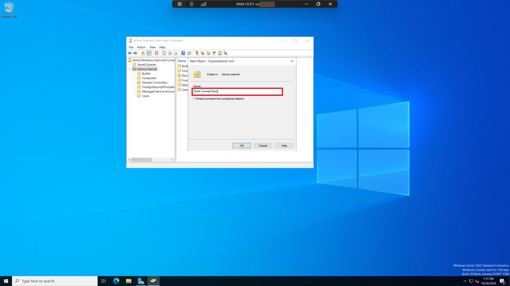

> An **organizational unit (OU)** is a folder inside a domain for organizing objects and applying Group Policy. Here it doubles as the **sync scope**: later I tell Connect Sync to only look in this OU.

### 1.2 Create three users

Inside the OU I created three users with **New → User**. The logon name gets the domain's UPN suffix, `@bamco.internal`, by default.

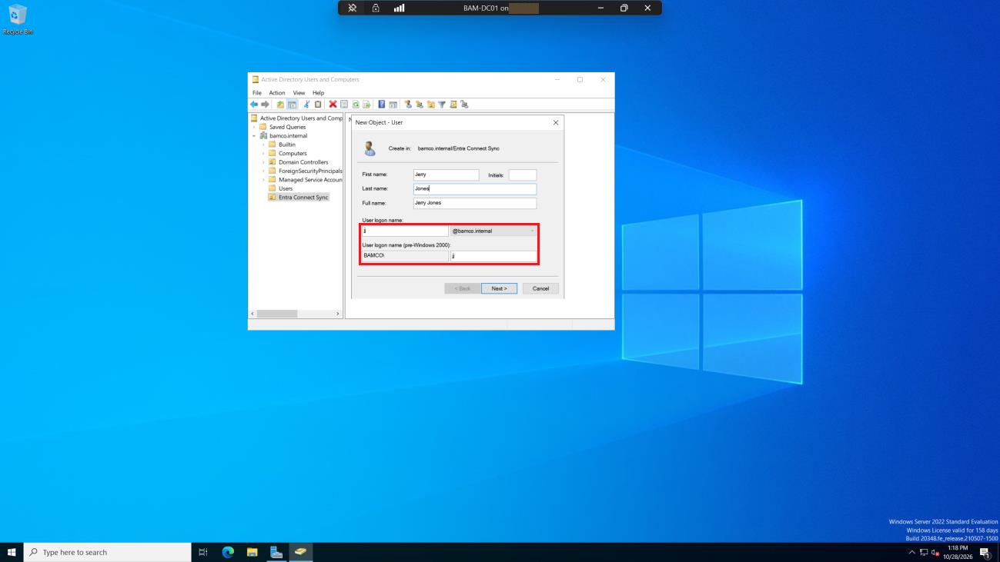

| Display name | Logon name | Description |
|---|---|---|
| Jerry Jones | `jj@bamco.internal` | Sales |
| Phil Palleto | `pp@bamco.internal` | Finance |
| Sally Salzo | `ss@bamco.internal` | HR |

I gave each user a department in the **Description** field. In a real company these users would already exist. I'm creating them so there's something to sync.

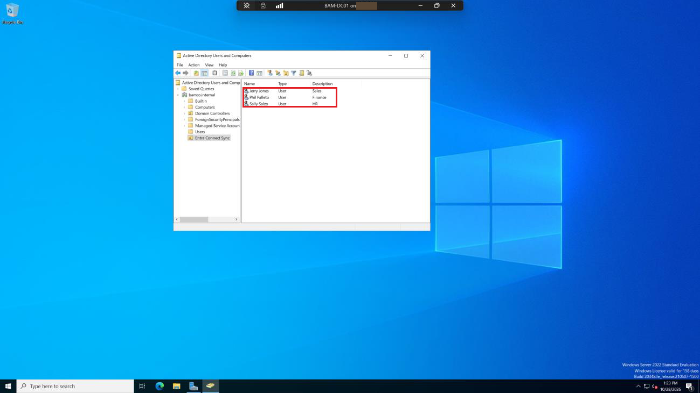

### 1.3 Create a security group

Last, I created a **security group** called `St. Louis On Prem Users` in the same OU, so there'd be a group to sync along with the users.

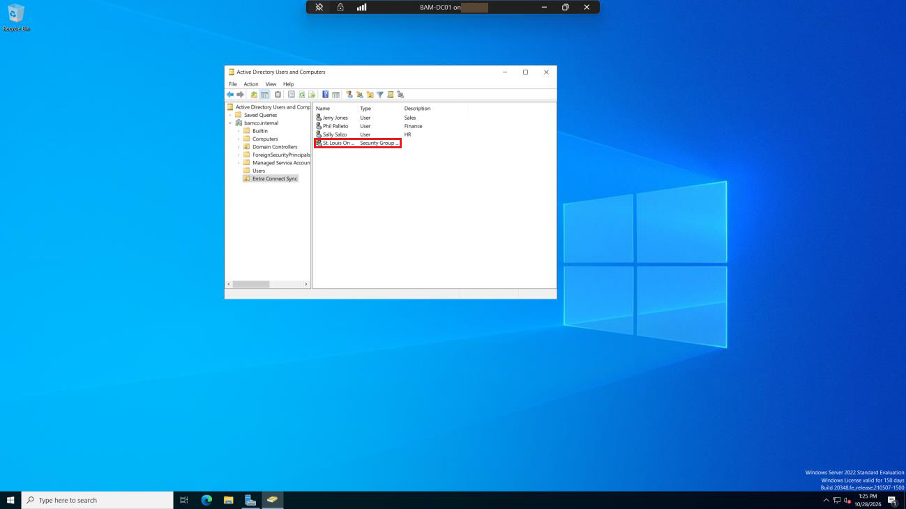

---

## Task 2 — Download Entra Connect Sync

### 2.1 Turn off IE Enhanced Security Configuration

Before downloading anything, I went to **Server Manager → Local Server** and made sure **IE Enhanced Security Configuration** was **Off**. It's a Windows Server protection that blocks a lot of web content and downloads, and if it's left on, the Connect Sync install and sign-in steps can throw errors. It can be turned back on after setup.

### 2.2 Find it in the Entra admin center

I signed in to the portal from a browser **on BAM-DC01**, the server I installed Connect Sync on. **Microsoft Entra ID → Entra Connect → Get started.** This is the same page I looked at in the course exercise, but this time I actually used it.

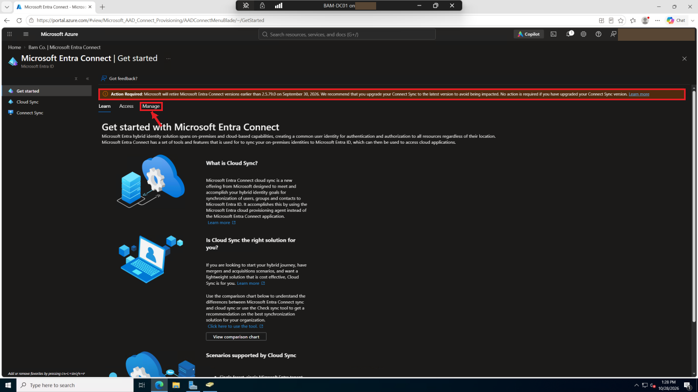

The banner at the top says Microsoft is retiring Connect Sync versions older than **2.5.79.0**. Since I downloaded a fresh copy from the portal, I started on a current version.

> The same page is also in the Entra admin center: **entra.microsoft.com → Identity → Show more → Hybrid management → Microsoft Entra Connect**. Microsoft changes these portals often, so it's good to know both paths.

### 2.3 Download the Connect Sync agent

The **Manage** tab shows both options side by side: **Cloud Sync**, which uses a lightweight provisioning agent, and **Connect Sync**, the full on-prem sync engine. I chose **Download Connect Sync Agent → Accept terms & download**, opened the file once it finished, agreed to the license terms, and clicked **Continue**.

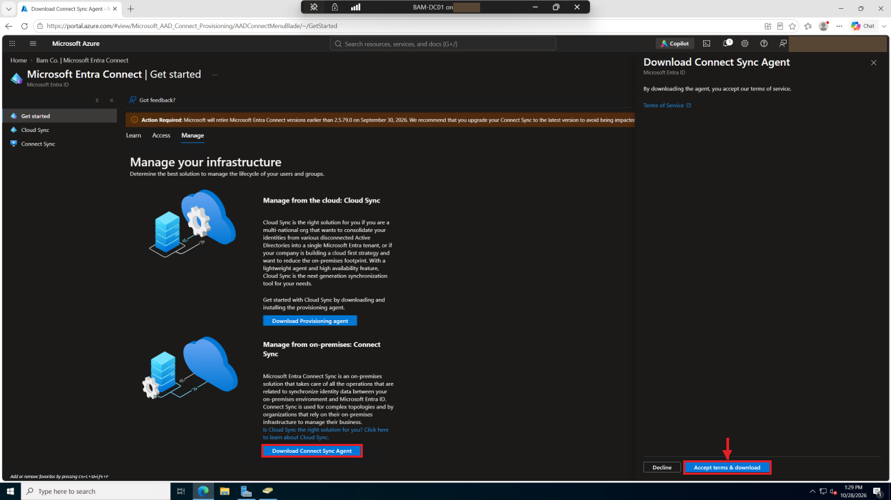

> Connect Sync supports device sync for hybrid join, which I want to try later. Cloud Sync can't do that.

---

## Task 3 — Configure Connect Sync

### 3.1 Express settings vs Customize

The first page offers **Express Settings**, which syncs the entire forest, turns on PHS, and enables auto upgrade. At the bottom the wizard already flagged my domain: *"bamco.internal is not a routable domain."* It recommended custom settings, so I clicked **Customize**.

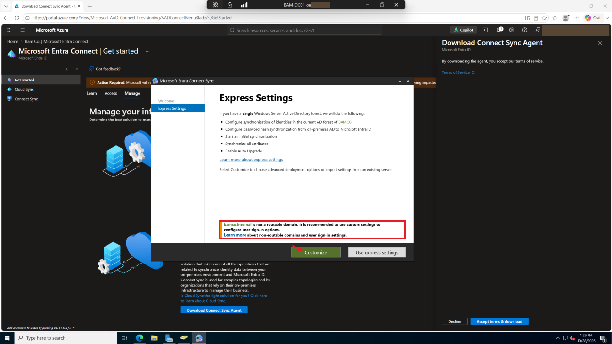

Express is the easy button, but it would sync my entire domain, and that's not what I wanted.

The next page, **Install required components**, has options for a custom install location, an existing SQL Server, an existing service account, custom sync groups, and importing settings from another server. I didn't need any of them, so I left them all unchecked and clicked **Install**. Connect Sync installs its own SQL Server Express database and creates its own service account. That part took about two minutes.

### 3.2 User sign-in

I picked **Password Hash Synchronization** and checked **Enable single sign-on**.

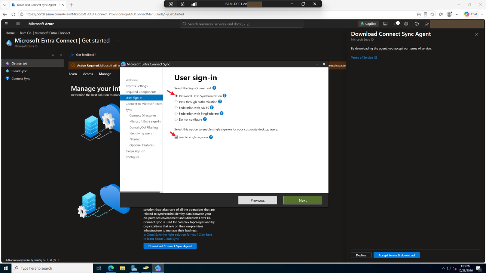

| Method | Where the password is checked | What's needed on-prem |
|---|---|---|
| **Password hash sync** | In Entra ID, against a synced hash | Just the sync server |
| Pass-through authentication | On-prem AD, through an agent | One or more PTA agents that must stay online |
| Federation (AD FS / PingFederate) | On-prem identity provider | A federation farm, proxies, and certificates |

The upside of the two federation options is that they support third-party authentication methods that PHS and PTA don't. The downside is all the extra infrastructure, and PingFederate is a paid third-party product.

PHS is the simplest option and the one Microsoft recommends for most organizations. It also keeps working if on-prem goes down. It doesn't send the actual password, or even the hash AD stores. Connect Sync takes the hash, adds a per-user salt, and runs it through a key derivation function (PBKDF2 with SHA-256) before sending it. The value in Entra ID can't be used to sign in to on-prem AD.

**Single sign-on** here means **Seamless SSO**. When a user signs in to their domain-joined computer on the company network, they also get signed in to Entra ID automatically through Kerberos, so they don't have to type their password again for cloud apps. Checking this box adds an extra credentials step near the end of the wizard.

### 3.3 Connect to Microsoft Entra ID

Next the wizard asks for a cloud account. It says **Hybrid Identity Administrator** is preferred, but a Global Administrator also works. This is a cloud account in my tenant. Since I don't use a custom domain for my admin, it's an `@<tenant>.onmicrosoft.com` name. The tenant's domain is listed on the **Microsoft Entra ID → Overview** page if you need to look it up.

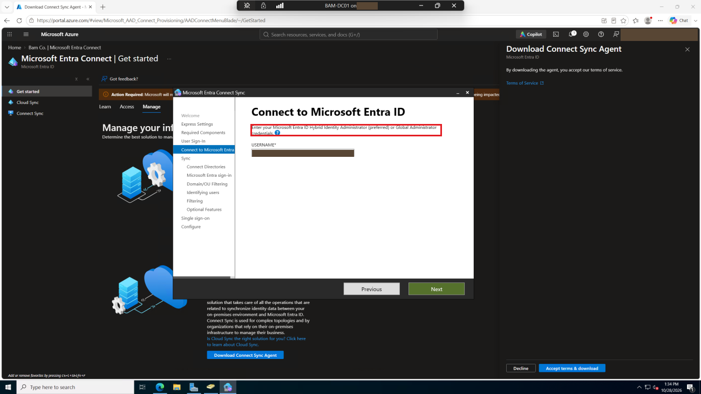

### 3.4 Connect your directories

Under **Forest** I selected `bamco.internal` and clicked **Add Directory**.

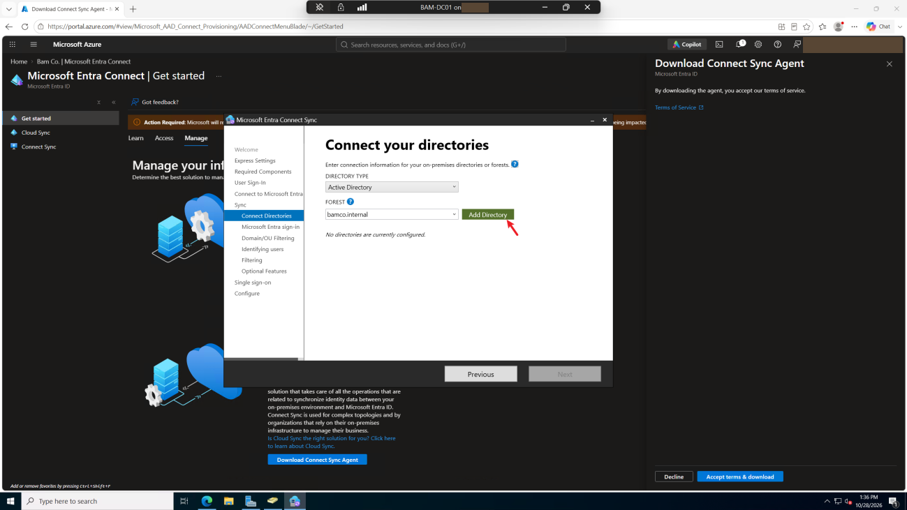

Connect Sync needs an account in AD that it uses on every sync cycle to read objects and, with writeback on, write changes back. I chose **Create new AD account** and entered Enterprise Admin credentials in the `DOMAIN\user` format, `BAMCO\administrator`. This is the on-prem domain account, not the cloud one. Those credentials are only used once to create the account. They aren't saved.

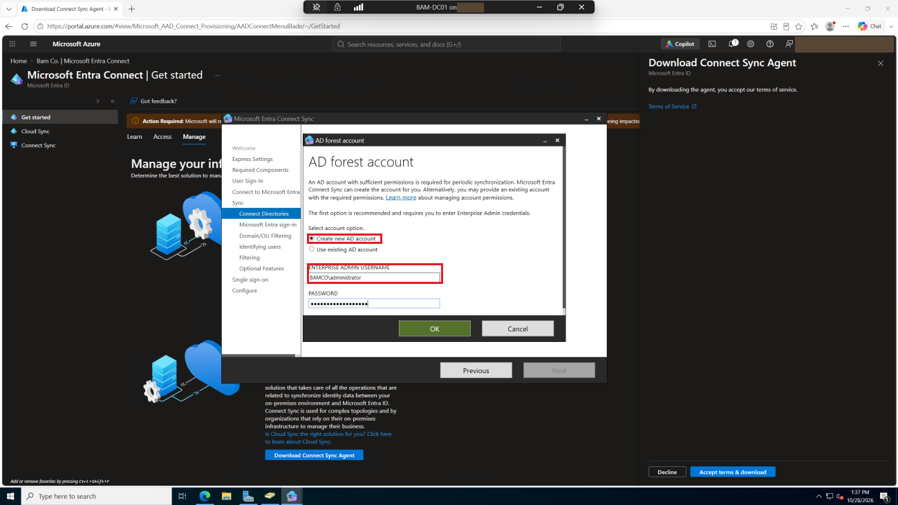

> The account the wizard creates is called the **AD DS Connector account**. You can create it yourself with the right permissions, which some organizations with strict rules do, but it's a lot of extra work. Letting the wizard create it means it gets only the permissions it needs, which is better than handing Connect Sync a domain admin account to use forever.

The forest showed up under **Configured directories** with a green check.

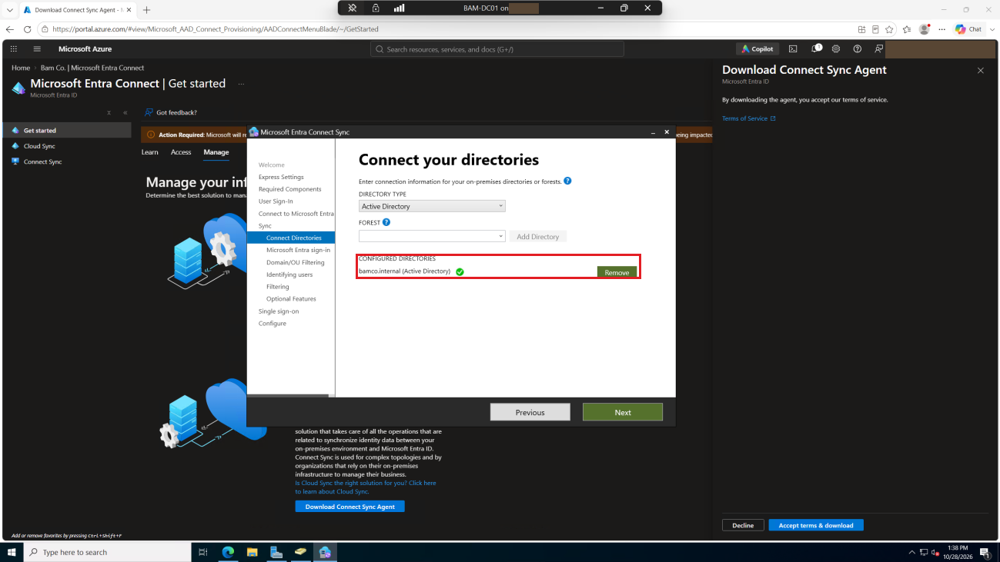

### 3.5 Microsoft Entra sign-in configuration

This is where the `.internal` problem actually matters. The wizard lists each UPN suffix in AD and whether a matching verified domain exists in Entra. `bamco.internal` shows **Not Added**.

A **verified domain** is a custom domain you've proven you own. You buy a domain from a registrar, add it under **Microsoft Entra ID → Custom domain names**, and create the TXT record Entra gives you in the registrar's DNS. I went through that screen in [exercise 02](../../entra/lab-02-branding-roles-admin-units/). `bamco.internal` can't be verified this way because no registrar sells `.internal` names.

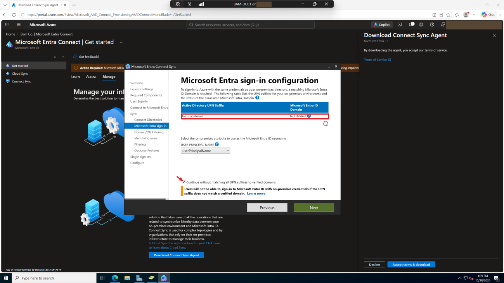

I left **userPrincipalName** as the attribute to use for the Entra username. A UPN is the email-style sign-in name, like `jj@bamco.internal`, and it's what almost everyone uses here. Then I checked **Continue without matching all UPN suffixes to verified domains**. The wizard warns that users won't be able to sign in to Entra with their on-prem credentials when the suffix doesn't match.

In practice, Entra swaps the suffix for the tenant's default `onmicrosoft.com` domain. Jerry is `jj@bamco.internal` on-prem but `jj@<tenant>.onmicrosoft.com` in the cloud. The password is still the same thanks to PHS, but the username isn't.

> The real fix is to add a **routable UPN suffix** that matches a domain verified in the tenant (**Active Directory Domains and Trusts → Properties → UPN Suffixes**), then change the users to it before syncing. Microsoft recommends a routable domain, or at least a routable UPN suffix, for hybrid setups for this reason.

### 3.6 Domain and OU filtering

I chose **Sync selected domains and OUs** and checked only the `Entra Connect Sync` OU. I only synced one OU for lab purposes. A real company would pick every OU that holds users who need cloud access. Everything else in the domain, including the default `Users` container, stays on-prem.

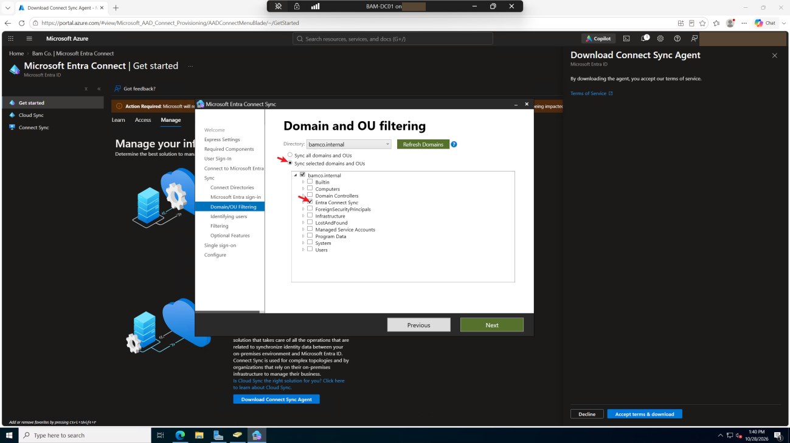

### 3.7 Uniquely identifying your users

I kept the defaults: **Users are represented only once across all directories** (I only have one forest) and **Let Azure manage the source anchor**.

This page mostly matters in big environments with several domains. If the same person had accounts in more than one directory, you'd match them up with something unique, usually the **Mail attribute**, since no two people share an email address.

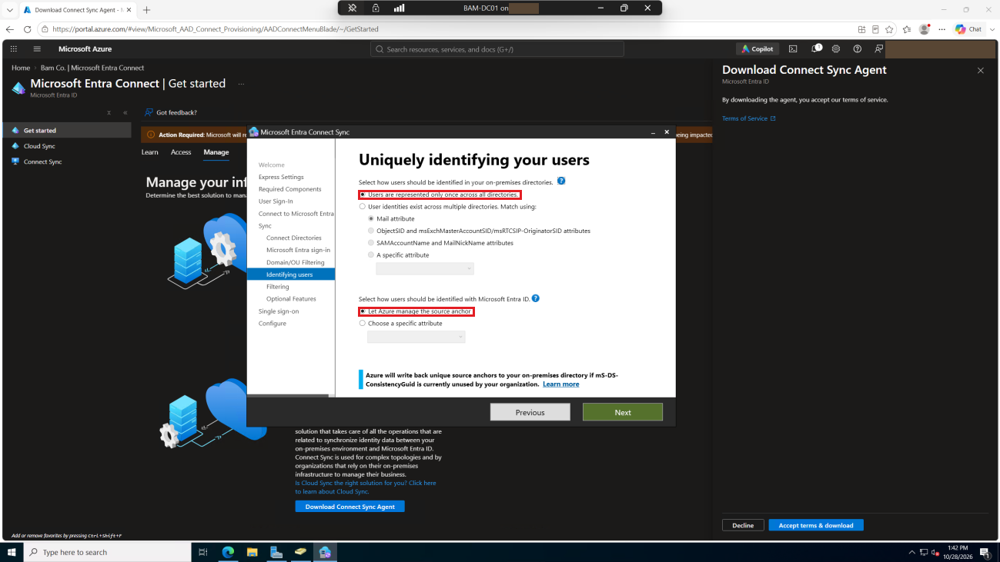

> The **source anchor** is the attribute that permanently links an AD user to its Entra user, even if the name or UPN changes later. By default Connect Sync uses `mS-DS-ConsistencyGuid`, which is based on the user's `objectGUID`. It's stored in Entra ID as the user's **ImmutableId**.

### 3.8 Filter users and devices

Group-based filtering is for pilot deployments, where you only sync members of one group. I already limited the scope with OU filtering, so I left this at **Synchronize all users and devices**. "All" here doesn't mean the whole domain. It means all users and devices inside the OU I picked in 3.6.

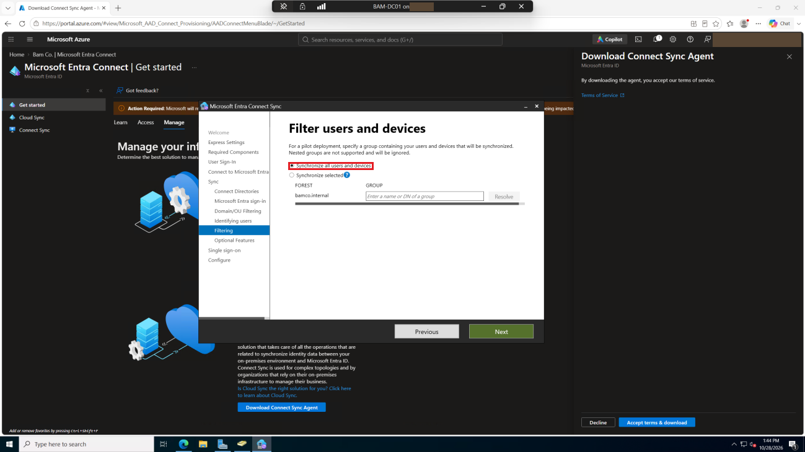

### 3.9 Optional features

**Password hash synchronization** was already checked from the sign-in page. I also checked **Password writeback** and **Group writeback**.

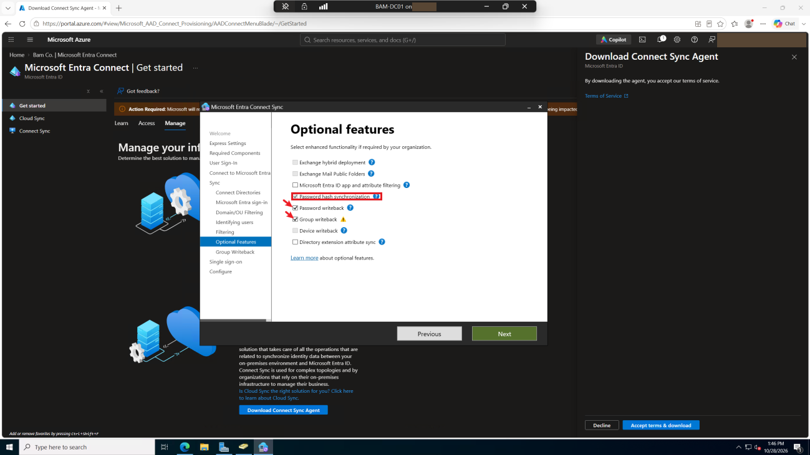

| Feature | What it does |
|---|---|
| Password hash sync | Copies password hashes from AD to Entra ID |
| Password writeback | When a synced user resets or changes their password in the cloud (like with [SSPR](../../entra/lab-07-self-service-password-reset/)), the new password is written back to AD |
| Group writeback | Writes groups created in Entra ID back to an OU in AD |
| Exchange hybrid / Exchange Mail Public Folders | Connect on-prem Exchange with Exchange Online. Grayed out for me because there's no Exchange in my domain |
| Microsoft Entra ID app and attribute filtering | Choose which apps and attributes get synced instead of all of them |
| Device writeback | Writes devices back to AD. Grayed out because it can only be turned on by running the wizard again after the first sync |
| Directory extension attribute sync | Syncs custom attributes a company added to AD itself, like an employee badge ID, which wouldn't sync otherwise |

**Group writeback** added a page where I picked the destination OU. I used `Entra Connect Sync` and checked **Writeback Group Distinguished Name with cloud Display Name (Preview)**, so written-back groups get readable names in AD instead of IDs. The wizard warned that my domain has no Exchange schema, so mail-related attributes won't be written back. That's fine since I'm not running Exchange.

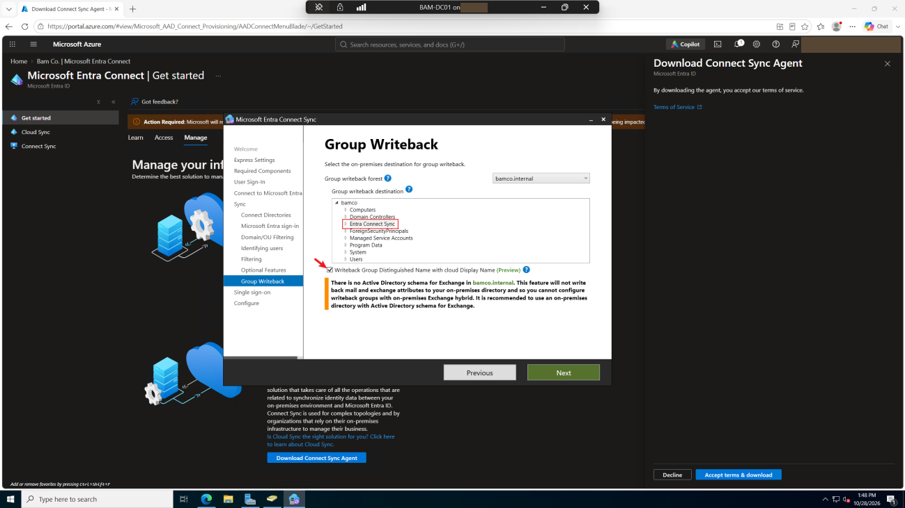

### 3.10 Enable single sign-on

Because I turned on Seamless SSO, the wizard asked for domain admin credentials for the forest. It uses them to create a computer account in AD named `AZUREADSSOACC`, which represents Entra ID in Kerberos.

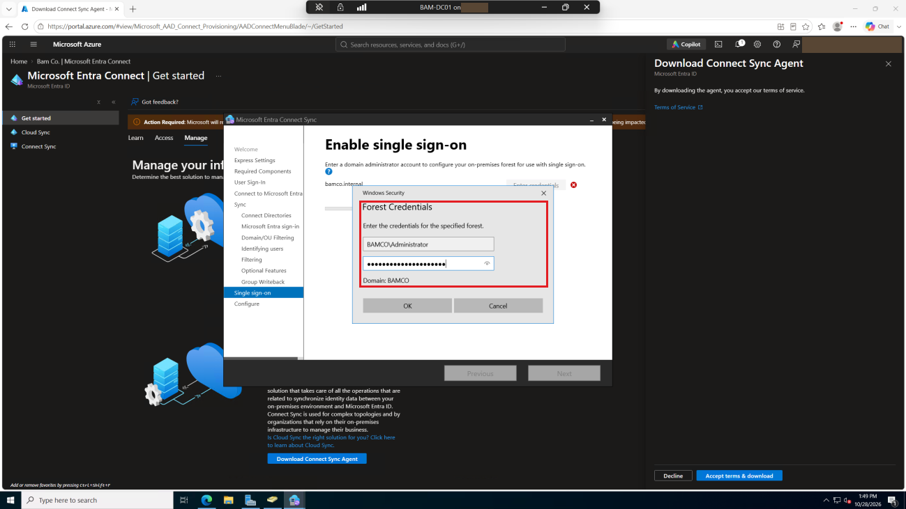

### 3.11 Ready to configure

The summary listed everything the wizard was about to do. One item I hadn't picked myself was the **export deletion threshold (500)**. It's a safety feature that stops a sync from deleting more than 500 objects in Entra at once, in case someone accidentally deletes or moves an OU on-prem.

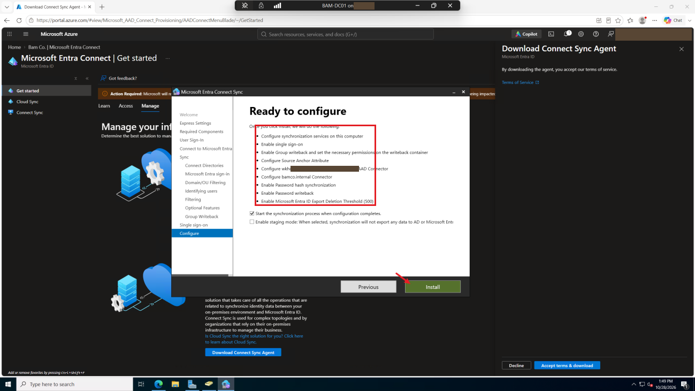

I left **Start the synchronization process when configuration completes** checked and **staging mode** unchecked, then clicked **Install**. It took about five minutes.

> **Staging mode** runs the sync engine without exporting anything. You'd use it when you already have a Connect Sync server and are setting up a second one, as a standby server that can take over if the main one fails, or to preview what a config change would do before it goes live.

### 3.12 Configuration complete

The configuration finished and the first sync started on its own. The final page had some warnings and recommendations:

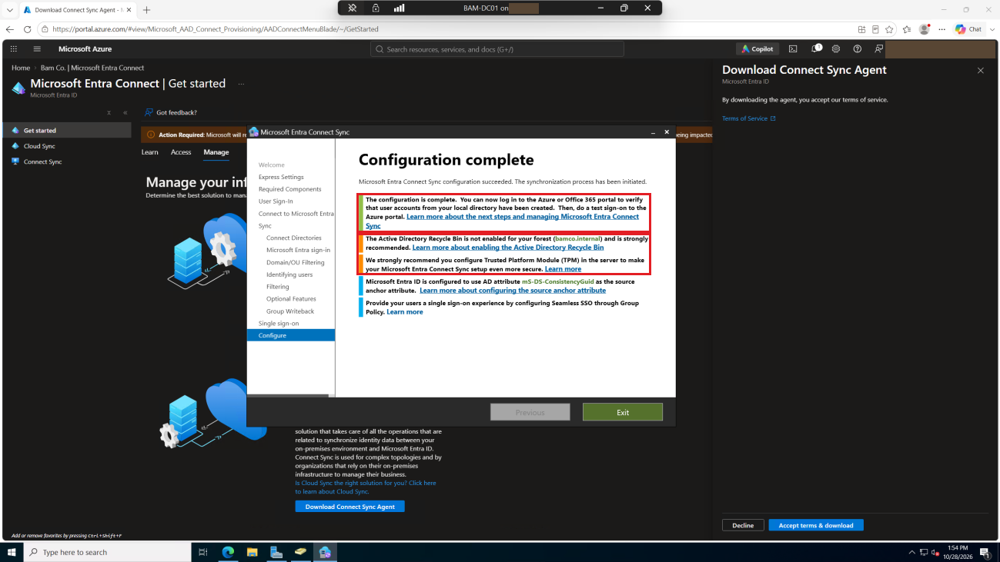

- The **Active Directory Recycle Bin** isn't enabled. If someone deletes a synced user on-prem, the Recycle Bin is what lets you restore the same object with the same source anchor, so the cloud user reconnects instead of a new one getting created.
- Microsoft recommends a **TPM** on the sync server to better protect the credentials Connect Sync stores.
- Seamless SSO still needs a **Group Policy** setting before it works on the workstation (see below).

---

## Task 4 — Verify the Sync

**Microsoft Entra ID → Users → All users.** The tenant now has 16 users. Jerry Jones, Phil Palleto, and Sally Salzo all show **On-premises sync enabled: Yes**. Every other user says **No** because they were created directly in the cloud in earlier exercises.

> The **Connect Sync** page under **Microsoft Entra Connect** also shows the sync status and when the last sync ran.

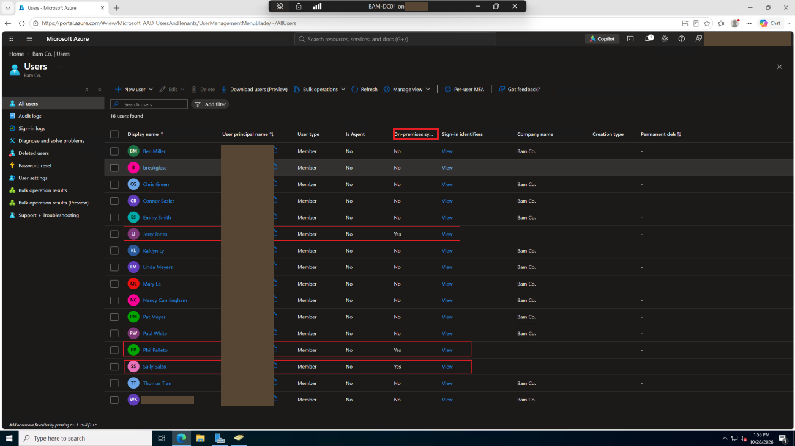

The synced users also have a blank **Company name**, unlike the cloud users. I never set a company on them in AD, and AD is now their **source of authority**. Most of a synced user's attributes have to be changed on-prem, not in the Entra admin center.

From creating the OU to seeing the users in Entra took about 40 minutes, judging by the screenshot timestamps.

---

## Things I Would Fix

- The synced users have `onmicrosoft.com` sign-in names that don't match their on-prem names. I'd add a UPN suffix for a domain verified in my tenant, switch the three users to it, and resync.
- Seamless SSO isn't finished. The wizard created the `AZUREADSSOACC` account, but the workstation also needs `https://autologon.microsoftazuread-sso.com` added to the Intranet zone through Group Policy before SSO works. I haven't done that or tested it from `BAM-WS01` yet.
- I used my main admin account for the Entra side and the domain Administrator for the AD side. In production I'd use a dedicated **Hybrid Identity Administrator** account for setup instead of a Global Admin.
- Connect Sync is installed on the domain controller. That works and is supported, but Microsoft treats the sync server as a **Tier 0** asset, just like a DC. A real setup would put it on its own hardened member server with a standby server in staging mode.
- I should turn on the AD Recycle Bin. It's one PowerShell command (`Enable-ADOptionalFeature`), and it protects against accidental deletes of synced objects.
- I turned on password writeback and group writeback but haven't tested either yet. The next step is to reset a synced user's password with SSPR and sign in on-prem with the new one.

## What I Learned

- How to install Entra Connect Sync and get through the custom setup wizard, page by page
- Express settings would have synced my whole domain. Customize let me pick just one OU, so only my three test users and one group went up
- The domain name I picked in Part 1 mattered more than I thought. Because `.internal` can't be verified, my users ended up with `onmicrosoft.com` sign-in names, and I'd have to add a UPN suffix to fix it
- Password hash sync doesn't send the actual password to the cloud. It sends a hashed version of the hash
- Once a user is synced, I manage it in AD, not in Entra. That's why my synced users have a blank company name while my cloud users don't
- To read the warnings on each page. The wizard flagged my domain name, the missing Recycle Bin, and the Exchange schema, and each one taught me something
- To check the result in the portal (**On-premises sync enabled: Yes**) instead of assuming the sync worked

---

> **Note:** Everything on-prem runs on local virtual machines on my own PC. My host computer's name, my admin account, the tenant name, and the users' cloud sign-in names have been redacted from the screenshots, and all passwords shown are masked. `bamco.internal` is a made-up domain that only exists inside this lab, and the users are fictional test accounts.

[← Back to IAM Labs](../)
