# Lab 2 — Zero Trust Privileged Access: Entra PIM + Phishing-Resistant MFA

## Overview

This is a hands-on lab I built in my personal Microsoft Entra ID tenant. It protects the **Global Administrator (GA)** role with **Privileged Identity Management (PIM)**, a **Conditional Access authentication context**, and a **device-bound passkey**.

> **Scope note:** this was built and tested in a personal lab tenant, not a production environment.

### The problem

A user account with standing Global Administrator access is a high-value target. If an attacker gets its credentials (phished password, approved push, stolen session), they immediately have full control of the tenant.

The goal was to remove standing privileged access entirely: the account holds GA as **eligible only**, and even with valid credentials it **can't activate GA** without the physical phone and biometrics tied to the passkey.

```text
  Signed in with password + push           Activate Global Administrator in PIM
  (what a phished account could do)  ───►  ───────────────────────────────────
                                            PIM calls authentication context c1
                                                         │
                                                         ▼
                                            Conditional Access policy
                                            "PIM - GA Activation - Require
                                             Phishing Resistant MFA"
                                                         │
                                                         ▼
                                            Prompt for the passkey on my iPhone
                                            (Face ID, every time)
                                                         │
                                          no passkey ◄───┴───► passkey
                                          GA stays off         GA active, max 3 hours
```

## Objectives

- Make Global Administrator eligible-only and time-bound with PIM
- Point PIM's activation requirement at a Conditional Access authentication context
- Build a Conditional Access policy that requires phishing-resistant MFA every time GA is activated
- Register a device-bound passkey and turn off SMS and voice
- Prove it works with What If, the audit log, an attacker-style test, and the sign-in log

## Tools & Technologies

| Category | Tools |
|---|---|
| Identity platform | Microsoft Entra ID P2 (personal lab tenant) |
| Privileged access | Privileged Identity Management (PIM) |
| Policy | Conditional Access, authentication contexts, authentication strengths |
| Sign-in method | Passkey (FIDO2) in Microsoft Authenticator on iPhone |
| Validation | What If, sign-in logs, audit logs, policy impact |

---

## What I Built

### Just-in-time Global Admin (PIM)

- GA is **eligible only**. There is no standing active assignment.
- Activation is **time-bound** (3-hour maximum).
- The PIM activation requirement is set to a **Conditional Access authentication context** instead of the default "Azure MFA".

**PIM → Microsoft Entra roles → Global Administrator → Role settings → Edit.** On the **Activation** tab I set the maximum duration and chose **Microsoft Entra Conditional Access authentication context** with my `Global Admin. Activation` context.

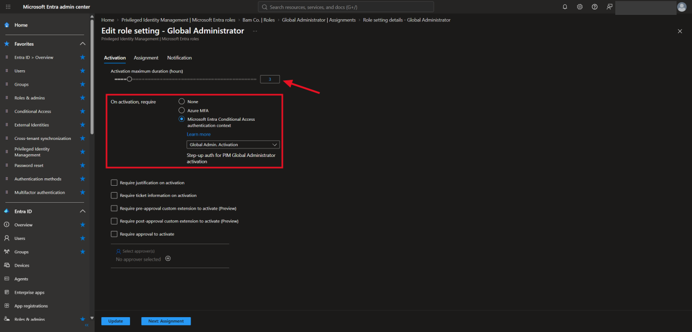

Under **My roles**, GA shows up as an **eligible** assignment with an **Activate** button instead of being always on.

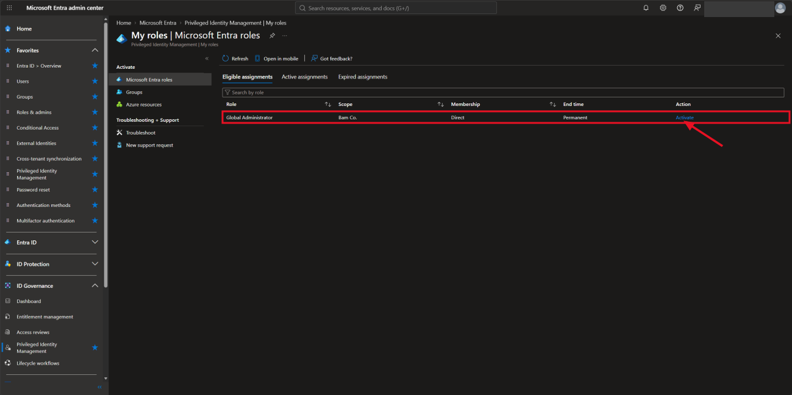

### Authentication context

I created **c1 - Global Admin. Activation** (description: "Step-up auth for PIM Global Administrator activation") and published it to apps.

**Conditional Access → Authentication contexts:**

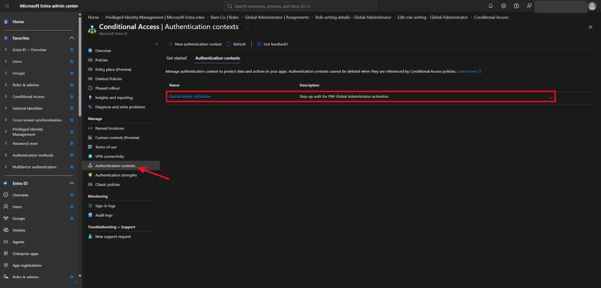

> An authentication context is like a label. PIM tags the activation with `c1`, and any Conditional Access policy that targets `c1` runs at that moment, even if I'm already signed in.

### Conditional Access policy

**"PIM - GA Activation - Require Phishing Resistant MFA"**

| Setting | Value |
|---|---|
| Target resources | Authentication context `c1` |
| Users | All users, with the break glass account excluded |
| Grant | Authentication strength = **Phishing-resistant MFA** |
| Session | Sign-in frequency = **Every time** |
| State | On |

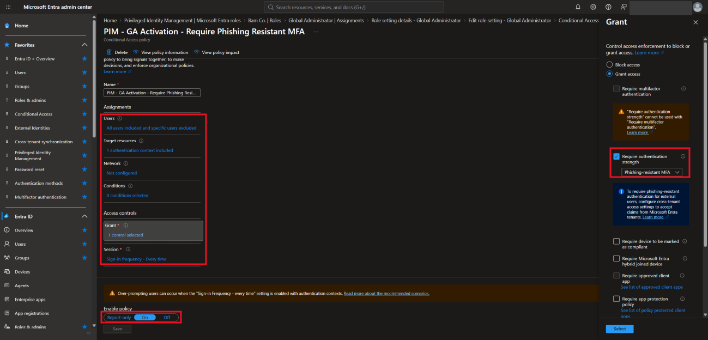

### Phishing-resistant sign-in method

- Registered a **device-bound passkey** in Microsoft Authenticator on my iPhone.
- **Passkey (FIDO2)** enabled with the default profile, attestation off.
- **SMS and voice** are disabled tenant-wide.

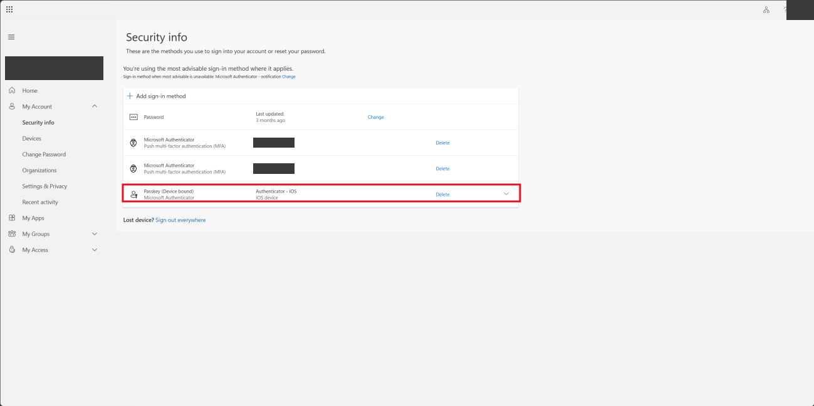

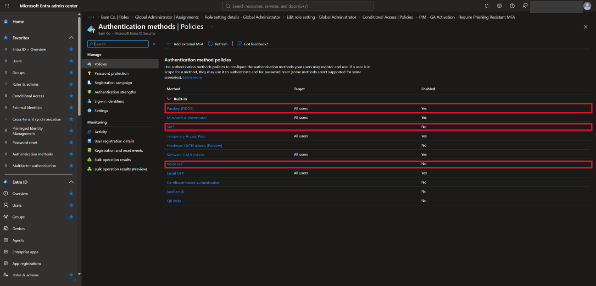

### Break glass account

A cloud-only emergency account is excluded from the policy, so a misconfiguration can't lock me out of the tenant.

---

## How It Maps to Zero Trust

| Zero Trust principle | How this lab applies it |
|---|---|
| **Verify explicitly** | Signing in isn't enough. Every GA activation triggers a fresh phishing-resistant challenge (sign-in frequency = every time), even inside an already-authenticated session. |
| **Least privilege** | No standing GA access. The role is eligible, time-bound, and only active when I deliberately activate it. |
| **Assume breach** | I designed for the case where the privileged account's credentials are already compromised. A stolen password or an approved push isn't enough to activate GA. The attacker would also need the physical iPhone and Face ID, and the passkey is bound to that device. |

**What this does and doesn't cover:** it limits an attacker's ability to turn stolen credentials into Global Administrator access. It doesn't stop everything. A compromised account still has whatever non-privileged access it normally holds, which is why tenant-wide MFA and risky sign-in policies still matter.

---

## Validation

### 1. Conditional Access What If

With my admin user and the `c1` context selected, the policy showed up under **Policies that will apply**, with Phishing-resistant MFA and sign-in frequency every time.

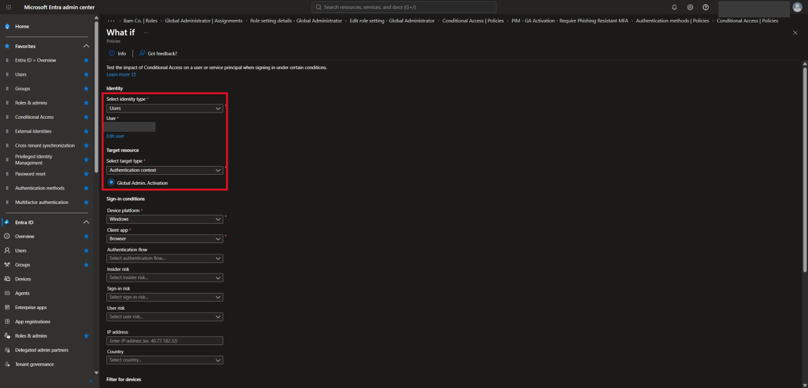

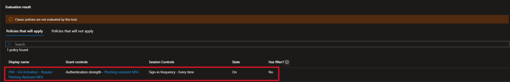

### 2. PIM audit log

Activation events changed from `IsAuthenticatedWithMfa: True` (before) to `IsAuthenticatedWithCAPolicy: true` (after), confirming PIM now calls Conditional Access.

### 3. Attacker-style test

I signed in with **password + Authenticator push** (not the passkey), then tried to activate GA. The activation pane warned that a Conditional Access policy may require additional verification:

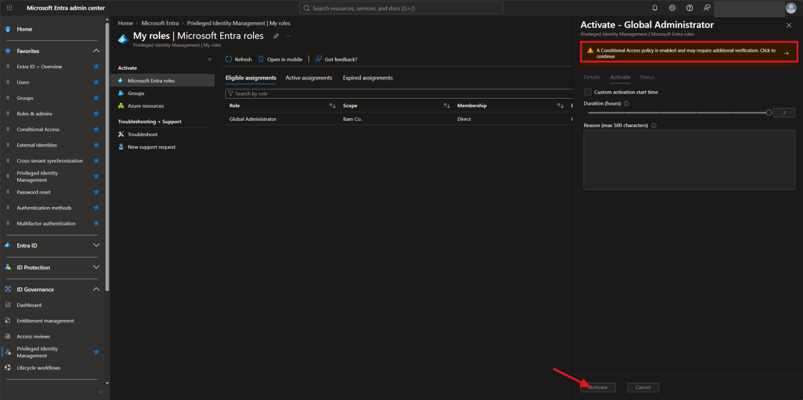

I was prompted for the **passkey**:

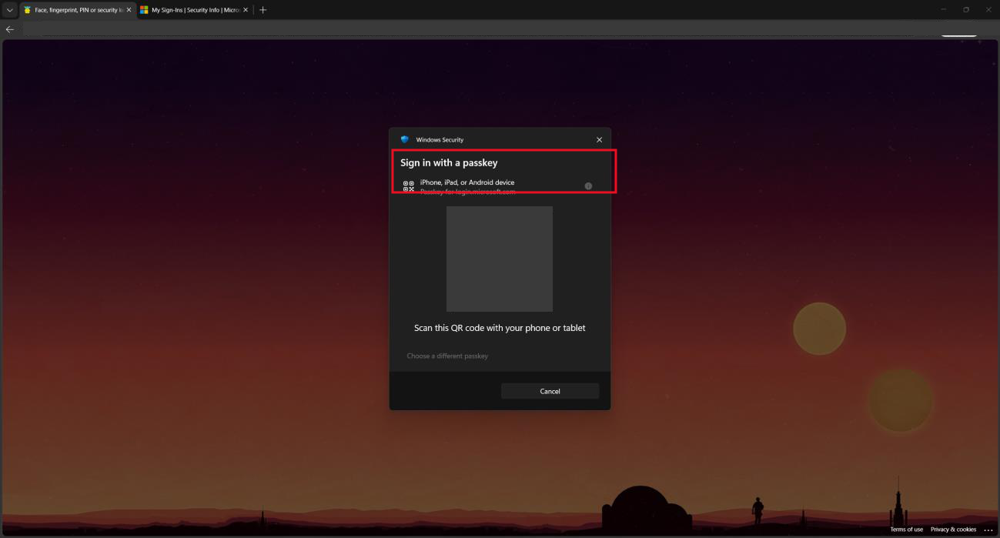

After the passkey, GA showed up under **Active assignments** with an end time:

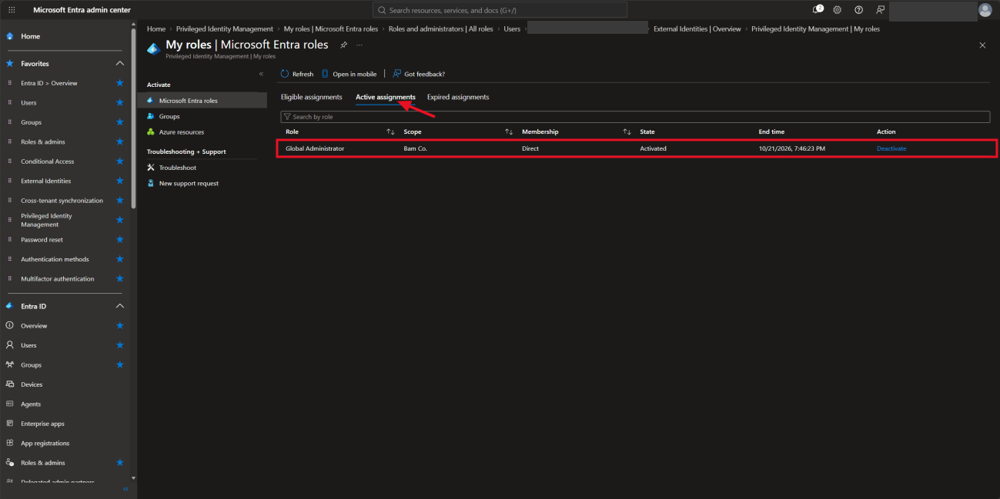

### 4. Sign-in log

The policy shows **Success** in the Conditional Access tab for the activation sign-in.

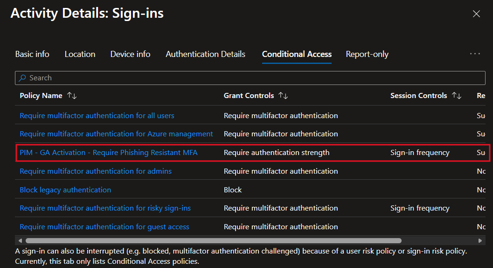

The **Authentication Details** tab shows the authentication strength and sign-in frequency (every time) were applied, with the requirement listed as **Phishing-resistant MFA**.

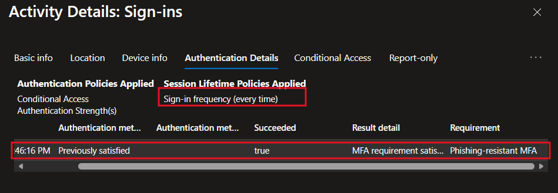

---

## Troubleshooting (What Went Wrong and How I Found It)

| Issue | How I diagnosed it | Fix |
|---|---|---|
| Policy never applied | Sign-in logs showed "Not Applied", and the policy showed 0 users | Included all users and excluded break glass |
| Wrong authentication strength (Passwordless MFA) | Policy JSON and audit log showed the strength ID | Switched to MFA, then to Phishing-resistant MFA after registering the passkey |
| First test didn't prompt for a passkey | Audit log showed the activation ran in a session already authenticated with the passkey | Ran a clean test using password + push only |
| Unsure whether PIM was calling Conditional Access | Compared audit log flags before and after | Confirmed `IsAuthenticatedWithCAPolicy: true` |

**Tools used:** sign-in logs, audit logs, policy impact, and What If.

---

## Known Gaps and Next Steps

- [ ] Add a backup phishing-resistant method (hardware FIDO2 key), so losing my phone doesn't depend on break glass
- [ ] Harden break glass: very long offline password, sign-in alerting, emergency use only
- [ ] Shorten activation to 1 hour and require justification
- [ ] Send PIM activation alerts to a second mailbox
- [ ] Restrict the passkey profile to device-bound only
- [ ] A location-based block policy was considered but not implemented

## Skills Demonstrated

Microsoft Entra ID, Privileged Identity Management, Conditional Access (authentication contexts and strengths), passkeys/FIDO2, IAM, Zero Trust design, log analysis and troubleshooting. Aligns with SC-300 topics.

---

> **Privacy note:** Tenant IDs, user and object IDs, UPNs, account names, device names, IP addresses, URLs, the passkey QR code, and log identifiers were redacted or replaced with placeholders. Raw log exports aren't included.

[← Back to IAM Labs](../)
